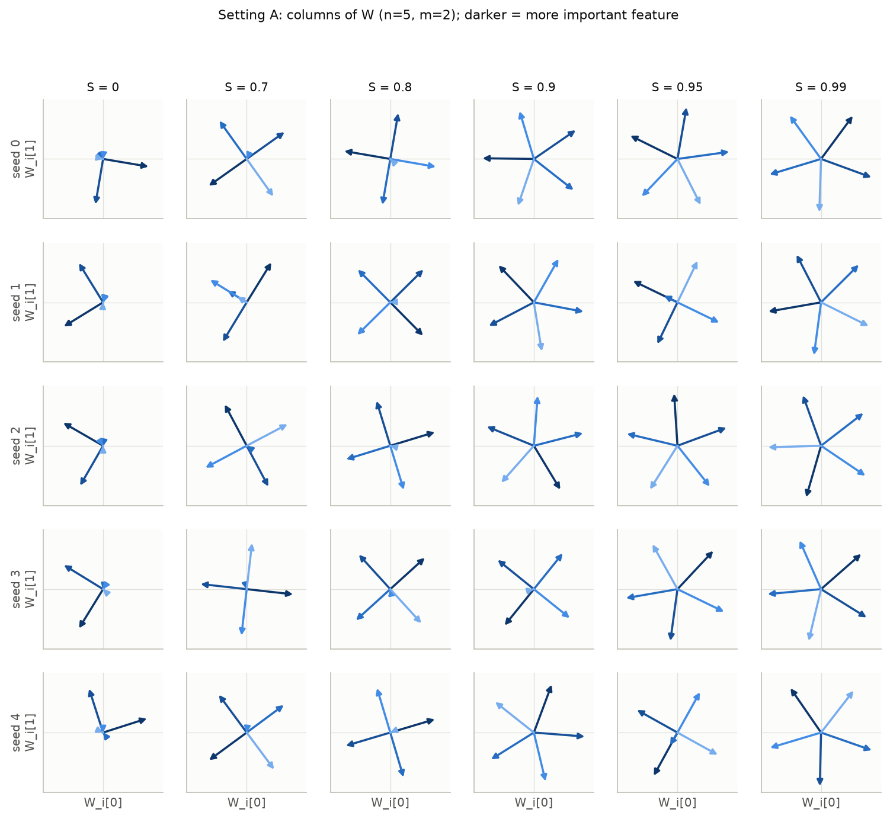
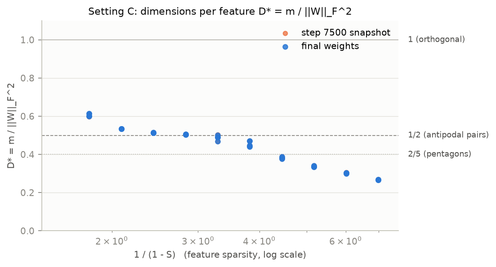
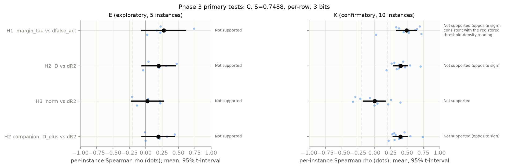
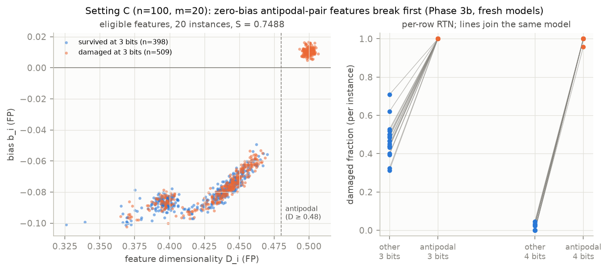
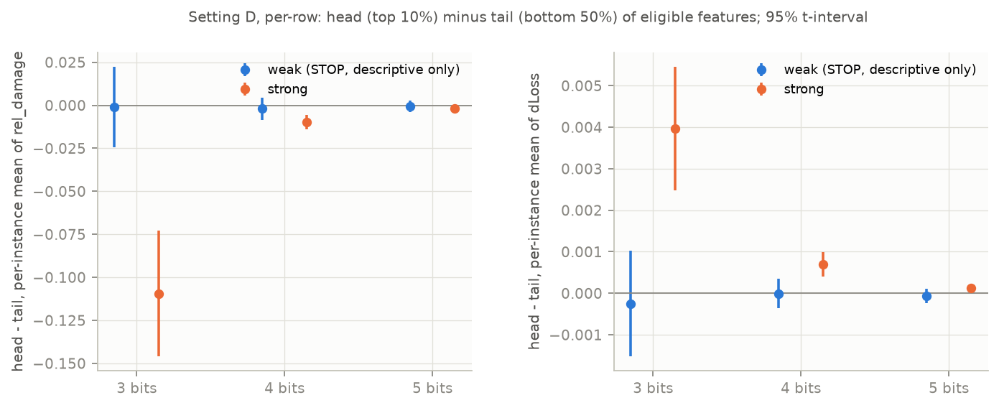
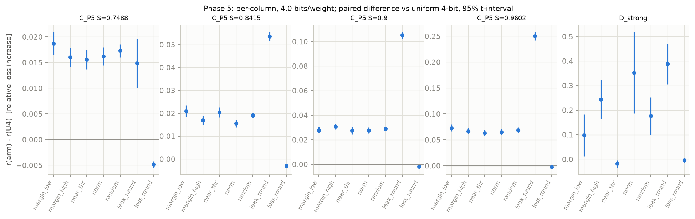

# Which features does quantization break first? In a toy model of superposition, it is the antipodal pairs, not the crowded ones

> **DRAFT, for the owner's review.** Claude Code prepared it on 2026-10-24 from `notes/LOG.md`. Every number
> comes from a `results/` directory listed in the provenance table at the end. The review points are collected in
> the last section. Nothing here has been published.

*Shen Yuting (research question, design and phase plan), with Claude Code (implementation and analysis).*

## TL;DR

- We train Anthropic's toy model of superposition (a tied ReLU autoencoder) with known ground-truth features.
  We then apply post-training round-to-nearest (RTN) weight quantization and measure the damage to each
  feature.
- **The intuitive prediction fails.** We expected crowded, low-margin features in dense superposition to
  break first. In the one cell where per-feature damage is reliable (n = 100, m = 20, S = 0.75), the
  registered predictors point the *opposite* way.
- **The fragile features are the zero-bias antipodal pairs.** Antipodal-pair features (D_i ≈ 0.5) have no
  positive interference to suppress, so they learn a bias of about +0.01. Their inactive pre-activation sits
  right at the activation threshold, and any weight perturbation of RTN size switches them on. Crowded
  features learn negative biases (about −0.08) that act as a buffer. On 20 fresh, pre-registered models,
  every antipodal feature is damaged at 3-bit per-row RTN, against 46% of the other features. At 4 bits,
  almost only antipodal features break. Isotropic Gaussian noise of the same size gives the same picture, so
  the cause is perturbation sensitivity, not something special about rounding.
- **Head vs tail depends on what you divide by.** Under a power-law feature frequency, the rare (tail)
  features lose a larger *relative* fraction of their R², but that comes entirely from normalization: the
  change in R² itself does not depend on frequency. Absolute damage sits in the frequent (head) features,
  and so do new false activations (post hoc).
- **Using geometry to allocate bits does not beat uniform 4-bit RTN.** At a fixed 4.0 bits per weight,
  mixing 3- and 5-bit columns costs about 2× the loss increase, and no geometry-based ranking recovers that.
  A generic loss-aware rounding removes about half of the quantization loss in one setting, but it does not
  rescue the fragile features.
- To our knowledge, the antipodal-fragility mechanism has not been reported before. Its premise (antipodal
  pairs need no negative bias) is known from Elhage et al. (2022) and Chen et al. (2023).

## 1. Motivation

Duan (2026, arXiv 2606.03002) quantized Pythia-70M and Gemma-2-2B with per-channel RTN and tracked
sparse-autoencoder (SAE) features. Some features degrade while perplexity stays flat, and whether a feature
survives can be predicted from full-precision statistics (AUC 0.92–0.97, with peak activation as the strongest
single predictor). The paper offers a heuristic ("quantization perturbations compete with each feature's
activation signal") but measures no geometry. In a real model we do not know the true features, so we cannot
ask *why* a given feature breaks.

The toy models of superposition (Elhage et al., 2022) give exactly that control. The features are known,
their geometry (norms, overlaps, biases, polytopes) can be read straight off the weights, and the model
trains in seconds. Our question:

> In a model with known ground-truth features, which features does weight quantization break first, and can
> superposition geometry predict this in advance?

## 2. Setup

**Model.** Features x ∈ R^n are independent: x_i = 0 with probability S, otherwise Uniform[0, 1]. The model
is h = Wx and x̂ = ReLU(Wᵀh + b), with W ∈ R^{m×n} tied as encoder and decoder. The loss is the
importance-weighted MSE. Training follows the official notebook's setup (AdamW with weight decay 0.01,
lr 1e-3, batch 1024); the paper itself states no hyperparameters. Setting D instead uses Liu, Liu & Gore's
(2025) recipe: their weight-decay knob γ on W only, lr 1e-2 with 2,000 warm-up steps and cosine decay, and
20k steps. Every configuration is trained as many instances in parallel, and we report all seeds.

| Setting | n | m | Importance | Sparsity | Used for |
|---|---|---|---|---|---|
| A | 5 | 2 | 0.9^i | sweep S | sanity check (pentagon) |
| B | 20 | 5 | 0.7^i | sweep S | main replication |
| C | 100 | 20 | uniform | sweep S | main quantization testbed |
| D | 200 | 20 | uniform | power law p_i ∝ (i+1)^−α | head vs tail |

**Quantization.**
- Symmetric RTN with qmax = 2^(b−1) − 1 at 8, 6, 5, 4, 3 and 2 bits.
- Scales per tensor, per column (one per feature) or per row (one per hidden dimension).
- W only, tied; b stays in FP32.
- A matched-noise control replaces each column's rounding error with an isotropic Gaussian direction of the
  same norm. This separates the structure of rounding from generic perturbation.

**Damage per feature.** All damage is measured on an eval set stratified by feature: 2,000 rows with the
feature active and 20,000 with it inactive, the same for the FP model and every quantized model. We record:
- dR2: the change in the feature's R².
- the change in false activations: P(x̂_i > 0.05 | x_i = 0).
- the change in leak energy: E[x̂_i² | x_i = 0].
- dLoss: the feature's share of the increase in total loss.
- a composite *damaged* label: Pearson survival < 0.9, OR dR2 > 0.1, OR a rise in false activations
  > 0.05.

Pearson survival alone, the criterion Duan uses, turned out to be almost useless in the toy model: at ≥ 4 bits
essentially every feature "survives" even when its R² drops a lot (Section 4). A feature is *eligible* if its
norm is > 0.5 and its FP R² is ≥ 0.5.

**Discipline.** Every hypothesis test was pre-registered in `notes/LOG.md`, together with its primary cell,
outcome, decision rule and stop rules, and the analysis code was frozen (committed) before the confirmatory
data were read. The setting-C hypotheses were explored on one set of models (E, seed 0) and decided on a
fresh set (K, seed 1). A finding discovered post hoc on K was then confirmed on a third fresh set (K2,
seed 7). Post-hoc analyses are labelled as post hoc throughout. Where we made a mistake, we say so
(Sections 6 and 8).

## 3. Replication sanity checks

- **Setting A (5 features in 2 dimensions).**
  - At S = 0, all 5 seeds keep exactly 2 orthogonal features.
  - The pentagon (all five D_i ≈ 0.4) forms in 4/5 seeds at S = 0.9, 3/5 at S = 0.95 and 5/5 at S = 0.99,
    with adjacent angles of 70°–74°.
  - The alternative solution is always a square (two antipodal pairs, the least important feature dropped).
- **Setting B (20 in 5).**
  - The number of represented features rises with sparsity (Spearman 0.998).
  - Our pre-registered bias criterion ("negative mean bias wherever superposition is present") **failed as
    written**. In the early antipodal regime (S ≈ 0.47–0.92), represented features carry a small *positive*
    bias.
  - Negative, interference-suppressing biases appear only in dense superposition: every instance with
    S ≥ 0.957 has a negative mean bias. This turns out to be the seed of our main finding.
- **Setting C (100 in 20, scaled down from the paper's 400/30).**
  - The "sticky" plateau of D* = m/‖W‖_F² at 1/2 is reproduced on a fine sparsity grid: four adjacent points,
    1/(1−S) from 2.1 to 3.3, lie within ±0.05 of 1/2.
  - The coarse grid missed it. The plateau spans about a factor 1.6 in 1/(1−S), the same as the coarse
    grid's spacing.
  - The plateau at 1 failed as written, because only S = 0 lies on it at this grid resolution.
  - With n/m = 5, every feature is represented from 1/(1−S) ≈ 10 onward, and D* saturates at about 0.15.

## 4. The quantization sweep

- **8 bits is lossless in practice**: the median |dR2| is ≤ 4e-4 in settings A–C.
- **Damage rises monotonically as bits fall**, for every granularity in settings A–C. Setting D's weak
  regime is the exception (Section 6).
- **Rounding is about as damaging as matched noise in B and C.** The RTN/noise ratio of the mean loss
  increase is 0.89–1.06. In the 2-D setting A, rounding is 2–4× *less* damaging: with per-column scales,
  the dominant coordinate of a 2-vector is represented exactly.
- **Pearson survival is uninformative.** At ≥ 4 bits the fraction of eligible features with correlation
  ≥ 0.9 is 1.00 in every setting, even where dR2 is large, so we use the composite label. In C at S = 0.749,
  84% of eligible features survive 4 bits and 45% survive 3 bits; 2 bits destroys everything.

## 5. Main result: the antipodal pairs break first

**Pre-registered tests.** These ran on K (10 fresh models; setting C, S = 0.7488, per-row RTN, 3 bits). The
statistic is the within-model Spearman ρ, averaged over models, with a 95% t-interval and a Holm correction:

| Hypothesis (as stated before the data) | Mean ρ | 95% CI | Holm p | Verdict |
|---|---|---|---|---|
| H1: smaller margin → more new false activations | +0.49 | [+0.34, +0.64] | 8e-5 | not supported, **opposite sign** |
| H2: smaller D (more crowded) → larger dR2 | +0.40 | [+0.29, +0.51] | 4e-5 | not supported, **opposite sign** |
| H3: larger norm → smaller dR2 | +0.00 | [−0.17, +0.17] | 0.98 | not supported (null) |

H1's opposite sign was registered in advance as an alternative reading, the "threshold density" reading:
features whose inactive pre-activation sits close to the threshold should flip most easily. Duan's own
predictor does hold here. Higher FP peak output means less damage (Spearman with dR2 −0.36; AUC 0.70),
whereas feature norm predicts nothing.

**What drives it (post hoc on K, then confirmed).** In this cell the features fall into discrete geometric
classes. The fragile class is the antipodal pairs, D_i ≈ 0.5 (K, per-row 3 bits):

| Class | n | D | Bias | P(pre-activation within 0.05 of threshold) | Damaged at 3 bits |
|---|---|---|---|---|---|
| crowded (margin < −0.1) | 108 | 0.40 | −0.087 | 0.10 | 37% |
| intermediate | 249 | 0.45 | −0.075 | 0.15 | 45% |
| antipodal pairs | 93 | 0.50 | +0.010 | 0.65 | 99% |

**Confirmation on fresh models (Phase 3b, pre-registered, 20 new models).**
- The difference in damaged fraction between antipodal and other features, per model, is **+0.53, 95% CI
  [+0.48, +0.58]**, t-test p = 1e-14 (18 of 20 models had antipodal features).
- Registered verdict: *Supported*.
- At 4 bits the difference is +0.98: essentially only antipodal features break.
- Under the matched-noise control it is +0.51.
- The threshold-free outcomes point the same way, with smaller margins: dR2 +0.04, leak energy +0.002.

**Mechanism.**
- An antipodal pair is the one arrangement with no positive interference: when feature j is active, feature
  i's pre-activation is negative and the ReLU removes it. The model therefore has no reason to pay for a
  negative bias, and learns b_i ≈ 0 (here +0.01).
- Its pre-activation on the inactive stratum then sits at the threshold. Any perturbation, whether rounding
  or Gaussian, pushes a large fraction of it over.
- Crowded features have positive interference, so they learn a negative bias to filter it. That bias is also
  a margin against weight noise.
- In short: **the protection against interference that the model learns is also protection against
  quantization, and the features that needed no protection have none.**

**Two limits of this result.**
- It lives at the one sparsity where antipodal pairs and denser polytopes coexist (S ≈ 0.75 for n/m = 5).
  At S ≥ 0.84, per-feature damage in setting C is dominated by the random draw of the perturbation and is
  not reliably predictable.
- The binary label depends on the 0.05 detection threshold. The threshold-free differences are real but
  smaller.

## 6. Head vs tail: it depends on what you divide by

The real-model literature disagrees on whether quantization hurts frequent or rare knowledge more:
- Wu et al. (2026) find that head knowledge loses a larger relative fraction.
- Chang et al. (2025) find long-tail examples less affected, though their "long-tail" is not a token
  frequency.

**Setup (setting D).**
- Feature frequencies follow a power law (n = 200, m = 20), and the degree of superposition is controlled
  with Liu, Liu & Gore's (2025) weight-decay knob γ.
- Liu et al.'s "weak" value, γ = 0.1, is not weak at our size; we had to use γ = 7.
- The regime is verified by phi_half, the fraction of features with norm > 1/2. There are 5 models per
  (α, k) for α ∈ {1.0, 1.5} and k = Σp ∈ {2, 5}.
  - Strong (γ = −1): phi_half is 1.00 / 0.62 / 1.00 / 0.99 for (α, k) = (1, 2) / (1, 5) / (1.5, 2) /
    (1.5, 5). So (1, 5) is not strongly superposed. The registered sensitivity analysis drops it.
  - Weak (γ = 7): phi_half is 0.11–0.20.
- Head and tail are the top 10% and bottom 50% of the *eligible* features. In the strong regime with k = 2,
  97–98% of the true bottom-50% tail is eligible. With k = 5 only 4–6% is, so there the eligible "tail"
  consists mostly of mid-frequency features (a selection effect). In the weak regime none of the true tail
  is eligible.
- **Strong regime (γ = −1).** Per-row 3-bit, within-model Spearman of frequency with relative damage
  dR2/R2_fp: **ρ = −0.21 [−0.27, −0.15]**, Holm p = 1e-6. The pre-registered category is "the tail loses a
  larger relative fraction". The effect is borderline: |ρ| only just clears our 0.2 size threshold, and the
  registered sensitivity analysis gives −0.17.
- **The decomposition belongs in the same sentence:**
  - dR2 itself does not depend on frequency (ρ = −0.03).
  - Its active part leans toward the head (+0.38).
  - Its inactive (leakage) part leans toward the tail (−0.20), only because it is divided by
    Var(x_i) ≈ p_i/3.
  - The overall negative sign comes from dividing by R2_fp, which is lower for the tail (0.61 vs 0.94).
  - In absolute terms the head takes almost all of the loss increase (ρ(p, dLoss) = +0.72).
  - The head also takes most of the new false activations (8% vs 0.3% in the tail; post hoc).
  - So the toy model reproduces *either* literature pattern, depending only on the normalization.
- **Weak regime (γ = 7): stopped by our own sanity rule.**
  - 2-bit RTN *improved* this model. The heavy weight decay shrinks the features (‖W_i‖² ≈ 0.36), and ternary
    rounding pushes most entries out to ±s, which re-inflates the norms.
  - Matched noise does not do this.
  - This is a limitation of the setup, not a finding about frequency: a model that is far from the
    reconstruction optimum cannot be "damaged" in a meaningful sense.

**A mistake we made.** We pre-registered an out-of-sample test of the antipodal mechanism in setting D. The
prediction was that in the strong regime the near-threshold head would be damaged more, so the relative
outcome would correlate positively with frequency. It came out negative, and the registered verdict is *not
confirmed*. In hindsight the test used the wrong outcome. A leakage mechanism should be tested on leakage
(new false activations), not on a ratio that divides by 1/p. On the raw leakage outcome the direction is
consistent with the mechanism: ρ(frequency, new false activations) = +0.52. That analysis is post hoc,
however, so we report the registered verdict as it stands.

## 7. Can geometry tell us where to spend bits?

**Setup.**
- At a fixed 4.0 bits per weight with per-column scales, we gave half of the represented columns 5 bits and
  the other half 3 bits.
- The ranking used one of: smallest margin (the original plan), largest margin, highest threshold density,
  largest norm, or a random order (20 draws).
- We also tried two greedy rounding rules: one that minimizes leakage on a calibration set, and a generic
  loss-aware control.
- The comparisons were pre-registered and run on 40 fresh setting-C models plus the 20 strong-regime
  setting-D models.

**Results.**
- **Nothing geometric beats uniform 4-bit.**
  - At the primary cell (C, S = 0.7488), uniform 4-bit RTN raises the loss by 0.89%. Random 3/5 mixing
    adds +1.73 percentage points, 1.9× uniform's own increase. We predicted about 2.1× from convexity before
    running.
  - Every geometric ranking is also worse than uniform: smallest margin +1.87, threshold density +1.56.
  - None is distinguishable from random after Holm correction. Geometry carries a little information (a few
    BH-significant gains over random at other sparsities, all ≤ 0.6 points), never enough to pay the mixing
    penalty.
- **Leak-minimizing rounding backfires.** It cuts calibration leakage by 7–76% in setting C (84% in D) but costs far more in
  active-stratum accuracy: +1.5 points at S = 0.75 and +25 points at S = 0.96.
- **Generic loss-aware rounding works in setting C, but only on average.**
  - It lowers the loss increase from 0.89% to 0.41% at S = 0.75, halfway to 5-bit, and helps at every
    sparsity.
  - It does *not* reduce the worst-feature damage or the damaged fraction, so it spreads small gains rather
    than rescuing the fragile features.
  - In setting D it overfits the calibration set in one configuration.
- **In setting D, ranking by threshold density does beat uniform. That is frequency allocation in disguise.**
  - There, threshold density correlates 0.92 with frequency (post hoc), and an explicit frequency ranking does
    just as well.
  - It wins only for the steeper power law (α = 1.5).
- Per-feature bit allocation also has no direct counterpart in real models, where features are not
  axis-aligned. This section is a mechanism demonstration, not a method.

## 8. Limitations

- **Scope.** One toy architecture (a tied ReLU autoencoder). The main finding rests on one (n, m, S) cell:
  n = 100, m = 20, S ≈ 0.75, where antipodal pairs and denser polytopes coexist.
- **Thresholds.** The damaged label uses a 0.05 detection threshold for false activations. The threshold-free
  outcomes agree in sign but show smaller gaps.
- **Setting D's weak regime** could not be built at our size without heavy weight decay, which breaks the
  premise of a damage study. Phase 4 therefore answers head vs tail only for strong superposition.
- **Our own errors, all in `notes/LOG.md`:**
  - Several pre-registered sanity criteria failed as written (B's bias criterion; C's coarse-grid plateaus).
  - A first pre-registration draft for Phase 3 picked a primary cell whose outcome was unreliable; review
    caught this before any test ran.
  - The Phase 4 mechanism test used the wrong outcome (Section 6).
  - The Phase 5 setting-D allocation result is confounded with frequency (Section 7).
- **No real model yet.** The bridge to Pythia-70M with a pretrained SAE (a margin analog from decoder overlaps
  and encoder biases, tested against Duan's predictors) is not done.

## 9. Related work

- Elhage et al. (2022): the toy model, the polytope geometry, and the role of negative biases in filtering
  positive interference.
- Chen et al. (2023, arXiv 2310.06301) tabulate optimal biases for small polytopes; the 4-gon of two
  antipodal pairs has b* = 0.
- Tlaie (2024) notes that biases are not negative until the antipodal structure is lost. That work studies
  quantization-aware training of ternary TMS models, not post-training quantization.
- Robustness work that links superposition to fragility concerns *input-space* adversarial attacks at the
  model level:
  - Elhage et al. (2022).
  - Gorton & Lewis (2025), who also observe an unexplained *dip* in vulnerability at antipodal
    superposition.
  - Stevinson et al. (2025).
- Duan (2026) studies per-feature quantization damage in real models without geometry. Our result supplies
  a geometric mechanism in a setting where the features are known, and agrees with Duan's peak-activation
  predictor.
- To our knowledge, the specific result that zero-bias antipodal features are the most fragile under
  post-training weight quantization, so that more crowded features are damaged *less*, has not been reported.

## 10. Next steps

1. **Bridge to a real model** (needs the owner's go-ahead, because it downloads a model). Pythia-70M with a
   pretrained SAE. Define a margin / threshold-density analog for each SAE feature from encoder biases and
   decoder overlaps, quantize with RTN, and test whether it predicts survival beyond peak activation.
2. **Map the result across (n, m, S)** to see whether antipodal fragility holds wherever antipodal pairs
   coexist with denser structures, including setting B.
3. **Re-test the setting-D mechanism with the right outcome** (new false activations), pre-registered, on
   fresh models.

## How this was made

Shen Yuting designed the research question, the overall architecture and the phase plan, and made every
scope and approval decision. Claude (claude.ai) helped write that design up as Markdown and did a few simple
lookups. Claude Code implemented the package, ran the experiments and analyses, wrote the pre-registrations
for Phases 3b–5 under the owner's standing instruction while the owner was away, and drafted this post. Every
decision and deviation is logged in `notes/LOG.md` and `notes/SESSION_JOURNAL.md`.

## Provenance (every number above)

| Section | Numbers | Source |
|---|---|---|
| 3 | setting A pentagon fractions and angles | `results/rep_5in2/20261024-062922` |
| 3 | setting B Spearman 0.998; bias table | `results/rep_20in5/20261024-063030` |
| 3 | setting C D* (coarse grid; fine-grid plateau) | `results/rep_dims/20261024-063236`, `results/rep_dims_fine/20261024-064438` |
| 4 | 8-bit sanity; RTN/noise ratios; survival fractions | `results/quant_sweep/20261024-092937-A`, `-092954-B`, `-093058-C` |
| 5 | H1–H3 verdicts; peak_out | `results/phase3/20261024-141233-K` |
| 5 | class table | `results/phase3/20261024-141422-posthoc` |
| 5 | Phase 3b verdict and secondaries; figure | `results/phase3b/20261024-142225-K2`, `results/quant_sweep/20261024-142123-C_confirm2` |
| 6 | H4 primary and secondaries | `results/phase4/20261024-152919-H4` (rerun `-153307-H4` is identical) |
| 6 | weak-regime diagnosis; raw leakage (post hoc) | `results/phase4_posthoc/diagnostics_20261024.txt` (script `notes/posthoc/phase4_diagnostics.py`) |
| 7 | Phase 5 families and secondaries | `results/phase5/20261024-160152-analysis` |
| 7 | setting-D frequency confound (post hoc) | `results/phase5_posthoc/d_frequency_confound_20261024.txt` (script `notes/posthoc/phase5_d_frequency_confound.py`) |
| 9 | literature check | `notes/litcheck_2026-10-24.md` (archived workflow output: synthesis, 30 candidates with URLs and the agents' quotes) |

## Review points for the owner (delete before publishing)

1. **Phase 4 framing** (Section 6). Is "it depends on what you divide by" the right headline, and is the
   borderline effect size stated clearly enough?
2. **Phase 5, setting D** (Section 7). The threshold-density "win" is presented as frequency allocation. Do
   you agree?
3. **Citations to check by hand.** The agents' quotes and URLs are in `notes/litcheck_2026-10-24.md`.
   - The quotes from Chen et al. 2023 (Table A.1, b* values), Stevinson et al. 2025 and Tlaie 2024 (biases not
     negative until the antipodal structure is lost).
   - Duan's title: one agent read the arXiv v1 HTML as "How Quantization Changes Interpretable Features: A
     Sparse Autoencoder Analysis of Language Models". Another read the abs page, which shows the current
     version, as "Perplexity Can Miss SAE Feature Damage Under Quantization", the title CLAUDE.md uses. Most
     likely the paper was retitled between versions; cite the current title.
4. **The novelty sentence** (TL;DR and Section 9). Keep "to our knowledge", or weaken it further?
5. **The real-model bridge** (Section 10). Run it before publishing, or publish the toy-model results first?
6. **Tone and voice.** This draft uses "we" throughout. Adjust it to how you want to present the
   collaboration.
