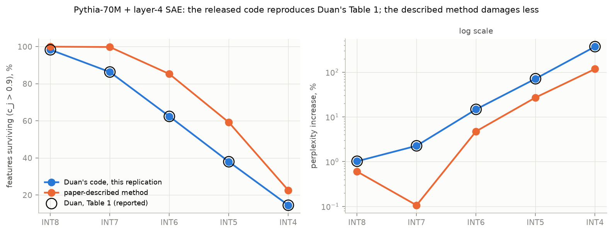
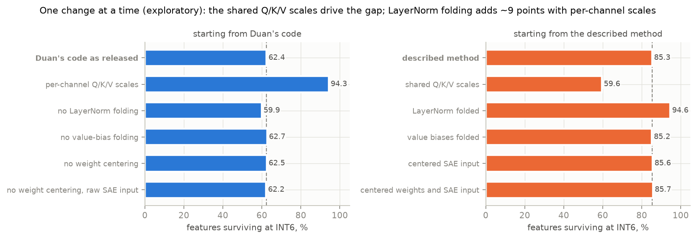

# Which features does quantization break first? In a toy model of superposition, it is the antipodal pairs, not the crowded ones

> **DRAFT v4, not published.** v2 (2026-10-24) followed Shen's review of v1: the head-vs-tail part became a
> short side section, the voice became first person, and the citations were checked against primary sources.
> v3 adds the real-model bridge. v4 splits it into a replication section (8) and a transfer section (9),
> following Shen's second review.
> Claude Code prepared it from `notes/LOG.md`. Every number comes from a `results/` directory, `notes/LOG.md`
> or a cited paper, as listed in the provenance table at the end. A multi-agent audit checked every number
> against those sources on 2026-10-25. The open review points are collected in the last section.

*Shen Yuting. Implemented and analysed with Claude Code.*

Code, configs, logs and the small result files: [github.com/fqybaba/tmsq](https://github.com/fqybaba/tmsq).
The full `results/` tree (weights, per-feature tables) is in that repository's Release `v0.1.0`.

**How this was made.**
- I designed the research question, the overall architecture and the phase plan, and I made the scope and
  approval decisions, except the ones Claude Code made under my standing instruction while I was away (next
  bullets).
- I used Claude (claude.ai) to write that design up as Markdown, for a few simple lookups, and later to review
  the drafts of this post and check its citations.
- I used Claude Code (Anthropic) to check the plan against primary sources, write all of the code, run every
  experiment and analysis, and draft this post.
- I approved the Phase 3 pre-registration before any test ran. After that I was away, and under my standing
  instruction Claude Code ran the Phase 3 tests, decided to confirm the post-hoc antipodal finding on fresh
  models (Phase 3b), wrote the pre-registrations for Phases 3b–5, chose the setting-D weak-regime γ under a
  logged deviation rule, and did the post-hoc analyses of Phases 3–5. These are marked where they appear.
  I reviewed the Phase 3b–5 pre-registrations afterwards.
- For the real-model bridge (Sections 8–9), I approved Claude Code's plan and chose one of its definitions (the
  encoder bias in the margin analog). Claude Code then wrote the pre-registration, had it checked by a
  separate multi-agent AI review that it ran itself (not human reviewers), and froze it before any quantized
  run. At my request it also ran the ablation and re-ran the registered tests on the described method. The
  first post-hoc check of the margin result (Section 9) it ran on its own, prompted by an AI advisor review.

"I" below means me. Every decision and deviation, with who made it and when, is logged in `notes/LOG.md` and
`notes/SESSION_JOURNAL.md`.

## TL;DR

- Anthropic's toy model of superposition (a tied ReLU autoencoder) has known ground-truth features. I quantize
  its weights after training with round-to-nearest (RTN) and measure the damage to each feature.
- **The intuitive prediction fails.** I expected crowded, low-margin features in dense superposition to break
  first. Of the four setting-C sparsities (n = 100, m = 20) whose reliability I checked before the tests
  (S = 0.75–0.96), S = 0.75 is the only one where per-feature damage is reliable enough to test. There, two of
  the three pre-registered predictors (margin and crowding) point the *opposite* way, and the third (feature
  norm) predicts nothing.
- **The fragile features are the zero-bias antipodal pairs.**
  - Antipodal-pair features (D_i ≈ 0.5) have no positive interference to suppress and learn a bias of about
    +0.01 (consistent with Elhage et al.'s (2022) account that a negative bias exists to filter small positive
    interference; a feature with none has nothing for such a bias to filter). Their output on inputs
    where they should be off sits just above zero, just below the 0.05 cutoff used to count false
    activations, so a 3- or 4-bit perturbation pushes it over.
  - Crowded features learn negative biases (about −0.08). The post-hoc reading, not tested by intervention, is
    that these biases act as a buffer.
  - The confirmation ran on 20 fresh, pre-registered models. At 3-bit per-row RTN every antipodal feature is
    damaged, against 46% of the other features. At 4 bits, almost only antipodal features break.
  - Isotropic Gaussian noise of the same size gives the same picture, so the cause is sensitivity to any
    perturbation, not something special about rounding.
- **In setting C, using geometry to allocate bits does not beat uniform 4-bit RTN.**
  - At a fixed 4.0 bits per weight, mixing 3- and 5-bit columns roughly triples the loss increase, and no
    geometry-based ranking recovers that.
  - In setting D a threshold-density ranking does beat uniform, but post hoc it turns out to be frequency
    allocation.
  - A generic loss-aware rounding removes about half of the 4-bit loss increase at one sparsity (and 7–31% at
    others), but it does not rescue the fragile features.
- **Real model: Duan's numbers replicate almost exactly; post hoc, the toy predictors add almost nothing
  beyond his statistics.**
  - On Pythia-70M with a pretrained SAE, Duan's survival and perplexity numbers reproduce to within 0.02.
  - His released code shares Q/K/V quantization scales across heads. In an exploratory ablation, per-channel
    scales keep 94% of features at INT6 instead of 62%.
  - Three of the four pre-registered tests cleared their minimum effect against peak activation alone.
    Post hoc, against all four of Duan's statistics, no toy-model predictor adds more than about 0.004 AUC
    for survival on either pipeline. Threshold density keeps a small association with new false activations
    (ρ ≈ 0.11 given all four statistics; about 0 given only peak and rarity).
- **Head vs tail is a weak side result.** Under a power-law frequency, the pre-registered test leans toward
  "the tail loses a larger relative fraction". The effect is weak and not robust, it comes from the
  normalization, and frequency is nearly collinear with geometry in those models.
- To my knowledge, the antipodal-fragility result has not been reported before. Its premise, that
  antipodal pairs need no negative bias, follows from Elhage et al.'s (2022) account of negative biases as
  filters for positive interference. For two hidden dimensions in the high-sparsity limit, Chen, Lau et al.
  (2023) show it directly (b* = 0 for the 4-gon).

## 1. Motivation

Duan (2026), "Perplexity Can Miss SAE Feature Damage Under Quantization", quantized Pythia-70M and Gemma-2-2B
with round-to-nearest (RTN) quantization, described as per-output-channel, and tracked sparse-autoencoder (SAE)
features.
- Some features degrade while perplexity stays flat.
- Whether a feature survives can be predicted from full-precision statistics: the cross-validated AUC is
  0.92–0.97, and peak activation is the strongest single predictor.
- The paper offers a heuristic ("quantization perturbations compete with each feature's activation signal")
  but measures no geometry.
- Section 8 notes a difference between its released code and the method the paper describes; I have asked the
  author about it.

In a real model the true features are unknown, so the question of *why* a given feature breaks cannot be
asked directly.

The toy models of superposition (Elhage et al., 2022) give exactly that control. The features are known, and
their geometry (norms, overlaps, biases, polytopes) can be read straight off the weights. The model also
trains in seconds. My question:

> In a model with known ground-truth features, which features does weight quantization break first, and can
> superposition geometry predict this in advance?

## 2. Setup

**Model.**
- Features x ∈ R^n are independent: x_i = 0 with probability S, otherwise Uniform[0, 1]. In setting D, S
  varies by feature: S_i = 1 − p_i.
- The model is h = Wx and x̂ = ReLU(Wᵀh + b), with W ∈ R^{m×n} tied as encoder and decoder. The loss is the
  importance-weighted MSE.
- Settings A–C use the official notebook's optimizer settings: AdamW with weight decay 0.01 on W and b,
  constant lr 1e-3, batch 1024. They train longer than the notebook's 10k steps: 20k steps for A and B, and
  15k for C. The paper itself states no hyperparameters.
- Setting D borrows three things from Liu, Liu & Gore (2025): power-law feature frequencies (with total
  density Σ p_i = k ∈ {2, 5} instead of their 1), their weight-decay knob γ (on W only) and their
  learning-rate schedule (lr 1e-2, 2,000 warm-up steps, cosine decay, 20k steps). The activations,
  initialization, loss and batch size are as in A–C. The deviations from their recipe are logged.
- Every configuration is trained as many instances in parallel, and all seeds are reported.

| Setting | n | m | Importance | Sparsity | Used for |
|---|---|---|---|---|---|
| A | 5 | 2 | 0.9^i | sweep S | sanity check (pentagon) |
| B | 20 | 5 | 0.7^i | sweep S | main replication |
| C | 100 | 20 | uniform | sweep S | main quantization testbed |
| D | 200 | 20 | uniform | power law p_i = min(1, c(i+1)^−α), α ∈ {1, 1.5}, Σ p_i = k ∈ {2, 5} | head vs tail |

**Quantization.**
- Symmetric RTN with qmax = 2^(b−1) − 1 at 8, 6, 5, 4, 3 and 2 bits.
- Scales per tensor, per column (one per feature) or per row (one per hidden dimension).
- Only W is quantized, tied; b stays in FP32.
- A matched-noise control replaces each column's rounding error with an isotropic Gaussian direction of the
  same norm. This separates the structure of rounding from generic perturbation.

**Damage per feature.** All damage is measured on an eval set stratified by feature: 2,000 rows with the
feature active and 20,000 with it inactive. The FP model and every quantized model use the same set. The
recorded quantities are:
- dR2: the change in the feature's R².
- the change in false activations: P(x̂_i > 0.05 | x_i = 0).
- the change in leak energy: E[x̂_i² | x_i = 0].
- dLoss: the feature's share of the increase in total loss.
- a composite *damaged* label: Pearson survival < 0.9, OR dR2 > 0.1, OR a rise in false activations
  > 0.05.

Pearson survival alone turned out to be almost useless in the toy model. This is Duan's criterion, adapted
here to the feature's active stratum, so it cannot see false activations; Section 8 uses his all-token
version. At ≥ 4 bits essentially every feature "survives" even when its R² drops a lot (Section 4). A
feature is *eligible* if its norm is > 0.5 and its FP R² is ≥ 0.5.

**Discipline.**
- Every hypothesis test was pre-registered in `notes/LOG.md`, together with its primary cell, outcome,
  decision rule and stop rules. The analysis code was frozen (committed) before the confirmatory data were
  read.
- The setting-C hypotheses were explored on one set of models (E, seed 0) and decided on a fresh set (K,
  seed 1).
- A finding discovered post hoc on K was then confirmed on a third fresh set (K2, seed 7).
- Post-hoc analyses are labelled as post hoc throughout.
- Mistakes are reported where they happened (Sections 6, 7, 9 and 10).

## 3. Replication sanity checks

- **Setting A (5 features in 2 dimensions).**
  - At S = 0, all 5 seeds keep exactly 2 orthogonal features.
  - The pentagon (all five D_i ≈ 0.4) forms in 4/5 seeds at S = 0.9, 3/5 at S = 0.95 and 5/5 at S = 0.99,
    with adjacent angles of 70°–74°.
  - The alternative solution (1/5 seeds at S = 0.9, 2/5 at S = 0.95) is always a square of two antipodal
    pairs. The dropped feature is not always the least important one.
- **Setting B (20 in 5).**
  - The number of represented features rises with sparsity (Spearman 0.998).
  - The pre-registered bias criterion, "negative mean bias wherever superposition is present", **failed as
    written**. In the early antipodal regime (S ≈ 0.47–0.92), represented features carry a small *positive*
    bias.
  - Every instance with S ≥ 0.957 has a negative mean bias, but at 0.957, still antipodal, it is barely below
    zero (−0.0002 to −0.007). Clearly negative, interference-suppressing biases come with dense superposition
    from S ≈ 0.98. This turns out to be the seed of the main finding.
- **Setting C (100 in 20; a scaled-down version of the paper's n = 400, m = 30 figure, which the official
  notebook reproduces at 200/20).**
  - The "sticky" plateau of D* = m/‖W‖_F² at 1/2 is reproduced on a fine sparsity grid: four adjacent points,
    1/(1−S) from 2.1 to 3.3, lie within ±0.05 of 1/2.
  - The coarse grid missed it. The plateau spans about a factor of 1.6 in 1/(1−S), the same as the coarse
    grid's spacing.
  - The plateau at 1 failed as written, because only S = 0 lies on it at this grid resolution.
  - With n/m = 5, every feature is represented from 1/(1−S) ≈ 16 onward (95–97 of 100 at 1/(1−S) = 10), and
    D* saturates at about 0.15.

## 4. The quantization sweep

- **8 bits is lossless in loss and R²**: the median |dR2| is ≤ 4e-4 in settings A–C. It is not always
  damage-free under the composite label. In C at S = 0.60, where almost every represented feature (about 38 of 100
  per model, the rest dead; 190 of 191 over the five models) is in an antipodal pair with a small positive
  bias (≈ +0.04), 7–23% of eligible features
  already count as damaged at 8 bits. The trigger is a rise in false activations past the 0.05 cutoff, while
  the median dR2 stays between 5e-5 and 3e-4 (see Section 5's limits).
- **Mean damage rises monotonically as bits fall** (eligible-feature dR2 pooled over S, and the total loss
  increase), for every granularity in settings A–C. Setting D's weak regime is the exception (Section 6).
- **With per-column scales, rounding is about as damaging as matched noise in B and C.**
  - The RTN/noise ratio of the mean loss increase is 0.89–1.06. Per-row and per-tensor scales spread more
    widely (0.53–1.52).
  - In the 2-D setting A, per-column rounding is 1.5–4.4× *less* damaging. One plausible reason: with
    per-column scales, the dominant coordinate of a 2-vector is represented exactly.
- **Pearson survival is uninformative.**
  - At ≥ 4 bits the fraction of eligible features with correlation ≥ 0.9 is 1.00 in every setting, even where
    dR2 is large, so the analysis uses the composite label.
  - In C at S = 0.749 (exploration set, per-column scales), 84% of eligible features survive 4 bits and 45%
    survive 3 bits under the composite label. 2 bits destroys everything.

## 5. Main result: the antipodal pairs break first

**Pre-registered tests.**
- They ran on K: 10 fresh models in setting C, at S = 0.7488, per-row RTN and 3 bits.
- The statistic is the within-model Spearman ρ, averaged over models, with a 95% t-interval and a Holm
  correction.

| Hypothesis (as stated before the data) | Mean ρ | 95% CI | Holm p | Verdict |
|---|---|---|---|---|
| H1: smaller margin → more new false activations | +0.49 | [+0.34, +0.64] | 8e-5 | not supported, **opposite sign** |
| H2: smaller D (more crowded) → larger dR2 | +0.40 | [+0.29, +0.51] | 4e-5 | not supported, **opposite sign** |
| H3: larger norm → smaller dR2 | +0.00 | [−0.17, +0.17] | 0.98 | not supported (null) |

- H1's opposite sign was registered in advance as an alternative, the "threshold density" reading: features
  whose inactive pre-activation sits close to the 0.05 false-activation cutoff should flip most easily.
- In an exploratory secondary analysis, Duan's own predictor holds here: higher FP peak output means less
  damage (Spearman with dR2 −0.36; AUC 0.70), whereas feature norm predicts nothing.

**What drives it (post hoc on K, then confirmed).** In this cell the features fall into discrete geometric
classes. The fragile class is the antipodal pairs, D_i ≈ 0.5 (K, per-row 3 bits):

| Class | n | D | Bias | P(inactive pre-activation in [0, 0.1]) | Damaged at 3 bits |
|---|---|---|---|---|---|
| crowded (margin < −0.1) | 108 | 0.40 | −0.087 | 0.09 | 37% |
| intermediate | 249 | 0.44 | −0.075 | 0.15 | 45% |
| antipodal pairs | 93 | 0.50 | +0.010 | 0.65 | 99% |

**Confirmation on fresh models (Phase 3b, pre-registered, 20 new models).**
- The difference in damaged fraction between antipodal and other features, per model, is **+0.53, 95% CI
  [+0.48, +0.58]**, t-test p = 1e-14 (18 of 20 models had antipodal features).
- Registered verdict: *Supported*.
- At 4 bits the difference is +0.98: essentially only antipodal features break.
- Under the matched-noise control it is +0.51.
- The threshold-free outcomes point the same way, with smaller gaps: dR2 +0.04, leak energy +0.002.

**Proposed mechanism.** The threshold-density reading was registered in advance as H1's alternative. The bias
story behind it was found post hoc on K and reproduced descriptively on K2. Nothing was tested by intervening on
b or W.
- In this cell the antipodal pairs (D_i ≥ 0.48: 92 of the table's 93) are the only features with no
  positive interference: their largest overlap with any other feature is at most 0.016, against at least
  0.088 for every other eligible feature. (The 93rd member of the table's class has D = 0.46 and overlap
  0.096.) When its
  partner is active, feature i's pre-activation is negative and the ReLU removes it. Elhage et al. (2022,
  "Mathematical Understanding") note that ReLU makes negative interference free and that a negative bias is
  what converts small positive interference into negative interference; in "Perturbing a Single Feature" they
  attribute the slight negative bias of pentagonal solutions to positive interference. By that account a
  feature with no positive interference has no reason to pay for a negative bias (my inference, not their
  statement), and indeed it learns b_i ≈ 0 (here +0.01).
- Its output on the inactive stratum then sits just above zero and just below the 0.05 cutoff for false
  activations. A 3- or 4-bit perturbation, whether rounding or Gaussian, pushes a large fraction of it over.
- Crowded features have positive interference, so they learn a negative bias to filter it. That bias is also
  a buffer against weight noise.
- This suggests that **the bias the model learns against interference also buffers it against quantization,
  and the features that needed no such bias have no buffer.** A direct test, such as shifting the antipodal
  features' biases before quantizing, has not been done.

**Two limits of this result.**
- It lives at the only sparsity on the quantization grid where antipodal pairs and denser polytopes coexist
  (S ≈ 0.75 for n/m = 5; on the finer full-precision grid this is a narrow window, roughly S ≈ 0.70–0.75). At
  S ≥ 0.84, per-feature damage in setting C is dominated by the random draw of the perturbation and is not
  reliably predictable.
- The binary label depends on the 0.05 detection cutoff. Post hoc, a plausible reading is that features whose
  inactive output sits just below it are flagged by small perturbations: at S = 0.60, where almost every
  represented feature is antipodal with bias ≈ +0.04, 7–23% of eligible features are flagged even at 8 bits (Section 4).
  The threshold-free differences point the same way but are smaller.

## 6. Side result: head vs tail is weak, and frequency is tangled with geometry

Real-model evidence on whether compression hurts frequent or rare knowledge more is mixed (Wu et al., 2026,
where the large shifts come mostly from pruning and very low bit widths; Chang et al., 2025, whose FineWeb
"long tail" is defined by full-precision loss rather than frequency, and whose PopQA entity-popularity result,
a frequency proxy, is non-monotone). Setting D gives each feature a frequency from a
power law (n = 200, m = 20).
- The degree of superposition is set with Liu, Liu & Gore's knob γ.
- The strong regime (γ = −1) is checked with phi_half, the fraction of features with norm > 1/2. It is 1.00 /
  0.62 / 1.00 / 0.99 for (α, k) = (1, 2) / (1, 5) / (1.5, 2) / (1.5, 5), with 5 models each. So (1, 5) is not
  strongly superposed, and the registered sensitivity analysis drops it.
- Head and tail are the top 10% and bottom 50% of the *eligible* features. With k = 2, 97–98% of the true
  bottom-50% tail is eligible. With k = 5 only 4–6% is, so there the eligible "tail" consists mostly of
  mid-frequency features.
- A weak regime could not be built at this size. Liu et al.'s γ = 0.1 is not weak here, and γ = 7 shrinks the
  features so much that 2-bit RTN *improves* the model. The registered sanity rule stopped it. Post hoc, the
  reason: ternary rounding re-inflates the norms (‖W_i‖² +0.25 at 2-bit per-row) far more than matched noise
  does (+0.06).

**(a) The registered result is weak and not robust.**
- Strong regime, per-row 3-bit, within-model Spearman of frequency with relative damage dR2/R2_fp:
  **ρ = −0.21 [−0.27, −0.15]**, Holm p = 1e-6.
- The registered category is "the tail loses a larger relative fraction".
- |ρ| only just clears the pre-registered 0.2 size threshold.
- The registered sensitivity analysis (phi_half ≥ 0.9) gives −0.17.
- In the secondaries the effect shrinks with more bits: −0.08 to −0.12 at 4 bits and −0.01 to −0.06 at 5 bits,
  across the three granularities.

**(b) Three damage measures, three answers, one reason.**
- *dR2 (the change in R²)* does not depend on frequency (ρ = −0.03). Its two parts cancel:
  - The active-stratum term leans toward the head (+0.38).
  - Leakage on the inactive stratum is divided by Var(x_i) ≈ p_i/3, which inflates it for rare features
    (−0.20).
- *Relative damage dR2/R2_fp* correlates negatively with frequency mainly because of its denominator. FP R²
  is 0.61 in the tail and 0.94 in the head (ρ(p, R2_fp) = +0.96).
- *Absolute damage dLoss* sits in the head (ρ = +0.72), because it is mechanically proportional to p.
- New false activations also sit in the head: 8% vs 0.3% in the tail, ρ = +0.52 (post hoc).
- The size of each feature's weight error ‖ΔW_i‖ does not depend on frequency (ρ = +0.03, post hoc). So which
  bucket "loses more" is decided by the normalization applied to the responses, not by the size of the
  perturbation each feature receives.

**(c) Frequency and geometry cannot be separated here.**
- In the strong-regime models, frequency is almost collinear with how much of a feature's inactive
  pre-activation sits near the 0.05 false-activation cutoff (ρ = +0.93 recomputed from the saved sweep; the
  pre-registration logged 0.94), and strongly correlated with its bias (+0.86).
- A frequency effect in this model is therefore "frequency, or the geometry it determines". Partial
  correlations are not trustworthy at this collinearity.
- The same confound explains the setting-D allocation result in Section 7.

**A mistake in the pre-registration.**
- Claude Code's Phase 4 pre-registration, written while I was away, included an out-of-sample test of the
  antipodal mechanism. It predicted that the near-threshold features, which here are the head, would be
  damaged more, so ρ(p, relative damage) > 0.
- The result was negative, and the registered verdict is *not confirmed*.
- The test used the wrong outcome. A leakage mechanism should be tested on leakage, and the project's own
  design note maps leakage to new false activations.
- On that outcome the direction fits the mechanism (ρ = +0.52, above). That is only post hoc, so the
  registered verdict stands.

**Real models.** Two real-model results point the same way as the head's larger raw leakage:
- Duan (2026) reports that "non-survival rises with firing rate" under RTN, and that rarer SAE features "are
  not more fragile and if anything survive better" once other statistics are controlled for.
- Borobia et al. (2026) find that rare SAE features survive *pruning* better.

Both measure correlation in an SAE basis, not leakage. So this is a consistent direction, not a
confirmation.

## 7. Can geometry tell us where to spend bits?

**Setup.**
- The budget was fixed at 4.0 bits per weight with per-column scales. Half of the represented columns got 5
  bits and the other half 3 bits.
- The ranking used one of: smallest margin (the original plan), largest margin, highest threshold density,
  largest norm, or a random order (20 draws).
- Two greedy rounding rules were also tried. One minimizes leakage on a calibration set; the other is a
  generic loss-aware control.
- The comparisons were pre-registered and run on 40 fresh setting-C models plus the 20 strong-regime
  setting-D models.

**Results.**
- **Nothing geometric beats uniform 4-bit.**
  - At the primary cell (C, S = 0.7488), uniform 4-bit RTN raises the loss by 0.89%.
  - Random 3/5 mixing raises the loss by 2.62% (+1.73 points over uniform), 2.9× uniform's increase. The
    pre-registration predicted that mixing would be worse, estimating about 2.1× from a 4^-b approximation of
    the rounding error. With this grid's actual steps (qmax = 3, 7, 15) the same argument gives about 2.8×. The
    direction was right; the registered size was an underestimate.
  - Every geometric ranking is also worse than uniform: smallest margin 2.77% (+1.87 points over uniform),
    threshold density 2.45% (+1.56).
  - None is distinguishable from random after Holm correction. Geometry carries a little information: there
    are a few BH-significant gains over random at other sparsities, all ≤ 0.6 points. That is never enough to
    pay the mixing penalty.
- **Leak-minimizing rounding backfires.**
  - It cuts calibration leakage by 7–76% in setting C and by 84% in D.
  - The accuracy it loses on active features outweighs the leakage it removes. Net, it is worse than uniform
    4-bit by +1.5 points of loss increase at S = 0.75 and by +25 points at S = 0.96.
- **Generic loss-aware rounding works in setting C, but only on average.**
  - It lowers the loss increase from 0.89% to 0.41% at S = 0.75, halfway to 5-bit, and by 7–31% at the higher
    sparsities.
  - It brings no detectable reduction in worst-feature damage, and the drop in the damaged fraction (1.3 points
    at S = 0.75) is not significant. It spreads small gains rather than rescuing the fragile features.
  - In setting D the registered pooled comparison with uniform is null. Post hoc, it is worse than uniform in
    all five (α = 1, k = 2) models, probably by overfitting the calibration set.
- **In setting D, ranking by threshold density does beat uniform, but that is frequency allocation in
  disguise.**
  - There, the threshold-density ranking correlates 0.92 with frequency (the confound of Section 6c), and an
    explicit frequency ranking does just as well (both post hoc).
  - Post hoc by configuration, it wins only for the steeper power law (α = 1.5).
- Per-feature bit allocation has no direct counterpart in real models, where features are not axis-aligned.
  This section is a mechanism demonstration, not a method.

## 8. Replicating Duan (2026) on Pythia-70M

**Versions.**
- Paper: arXiv 2606.03002 v2 (4 June 2026).
- Code: the anonymous mirror `sae-feature-survival-quantization-0141`, source commit dated 2026-06-08. Its
  README links to the v2 title. The Pythia script is `scripts/02_pythia_phase2b_streaming_final.py`.

**Setup.** Duan's setting:
- Model: Pythia-70M-deduped (Biderman et al., 2023).
- SAE: the SAELens SAE `pythia-70m-deduped-res-sm` on the layer-4 residual stream, 32,768 features, from
  Marks et al. (2024).
- Data: 199,680 WikiText-2 tokens.
- Quantization: RTN on the transformer-block linear weights.
- Survival: the Pearson correlation of each feature's activations before and after quantization, over all
  tokens, must exceed 0.9.

**Results**, following the released code:

| Bits | Survived (mine / Duan, Table 1) | Perplexity (mine / Duan, Table H.7) |
|---|---|---|
| INT8 | 98.3% / 98.3% | 68.53 / 68.53 |
| INT7 | 86.3% / 86.3% | 69.37 / 69.37 |
| INT6 | 62.4% / 62.4% | 77.83 / 77.83 |
| INT5 | 38.0% / 38.0% | 116.15 / 116.15 |
| INT4 | 14.5% / 14.5% | 319.59 / 319.60 |

- Every survival rate is within 0.02 percentage points of Duan's (one feature out of 5,688), and every
  perplexity within 0.02.

- Duan's four-statistic predictor gives AUC 0.924 here, as in his Table 2.
- Peak activation alone gives AUC 0.879. Duan does not report this number. It means the other three
  statistics add about 0.045.

**Implementation note.** Duan's paper (§3.2, Appendix L) describes per-output-channel RTN, with LayerNorm
parameters left in full precision. The released code differs in two ways and fixes one detail the paper leaves
open:
1. W_Q/W_K/W_V share one scale per d_head index across all 8 heads, instead of one scale per output channel.
2. The weights are quantized after TransformerLens's default processing. That folds the LayerNorm gains into
   the quantized weights; it also centers the weights and folds the value biases.
3. Not specified in the paper: the SAE receives the mean-centered residual. On positions < 128 (the SAE's
   training context), it reconstructs that worse than the raw residual: fraction of variance unexplained 0.232
   vs 0.193. For the described method I feed the raw residual, chosen by this fit test before any quantized
   run.

The near-exact match above strongly suggests that the released code produced the paper's numbers. An
exploratory ablation at INT6 changes one factor at a time, starting from either end. The described method
gives 85.3% survival.

| Change | Survived at INT6 |
|---|---|
| Duan's code as released | 62.4% |
| … with per-channel Q/K/V scales | 94.3% |
| Described method (per-channel scales, raw weights, raw residual) | 85.3% |
| … with shared Q/K/V scales | 59.6% |
| … with LayerNorm gains folded in before quantizing | 94.6% |
| … with the centered residual fed to the SAE | 85.6% |

- The two pipelines differ by 22.9 points. Switching only the Q/K/V scales moves survival by more than that:
  +31.9 points from the code end, and −25.7 from the described end.
- LayerNorm folding pushes the other way: folding the gains in before quantizing *raises* survival, by about 9
  points with per-channel scales and about 2.5 with shared ones.
- The SAE input convention, weight centering and value-bias folding each move survival by less than 0.5
  points.

- So Duan's headline INT6 survival depends mainly on one implementation detail. I contacted the author on
  25 October 2026 and will update this note with his reply.
- The registered tests below use the released code, so they are comparable with the paper. They were re-run
  post hoc on the described method (Section 9).

## 9. Does the toy-model mechanism transfer?

**Question.** Do the toy-model predictors tell us anything about which SAE features break, beyond what Duan's
activation statistics already tell us?

**The two predictors.**
- *Threshold density*: how much of a feature's pre-activation sits just below its firing threshold.
- *Margin analog*: built from the SAE's encoder bias and decoder overlaps.

**How the tests were fixed in advance.**
- I approved the plan and chose the margin's bias term.
- The pre-registration was frozen before any quantized run. Before that, a multi-agent AI review run by
  Claude Code found 9 problems, two of them in the statistics, and all 9 were fixed.
- Each test compares a predictor with **peak activation alone**, and needs at least +0.02 AUC (survival) or a
  partial correlation of at least 0.10 (new false activations) to count.

**Registered tests** (INT6). Duan's pipeline has 5,688 active features. The described method (run R3, a
registered secondary run) has 5,717; applying the registered verdict rules to it is post hoc.

| Test | Duan's pipeline | Described method (verdicts post hoc) | Verdict on both |
|---|---|---|---|
| Threshold density → survival | dAUC +0.008 | +0.000 | no added information |
| Margin → survival | dAUC +0.024, larger margin = *lower* survival | +0.035, same sign | adds information beyond peak |
| Threshold density → new false activations | partial ρ +0.79 | +0.74 | "supported", but frequency (below) |
| Margin → new false activations | partial ρ +0.26 | +0.15 | associated |

**Threshold density.**
- It adds nothing to peak activation for predicting survival.
- Its strong link to new false activations is feature frequency. With rarity also controlled, as registered in
  advance, ρ = 0.79 falls to −0.01 (−0.03 on the described method). That control was registered because
  frequency and geometry were confounded in Sections 6–7.
- In this model, frequent features leak more (partial ρ of rarity with new false activations: −0.82). That is
  the same direction as Duan's "non-survival rises with firing rate" and as the head's raw leakage in
  Section 6 (post hoc there), though the metrics differ.

**Margin.**
- The margin passed its pre-registered criterion: ΔAUC = 0.024 over peak activation alone, with a threshold of
  0.02. Larger margins predicted more damage.
- A post-hoc check shows that this information is already contained in Duan's statistics.
  - The margin's denominator μ⁺ equals mean activation divided by firing rate.
  - Adding the margin to all four of Duan's predictors improves AUC by only 0.001–0.002 (0.004 on the
    described method).
- Its association with new false activations falls once all four of Duan's statistics are controlled for:
  from 0.26 to 0.03 on Duan's pipeline, and from 0.15 to 0.07 on the described method. Rarity alone does not
  remove it: given peak and rarity it is 0.17 and 0.30.
- **In hindsight, the registered baseline should have been Duan's full model, not peak activation alone.**
  That choice is why the margin "passed" before it was explained away.
- The sign matches the toy model's H1 result: there, too, larger margins went with more damage. That is a
  match in direction only, not supporting evidence.

**Net result (the comparison with Duan's four statistics is post hoc).**
- On Pythia-70M, none of the SAE-level proxies of the toy-model mechanism adds more than about 0.004 AUC
  (largest raw value +0.0041) for survival beyond Duan's four statistics, on either pipeline.
- For new false activations, threshold density keeps a residual partial correlation of ρ ≈ 0.11 given all
  four statistics, on both pipelines. That just clears the 0.10 minimum of the registered tests, but it is post
  hoc, has no permutation p-value, and is about 0 when only peak and rarity are controlled.
- This does not rule out the mechanism in real models. These proxies may not capture it: in the toy model, the
  fragile geometry is the model's own weights and biases, whereas an SAE's encoder bias and decoder overlaps
  belong to a dictionary fitted on top of the model.
- As in the toy model, matched Gaussian noise does about the same damage as rounding: 63.8% survive vs 62.4%
  (a registered secondary with a single noise draw, so the gap has no uncertainty estimate).

## 10. Limitations

- **Scope.** One toy architecture, a tied ReLU autoencoder. The main finding rests on one (n, m, S) cell:
  n = 100, m = 20, S ≈ 0.75, the only one on the quantization grid where antipodal pairs and denser polytopes
  coexist.
- **Thresholds.** The damaged label uses a 0.05 detection cutoff for false activations, and features whose
  inactive output sits just below it are flagged by small perturbations (Section 4). The threshold-free
  outcomes agree in sign but show smaller gaps.
- **Setting D's weak regime** could not be built at this size without heavy weight decay, which breaks the
  premise of a damage study. Section 6 therefore covers strong superposition only.
- **Errors, all in `notes/LOG.md`:**
  - Three pre-registered sanity criteria failed as written: B's bias criterion, and C's plateaus at 1 and at
    1/2 on the coarse grid. The 1/2 plateau passed on the registered fine-grid follow-up.
  - The Phase 5 write-up compared the extra loss of random mixing (1.9×) with a registered prediction about
    the total (2.1×). The total ratio is 2.9× (Section 7). The pre-publication audit caught this.
  - A first pre-registration draft for Phase 3 picked a primary cell whose outcome was unreliable. A
    multi-agent AI review run by Claude Code caught this before any test ran.
  - The Phase 4 mechanism test used the wrong outcome (Section 6).
  - The Phase 5 setting-D allocation result is confounded with frequency (Section 7).
- **The real-model bridge is one model, one SAE, one layer.**
  - With about 5,700 features, the permutation p-values of all four registered decision tests sit at their
    floor (1/1001 or 1/10001). The features are also not independent, so those p-values overstate the
    evidence. The pre-registered
    minimum effect sizes carry the decisions.
  - The margin result was explained away post hoc, because the registered baseline was peak activation
    alone rather than Duan's full model (Section 9).
  - The registered decision tests ran only on Duan's released pipeline. The described method was a
    registered descriptive run; applying the decision rules to it, and the Duan-4 baselines, are post hoc.

## 11. Related work

- **The toy model.** Elhage et al. (2022) introduced it, its polytope geometry, and the role of negative
  biases in filtering positive interference.
- **Zero bias for antipodal pairs, analytically.** Chen, Lau et al. (2023) work in the high-sparsity limit
  with two hidden dimensions. They show that the 4-gon critical point (two orthogonal antipodal pairs) has
  b* = 0 and ‖W_i‖ = 1 (their Table A.1). That is consistent with the near-zero biases observed here for
  antipodal pairs in setting C, which is a different regime (n = 100, m = 20, S ≈ 0.75).
- **BitLinear TMS.** Tlaie (2024) trains TMS models (n = 20, m = 5) with BitLinear layers (BitNet-style
  low-bit weights trained from scratch, i.e. quantization in the loop, not post-training quantization) next to
  a dense reproduction, and observes on the BitLinear network that "the bias vector is not negative until
  larger sparsities (when the antipodal structure is lost)", later than in the dense baseline. The author
  calls it "too little work to extract strong conclusions".
- **Superposition and robustness.** This line of work concerns *input-space* adversarial attacks at the model
  level:
  - Elhage et al. (2022).
  - Gorton & Lewis (2025, Sec. 3.2 and Fig. 2B), who also report "one striking dip" in adversarial
    vulnerability at antipodal superposition, call it unexpected and leave it to future work (their Sec. 5).
    Note the direction: antipodal models are *less* vulnerable to input-space attacks there, while antipodal
    features are the *most* fragile under weight quantization here.
  - Stevinson et al. (2026).
- **SAEs in Pythia.** The bridge uses the residual-stream SAEs of Marks et al. (2024).
- **Quantization damage to features in real models.**
  - Duan (2026) studies per-feature quantization damage in real models without geometry. In a toy model where
    the features are known, this project proposes a geometric mechanism and, in an exploratory secondary
    analysis, agrees with Duan's peak-activation predictor. On Pythia-70M, post hoc, the SAE-level proxies of
    that mechanism add at most about 0.004 AUC for survival beyond Duan's statistics (Section 9), so the mechanism
    is not shown to transfer.
  - Borobia et al. (2026) do the same kind of SAE analysis for pruning.
- **Why PTQ works at all.** Chen, Beyer et al. (2026) explain it at the level of hidden states (errors
  counteracting across layers), not individual features.
- **Novelty.** To my knowledge, nobody has reported the specific result that, in a toy model of
  superposition (n = 100, m = 20, at the sparsity where antipodal pairs and denser polytopes coexist), zero-bias
  antipodal features are the most fragile under post-training weight quantization, so that more crowded
  features are damaged *less*.

## 12. Next steps

1. **Test the geometry where it lives.** A margin defined on the model's own neurons or attention, rather than
   on an SAE dictionary, in a second model or layer.
2. **Map the result across (n, m, S)**, to see whether antipodal fragility holds wherever antipodal pairs
   coexist with denser structures, including setting B.
3. **Re-test the setting-D mechanism with the right outcome** (new false activations), pre-registered, on
   fresh models.
4. **Test the proposed mechanism by intervention**: shift the antipodal features' biases negative before
   quantizing, and compare the damage.

## References

- Borobia, H., Seguí-Mas, E. & Tormo-Carbó, G. (2026). How Pruning Reshapes Features: Sparse Autoencoder
  Analysis of Weight-Pruned Language Models. arXiv:2603.25325.
- Biderman, S., Schoelkopf, H., Anthony, Q. et al. (2023). Pythia: A Suite for Analyzing Large Language
  Models Across Training and Scaling. arXiv:2304.01373.
- Chang et al. (2025). Why Do Some Inputs Break Low-Bit LLM Quantization? EMNLP 2025. arXiv:2506.12044.
- Chen, Y., Beyer, M., Zhu, J. & Chen, J. (2026). Why Does Post-Training Quantization Work? arXiv:2609.11716.
- Chen, Z., Lau, E., Mendel, J., Wei, S. & Murfet, D. (2023). Dynamical versus Bayesian Phase Transitions in a
  Toy Model of Superposition. arXiv:2310.06301.
- Duan, E. (2026). Perplexity Can Miss SAE Feature Damage Under Quantization. arXiv:2606.03002.
- Elhage et al. (2022). Toy Models of Superposition. Transformer Circuits Thread.
- Gorton & Lewis (2025). Adversarial Examples Are Not Bugs, They Are Superposition. arXiv:2508.17456.
- Liu, Liu & Gore (2025). Superposition Yields Robust Neural Scaling. NeurIPS 2025. arXiv:2505.10465.
- Marks, S. et al. (2024). Sparse Feature Circuits: Discovering and Editing Interpretable Causal Graphs in
  Language Models. arXiv:2403.19647.
- Stevinson, E., Prieto, L., Barsbey, M. & Birdal, T. (2026). Adversarial Vulnerability from Interference
  Between Features in Superposition. ICML 2026. Preprint arXiv:2510.11709, titled "Adversarial Attacks
  Leverage Interference Between Features in Superposition".
- Tlaie, A. (2024). Toy Models of Superposition: what about BitNets? LessWrong, 8 August 2024.
- Wu et al. (2026). The Asymmetric Harms of LLM Compression. arXiv:2608.19670.

## Provenance (every number above)

| Section | Numbers | Source |
|---|---|---|
| 2 | setup constants (steps, schedules, eval-set sizes) | `configs/*.yaml`; each run's `config.yaml` |
| 3 | setting A pentagon fractions and angles | `results/rep_5in2/20261024-062922` |
| 3 | setting B Spearman 0.998; bias table | `results/rep_20in5/20261024-063030` |
| 3 | setting C D* (coarse grid; fine-grid plateau) | `results/rep_dims/20261024-063236`, `results/rep_dims_fine/20261024-064438` |
| 4 | 8-bit sanity; RTN/noise ratios; survival fractions | `results/quant_sweep/20261024-092937-A`, `-092954-B`, `-093058-C` |
| 5 | H1–H3 verdicts; peak_out | `results/phase3/20261024-141233-K` |
| 5 | E-vs-K forest figure | `results/phase3/20261024-141338-compare` |
| 5 | class table (post hoc); max-overlap bounds | class table: `notes/LOG.md`, Phase 3 post-hoc item 1, read with the 2026-10-25 corrections entry (item 7); both recomputed from the K sweep `results/quant_sweep/20261024-140931-C_confirm/features.parquet` (S = 0.7488, per-row 3 bits, RTN, eligible features); the max-overlap bounds (D_i ≥ 0.48 vs the rest) are recorded in the corrections entry |
| 5 | Phase 3b verdict and secondaries; figure | `results/phase3b/20261024-142225-K2`, `results/quant_sweep/20261024-142123-C_confirm2` |
| 6 | phi_half; frequency–geometry correlations (0.93, 0.86) | phi_half: `results/setting_d/20261024-145113-g-1`; correlations recomputed from `results/quant_sweep/20261024-152211-D_strong/features.parquet` (the pre-registration's FP facts in `notes/LOG.md` logged 0.94) |
| 6 | H4 primary, sensitivity and secondaries (incl. 4/5 bits) | `results/phase4/20261024-152919-H4` (rerun `-153307-H4` is identical) |
| 6 | weak-regime diagnosis; raw leakage; ‖ΔW_i‖ (post hoc) | `results/phase4_posthoc/diagnostics_20261024.txt` (script `notes/posthoc/phase4_diagnostics.py`) |
| 6 | Duan's frequency statements | arXiv:2606.03002v2, Sections 4.4 and 5.4 |
| 7 | Phase 5 families and secondaries | `results/phase5/20261024-160152-analysis` |
| 7 | setting-D frequency confound (post hoc) | `results/phase5_posthoc/d_frequency_confound_20261024.txt` (script `notes/posthoc/phase5_d_frequency_confound.py`) |
| 8–9 | replication, registered tests, secondaries | `results/bridge/20261024-224808-fp` (FP stage), R1–R4 `results/bridge/20261024-230636-code-b6`, `-230918-code-b8-7-5-4`, `-231452-stated-b8-7-6-5-4`, `-232022-code-b6-noise0`; analysis `results/bridge/20261024-232316-analysis` |
| 8 | figures `bridge_replication`, `bridge_ablation` | `src/tmsq/experiments/figure_bridge.py` (reads R1–R3 and the ablation runs; Duan's values from his Table 1 / H.7 as recorded in `notes/LOG.md`) |
| 8 | ablation of code vs described method (exploratory) | `results/bridge_ablation/20261025-024313-r1-int6`, `-024807-c1-int6`, `-025332-c2-int6`, `-025755-r2-int6` (module `src/tmsq/experiments/bridge_ablation.py`) |
| 9 | described-method registered tests; Duan-4 baselines (post hoc) | `results/bridge_posthoc/stated_arm_tests_20261025.{txt,json}` (script `notes/posthoc/bridge_stated_arm_tests.py`) |
| 9 | margin decomposition; B_M check (post hoc) | `results/bridge_posthoc/margin_decomposition_20261024.txt` (script `notes/posthoc/bridge_margin_decomposition.py`) |
| 11 | literature check | `notes/litcheck_2026-10-24.md`; Duan, Chen–Beyer, Borobia, Stevinson and Chen–Lau re-checked against arXiv and ICML pages on 2026-10-24 (`notes/LOG.md`); Biderman et al. against arXiv on 2026-10-25 |
| all | pre-publication audit (every number vs its source) | workflow `post-number-audit`, 2026-10-25; corrections listed in `notes/LOG.md` |

## Review points still open (delete before publishing)

1. **Duan's reply.** Shen emailed him on 2026-10-25. When he replies, summarize the answer in Section 8's
   implementation note.
2. **Stevinson et al.** The PMLR volume and pages are not out yet. Add them when the proceedings appear; do not
   guess them.
3. **Duan's title.** Version 1 (2 June 2026) was titled "How Quantization Changes Interpretable Features: A
   Sparse Autoencoder Analysis of Language Models". The current version, v2 (4 June 2026), is cited.
