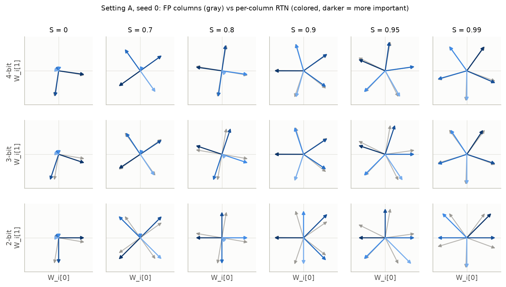
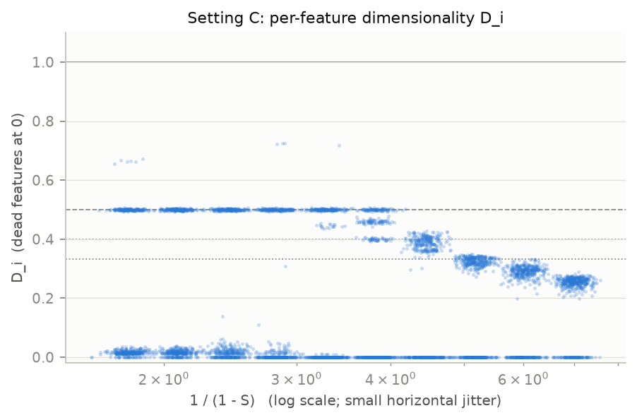

# TMS-Q 重写提纲（中文，含数据表和图）

> 给 Shen 自己写 LessWrong 首帖用。每节有：要点、数据表（附来源）、图、措辞边界、你来决定。标签：【预注册】【事后】【探索性】。数字和表可以直接用；要点只是事实清单，句子请自己写。建议篇幅是按总长 1,500–2,000 英文词分配的参考值。

## 一、TL;DR 和核心主张（约 100 词）

- 篇幅：成稿里这一节约 100 词（全文目标 1,500–2,000 词，主线是反极对结果；见 `notes/LOG.md`「2026-10-26 — Third external review of the post」末尾）。
- 本节只列事实、数字、范围和图的位置；句子由你自己写。
- 状态标签：【预注册】= 数据出来前写进 LOG 并提交；【事后】= 看到数据后才做的分析；【探索性】= 未预注册的探索。

### 1. 三条核心主张一览

| # | 主张（事实） | 状态 | 范围 | 一个关键数字 |
|---|---|---|---|---|
| 1 | 最先被 RTN 损伤的是零偏置的反极对（antipodal pair）特征，不是拥挤特征；据我们所知是新结果 | 在 E/K 上【事后】发现 → Phase 3b【预注册】确认（20 个新模型，18 个有效） | 设定 C（n = 100, m = 20），S = 0.7488（文中写 0.75），按行（per-row）RTN，3 位；S = 0.75 是检查过的四个稀疏度（0.75–0.96）中唯一逐特征损伤可靠到能检验的 | 每模型损伤比例差 +0.53，95% CI [+0.48, +0.58] |
| 2 | Duan (2026) 用他公开的代码在 Pythia-70M 上几乎完全复现；玩具模型预测量对存活几乎没有超出他四统计量的信息 | 复现门槛 G2【预注册】；4 项检验【预注册】（对照基线 = 仅峰值激活）；"超出 Duan 四统计量"的比较【事后】 | Pythia-70M-deduped，第 4 层残差流 SAE，INT6 为主单元 | 存活率差 ≤ 0.02 个百分点；4 项预注册检验 3 项达到最小效应；事后存活 AUC 增益 ≤ 0.004；泄漏残余 ρ ≈ 0.11【事后】 |
| 3 | 在设定 C 中，按几何分配比特不胜过统一 4 位按列（per-column）RTN | 【预注册】（Phase 5）：主检验（Family 1, Holm）只在 S = 0.7488；其他三个 S 是预注册次要（BH，仅估计） | 设定 C，S = 0.75–0.96，固定 4.0 bits/weight，按列缩放 | 主单元：统一 4 位损失增幅 0.89%，阈值密度排序 2.45%，最小余量排序 2.77% |

来源：`writeup/post.md` TL;DR、第 5、7–9 节；`README.md` 第 7–14 行（TL;DR）；`notes/LOG.md`「Phase 3b RESULTS」「Phase 6b (bridge): RESULTS」「Phase 5 results」。

### 2. 主张 1：反极对最先坏

**背景：预注册的直觉预测失败**【预注册】（K：10 个新模型，S = 0.7488，按行 3 位，模型内 Spearman ρ 取均值，Holm 校正）

| 假设（数据前写定） | 平均 ρ | 95% CI | Holm p | 裁决 |
|---|---|---|---|---|
| H1：余量（margin）越小 → 新误激活越多 | +0.49 | [+0.34, +0.64] | 8e-5 | 不支持，**方向相反** |
| H2：D 越小（越拥挤）→ dR2 越大 | +0.40 | [+0.29, +0.51] | 4e-5 | 不支持，**方向相反** |
| H3：范数越大 → dR2 越小 | +0.00 | [−0.17, +0.17] | 0.98 | 不支持（零结果） |

来源：`writeup/post.md` 第 5 节第一张表；`notes/LOG.md`「Phase 3 RESULTS (confirmatory, set K)」→「Primary verdicts」；`results/phase3/20261024-141233-K`。

- H1 的反向结果在预注册时已列为备择解读（阈值密度解读，threshold-density reading）。

**为什么只在 S = 0.75**【预注册】（选主单元的依据：E 上只涉及结果本身（outcome-only）和全精度量（FP-only）的信息，主要是下表的结果可靠性；没有用任何预测量–结果关联）

| S | ICC(1)：dfalse_act / dR2（按行 3 位，E） |
|---|---|
| 0.7488 | 0.55 / 0.12 |
| 0.8415 | −0.00 / 0.01 |
| 0.9000 | −0.03 / −0.03 |
| 0.9602 | 0.05 / 0.07 |

来源：`notes/LOG.md`「Phase 3 pre-registration (v2…)」→「Primary cell (one cell for H1–H3)」。

- 四个检查过的稀疏度里，只有 0.7488 的逐特征损伤可靠到可以检验；S ≥ 0.8415 时损伤主要由扰动的随机抽样决定。
- 在全精度细网格上，反极对与更密的多胞形（polytope）共存的窗口大约是 S ≈ 0.70–0.75（post 第 5 节「Two limits」）。

**发现与确认**

- 【事后】在 E（种子 0，5 个模型）和 K（种子 1，10 个模型）上看到的三个几何类别（post 第 5 节类别表；LOG「POST-HOC exploration」第 1 条）。
- 【预注册】Phase 3b：K2，20 个新模型，训练种子 7；反极定义 D_i ≥ 0.48（预注册时固定）；有效模型 18/20（实例 0 和 4 没有反极特征）；裁决 *Supported*。

| 统计量（每模型：反极 − 其他） | K2 均值 | 95% t 区间 | 状态 |
|---|---|---|---|
| 损伤比例，按行 3 位（主检验） | +0.529 | [+0.483, +0.575] | 【预注册】主检验；t 检验 p = 1.4e-14，符号翻转 p = 7.6e-6 |
| 损伤比例，按行 4 位 | +0.984 | [+0.975, +0.993] | 【预注册】次要（仅估计） |
| 损伤比例，匹配高斯噪声，按行 3 位 | +0.513 | [+0.486, +0.541] | 【预注册】次要（仅估计） |
| dR2（无阈值），按行 3 位 | +0.039 | [+0.027, +0.051] | 【预注册】次要（仅估计） |
| 泄漏能量 dleak_energy（无阈值），按行 3 位 | +0.0020 | [+0.0015, +0.0024] | 【预注册】次要（仅估计） |
| 同一统计量在 E / K 上 | +0.448 / +0.574 | [+0.375, +0.521] / [+0.553, +0.594] | 【事后】 |

来源：`notes/LOG.md`「Phase 3b RESULTS」；`results/phase3b/20261024-142225-K2/phase3b.json`。post 第 5 节把主检验写成 +0.53 [+0.48, +0.58]、p = 1e-14，4 位写成 +0.98，噪声写成 +0.51。

- 3 位时：反极特征损伤比例 1.00（166 个），其他特征 46%（跨模型汇总 pooled；每模型均值 47%）。来源：`phase3b.json` class_means；LOG「README front page」条目。
- 偏置（bias）：反极 +0.010，其他 −0.080（K2 类别均值）；K 的类别表里拥挤类 −0.087。
- 【事后】机制解读（负偏置 = 抵抗干扰 + 量化缓冲；反极特征偏置 ≈ 0 → 无缓冲）：在 K 上事后发现，在 K2 上描述性复现，**没有做干预实验**（post 第 5 节「Proposed mechanism」）。背后的阈值密度解读本身在预注册时已列为 H1 的备择。
- 新颖性：post 与 LOG 都写"据我们所知"（to our knowledge）。
- 前提"反极对不需要负偏置"的出处，分开写：
  - Elhage et al. (2022) 原文只说负偏置把小的正干扰变成负干扰（"Mathematical Understanding"），五边形解的轻微负偏置由正干扰驱动（"Perturbing a Single Feature"）；"所以反极对没理由付出负偏置"是我们的推断，不是原文陈述。
  - Chen, Lau et al. (2023)：两个隐藏维度、高稀疏极限下，4-gon（两对正交反极对）临界点 b* = 0（他们的 Table A.1）。
  - 来源：post 第 5 节「Proposed mechanism」、第 11 节；LOG「Third external review」第 3 条。注意 post TL;DR 末条仍写 "known from Elhage et al. (2022)"，比 LOG 第 3 条的结论宽。

### 3. 主张 2：Duan 复现与迁移检验

- 【预注册】复现门槛 G2：INT6 存活率须在 62.4 ± 3.0%；结果 62.41% vs Duan 62.395%，通过。五个位宽（INT8–INT4）存活率差 ≤ 0.02 个百分点（最多差 5,688 个中的 1 个特征），困惑度差 ≤ 0.02。
- 设置：Pythia-70M-deduped；SAE `pythia-70m-deduped-res-sm`，第 4 层残差流，32,768 个特征；WikiText-2，199,680 个 token；INT6 主单元 5,688 个活跃特征。
- 仅峰值激活（peak activation）的 AUC 0.879（Duan 未报告）；Duan 四统计量模型 AUC 0.924（与他的 Table 2 一致）。

| 检验（INT6，Duan 公开代码管线） | 统计量 | 最小效应 | 结果 | 状态 |
|---|---|---|---|---|
| 阈值密度 → 存活 | dAUC +0.008 | 0.02 | 未达到 | 【预注册】 |
| 余量类比 → 存活 | dAUC +0.024 | 0.02 | 达到；余量越大存活越低 | 【预注册】 |
| 阈值密度 → 新误激活 | 偏相关 ρ +0.79 | 0.10 | 达到；但控制稀有度后为 −0.01（频率效应） | 【预注册】（含预注册次要 S1） |
| 余量类比 → 新误激活 | 偏相关 ρ +0.26 | 0.10 | 达到 | 【预注册】 |
| 任何代理相对 Duan 全部四统计量的存活 AUC 增益 | ≤ 0.004（两条管线） | — | 几乎无增益 | 【事后】 |
| 阈值密度与新误激活的残余偏相关（给定四统计量） | ρ ≈ 0.11（两条管线） | — | 给定峰值 + 稀有度时约 0；无置换 p 值 | 【事后】 |

来源：`writeup/post.md` 第 8–9 节；`notes/LOG.md`「Phase 6b (bridge): RESULTS」「Phase 6b: POST-HOC check of the margin result」「Phase 6b: POST-HOC re-run of the registered tests on the described method, and Duan-4 baselines」；`results/bridge/20261024-232316-analysis`、`results/bridge_posthoc/stated_arm_tests_20261025.txt`。

- 四项预注册检验中 3 项相对"仅峰值激活"基线达到最小效应。
- LOG 自认的设计教训：预注册基线应是 Duan 的四统计量模型，不是仅峰值。
- 可选附带【探索性】：Duan 公开代码让 W_Q/W_K/W_V 在各头之间共享缩放因子；改为按通道缩放后，INT6 存活 62.4% → 94.3%；论文描述的方法为 85.3%。来源：post 第 8 节消融表；LOG「EXPLORATORY ablation」。

### 4. 主张 3：比特分配

- 【预注册】Phase 5：设定 C 的 40 个新模型（P5，种子 13，每个 S 10 个；S ∈ {0.7488, 0.8415, 0.9000, 0.9602}）+ 设定 D 强叠加的 20 个模型；预算固定 4.0 bits/weight，按列缩放；被表示的列一半 5 位、一半 3 位。

| 方案（主单元 C，S = 0.7488） | 损失相对增幅 r | 相对统一 4 位 | 状态 / 类别 |
|---|---|---|---|
| 统一 4 位（U4） | 0.89% | 基准 | — |
| 随机 3/5 混合（20 次抽取平均） | 2.62% | +1.73 个百分点，2.9× | 【预注册】次要（仅估计）；预注册预测（不是检验）"更差"，约 2.1×（方向对，大小低估） |
| 最小余量优先（margin_low） | 2.77% | +1.87 | 【预注册】worse than uniform，Holm p 4.9e-8 |
| 阈值密度优先（near_thr） | 2.45% | +1.56 | 【预注册】worse than uniform，Holm p 4.9e-8 |
| 泄漏最小化舍入（leak_round） | — | +1.5 | 【预注册】worse than uniform，Holm p 6.0e-5 |
| 感知损失的舍入（loss_round，对照） | 0.41% | 更好 | 【预注册】次要对照；不是几何方法 |

来源：`writeup/post.md` 第 7 节；`notes/LOG.md`「Phase 5 results…」→「Family 1」「Secondaries」，以及「Corrections found by the pre-publication audit」第 1 条（2.9×、2.1×）；`results/phase5/20261024-160152-analysis`。

- 几何排序 vs 随机：主单元 Holm 后全部"no detectable difference"【预注册】（Family 2）；其他 S 有几个 BH 显著的小优势，均 ≤ 0.6 个百分点，抵不过混合代价（预注册次要，仅估计）。
- 设定 D：阈值密度排序胜过 U4（预注册次要，BH q = 0.03）；它与频率的相关为 0.92、显式按频率排序效果相同、按配置看只在 α = 1.5 时赢，这三点都是【事后】。来源：LOG「Setting D: the allocation results are frequency allocation (post hoc)」；`results/phase5/20261024-160152-analysis/secondary.csv`。

### 5. TL;DR 下面放的图

- 左图：
  - 点 = K2 的 20 个模型中全部合格特征，907 个（3 位时存活 398、损伤 509）。
  - 横轴全精度特征维度 D_i，纵轴全精度偏置 b_i。
  - 颜色 = 按行 3 位 RTN 下的**复合损伤标签**（Pearson < 0.9，或 R² 下降 > 0.1，或新误激活上升 > 0.05）。
  - 虚线 D_i = 0.48 = 预注册的反极切分。
  - 右上角 D ≈ 0.5、b ≈ +0.01 的一团（166 个反极特征）全部是损伤色。
- 右图：
  - 每个模型的损伤比例，"其他 vs 反极"，按行 3 位和 4 位各一组，连线连接同一模型。
  - 只有 18/20 个模型（实例 0 和 4 没有反极特征）。
- 读图注意：颜色不是 Duan 的 Pearson 存活；只用 Pearson 标签时，E 上 3–8 位的损伤比例 ≈ 0（LOG「Phase 3 pre-registration」→「Fixed definitions」）。
- 来源：`figures/phase3b_antipodal.png`；`README.md` 第 16–26 行图注；`results/quant_sweep/20261024-142123-C_confirm2`。

### 6. 标题必须遵守的事实（不提供成句）

1. 对象与方法：玩具模型（绑定权重 ReLU 自编码器）、对称 RTN 训练后量化（PTQ）、只量化 W、b 保持 FP32。真实模型（Pythia-70M）上，事后看该机制的 SAE 代理对存活的预测几乎没有超出 Duan 四统计量（AUC 增益 ≤ 0.004；泄漏上只剩残余 ρ ≈ 0.11），所以标题不能暗示 LLM 或"真实模型"。
2. 范围：一个设定（C）、一个稀疏度（S ≈ 0.75）；确认的是**两类对比**（反极 vs 其他），不是"越拥挤越稳"的排序（README 审阅把 "not the most crowded ones" 改为 "not the crowded ones"，见 LOG「README front page」条目）。
3. 证据等级：现象是【预注册】确认的；"偏置作缓冲"的机制是【事后】，未做干预；匹配噪声给出相同图景（+0.51），所以不是舍入特有的效应；新颖性只能带"据我们所知"。

### 措辞边界

- 可用：设定 C、S = 0.75、按行 3 位 → 每模型差 +0.53 [+0.48, +0.58]；18/20 个新模型；预注册。
- 可用：4 位 → 差 +0.98（几乎只有反极特征坏）。
- 可用：H1、H2 预注册检验方向相反；H3 零结果。
- 不可：拥挤特征"稳健""不受损"（其他特征 3 位时仍 46% 损伤）。
- 不可：推广到所有稀疏度、位宽、缩放粒度（按张量缩放差只有 +0.28）。
- 不可：把机制写成已证明；省略"事后"。
- 不可：把二值标签的差当无阈值损伤的差（二值标签依赖 0.05 误激活阈值；无阈值 dR2 差 +0.039，泄漏能量差 +0.0020）。
- Duan：可用"用他公开的代码几乎完全复现"；不可"玩具模型机制在真实模型上得到验证"，也不可"毫无关联"（残余 ρ ≈ 0.11，事后）。
- 比特分配：只限设定 C 与按列 4 位基准；不可"任何更聪明的量化都不如统一 4 位"（感知损失的舍入在 C 中更好）；设定 D 的"胜出"是频率分配，不算几何的胜利。

### 你来决定

- TL;DR 放三条主张，还是只放主张 1、其他两条一笔带过？
- 要不要在 TL;DR 先交代"预注册的直觉预测失败"（H1/H2 反向），再引出反极结果？
- TL;DR 写不写置信区间和 p 值，还是只写效应大小？
- 写 S = 0.7488 还是 0.75？全文统一用哪个？
- Duan 的实现差异（共享 Q/K/V 缩放）放进这篇的 TL;DR，还是留给 LOG 里提到的可能的第二篇短文？
- TL;DR 下放整张 `phase3b_antipodal.png`，只放左图，还是 TL;DR 不放图、留到正文？
- 标题要不要同时出现"玩具模型"和"反极对"这两个限定词？
- 新颖性声明放在 TL;DR，还是只放在相关工作一节？

## 二、问题和设置（约 250 词）

> 对应英文 post：§1 末尾的研究问题 + §2 Setup。250 词装不下下面全部材料，需要大幅删减（见本节末尾"你来决定"）。
> 标签：【预注册】【事后】【探索性】照抄来源的标法；纯定义不加标签；Phase 2 的数据描述在来源里写的是 "data only, no
> hypothesis interpretation"，这里标为（Phase 2 描述，非检验）。

### 2.1 研究问题

- 原始表述（CLAUDE.md，Shen 设计的问题；post §1 引用）："In a model with known ground-truth features, which features does weight quantization break first, and can superposition geometry predict this in advance?"
- 两个子问题：① 哪些特征先坏；② 能否只靠全精度（FP）几何事先预测
- 为什么用玩具模型：真实模型里没有已知的真实特征（ground-truth feature）；玩具模型的特征已知，几何（范数、重叠、偏置、多胞形）可以直接从 W 读出，训练只需几秒（post §1）
- 和 Duan (2026) 的关系放第一节；本节只需一句指回

### 2.2 玩具模型（定义，无标签）

| 项 | 内容 | 出处 |
|---|---|---|
| 数据 | x ∈ R^n，各特征独立；x_i = 0 的概率为 S_i，否则 Uniform[0, 1]；频率 p_i = 1 − S_i | CLAUDE.md "Model and data" |
| A–C 的稀疏度 | 所有特征同一个 S | post §2 |
| D 的稀疏度 | 每个特征不同，S_i = 1 − p_i | post §2 |
| 模型（绑定权重） | h = W x，W ∈ R^{m×n}；x̂ = ReLU(Wᵀ h + b)；同一个 W 作编码器和解码器 | CLAUDE.md；post §2 |
| 损失 | batch 平均的 Σ_i I_i (x_i − x̂_i)²（重要性加权 MSE） | CLAUDE.md |
| 损失归一化差异 | 官方 notebook 还对特征维度取平均 → 其每实例损失 = 我们的 / n；比较 loss 数值时要说明用哪种 | CLAUDE.md |
| 初始化 | 每个实例单独 Xavier normal，std = sqrt(2 / (n + m))；b = 0 | LOG "Phase 0 + Phase 1 plan" |
| notebook 初始化怪癖（未复刻） | notebook 对整个 [K, n, m] 张量调 `xavier_normal_`，std 随实例数 K 变：n=5, m=2 时 0.355 (K=1)、0.264 (K=10)、0.162 (K=30)、0.110 (K=80)；逐实例 Xavier 为 0.535 | LOG "Phase 0 + Phase 1 plan" |
| 优化器（A–C） | AdamW，weight_decay = 0.01，作用于 W 和 b；常数 lr 1e-3；batch 1024 | configs/rep_*.yaml；post §2 |
| 超参来源 | 优化器、weight decay、lr、batch 来自官方 notebook（步数不同，见下一行）；论文本身没有给训练超参 | CLAUDE.md；post §2 |
| 步数 | A、B 20k；C 15k（notebook 是 10k）；C 的 15k 由计时决定（K = 80 时约 39 ms/步，20k 步约 13 分钟，超出 ~10 分钟预算） | LOG "Phase 0 + Phase 1 plan"；post §2 |
| 并行与种子 | 多实例并行训练（W 形状 [K, m, n]）；所有种子都报告，不挑最好的 | CLAUDE.md；post §2 |

来源：CLAUDE.md "Model and data"；`configs/rep_5in2.yaml`、`rep_20in5.yaml`、`rep_dims.yaml`；notes/LOG.md "Phase 0 + Phase 1 plan"；post §2。

### 2.3 设置表（A–D，含实际用到的实例数）

| ID | n | m | 重要性 I_i | 稀疏度 | 用途 | 训练 | 实例数（运行） |
|---|---|---|---|---|---|---|---|
| A | 5 | 2 | 0.9^i | S ∈ {0, 0.7, 0.8, 0.9, 0.95, 0.99} | 复现检查（五边形） | AdamW，20k 步 | 6 个 S × 5 种子 = 30 |
| B | 20 | 5 | 0.7^i | 1 − S 对数间隔 1 → 0.001，12 个值 | 主复现 | AdamW，20k 步 | 12 × 5 = 60 |
| C | 100 | 20 | 均匀（I_i = 1） | 1 − S 对数间隔 1 → 0.001，16 个值；细网格 1 − S 从 0.556 到 0.143，10 个值 | 主量化测试床 | AdamW，15k 步 | 粗网格 80；细网格 50；量化用的 E / K / K2 / P5 见下表 |
| D | 200 | 20 | 均匀 | p_i = min(1, c(i+1)^−α)，α ∈ {1.0, 1.5}，Σ p_i = k ∈ {2, 5} | 头部 vs 尾部（H4） | lr 1e-2，2,000 步预热，余弦衰减到 0.05·lr，20k 步；γ 只作用于 W | 弱 γ = 7：20；强 γ = −1：20（各为 4 个 (α, k) × 5 种子）；另有只做 FP 的 γ 扫描（每个 (α, k) 1 个种子） |

来源：`configs/rep_5in2.yaml`、`rep_20in5.yaml`、`rep_dims.yaml`、`rep_dims_fine.yaml`、`setting_d.yaml`；notes/LOG.md "Phase 1, setting A / B / C"、"Phase 1, setting C fine grid"、"Phase 4 weak-gamma selection"；post §2 表。

设置 C 的四批模型（探索 / 确认分离的基础）：

| 批次 | 训练种子 | S | 每个 S 的实例数 | 总数 | 作用 |
|---|---|---|---|---|---|
| E | 0 | {0, 0.6019, 0.7488, 0.8415, 0.9, 0.9602, 0.9749, 0.99}（粗网格的 8 个点） | 5 | 40 | Phase 2 量化扫描；Phase 3 探索集（不在这里判定） |
| K | 1 | {0.7488, 0.8415, 0.9000, 0.9602} | 10 | 40 | Phase 3 确认集，H1–H3 在这里判定 |
| K2 | 7 | 0.7488 | 20 | 20 | Phase 3b，确认事后发现的"反极对"结果（H5） |
| P5 | 13 | {0.7488, 0.8415, 0.9000, 0.9602} | 10 | 40 | Phase 5 比特分配；新模型，避免在激发假设的模型上打分 |

来源：`configs/quant_sweep.yaml`、`rep_dims_confirm.yaml`、`rep_dims_confirm2.yaml`、`rep_dims_p5.yaml`；notes/LOG.md "Phase 2 plan"、"Phase 3 pre-registration › Data"、"Phase 3b pre-registration"、"Phase 5 plan › Models"。

- K、K2、P5 的 S 用网格下标从同一个 16 点网格取，和 E 按位相同（LOG "Phase 3 pre-registration › Data"）
- K 复现了 E 的 D*（FP，按 S 从小到大，K vs E）：0.431 vs 0.425、0.290 vs 0.289、0.207 vs 0.208、0.155 vs 0.155（同上）
- E / K / K2 / P5 的初始化、训练数据、评估集、噪声方向（及 Phase 5 校准集）用互不重叠的整数种子，由 `tests/test_seed_independence.py` 检查；唯一例外：K 训练数据 chunk 2 的种子 2,000,043 = E 一个噪声方向（实例 0、5 位、按行、噪声种子 2）的种子，测试里明确断言，LOG 判定无实质影响（同上）

设置 D 相对 Liu, Liu & Gore (2025) 的偏离（全部记在 LOG）：

| 项 | Liu et al. | 本项目 |
|---|---|---|
| 激活值 | U[0, 2] | U[0, 1] |
| 损失 | `nn.MSELoss`（对特征取平均） | 重要性加权求和，I = 1 |
| 初始化 | randn / sqrt(m)，随机 b | Xavier，b = 0 |
| batch | 2048 | 1024 |
| 总密度 | E = Σ p_i = 1 | k ∈ {2, 5} |
| 弱 regime 的 γ | 0.1 | 7（见下） |

来源：notes/LOG.md "Phase 4 plan"、"Phase 4 regime sweep result and a logged DEVIATION"、"Phase 4 weak-gamma selection"；CLAUDE.md "Setting D recipe"。

- 归一化：α = 1.5、k = 5 时 min(1, ·) 截断生效，c = 2.719（LOG "Phase 4 plan"）
- 强 regime（γ = −1）phi_half（norm > 1/2 的特征比例）：1.00 / 0.62 / 1.00 / 0.99，对应 (α, k) = (1, 2) / (1, 5) / (1.5, 2) / (1.5, 5)；(1, 5) 不算强叠加（LOG "Phase 4 pre-registration"；post §6）
- Liu 的 γ = +0.1 在这里不是弱 regime：phi_half 0.380–0.630（单种子 FP 扫描，LOG "Phase 4 regime sweep result"）
- 预先定的规则选出 γ = 9，但 γ = 9 让模型崩溃（0–1 个被表示的特征）→ 偏离规则（logged DEVIATION）→ γ = 7，phi_half 0.107–0.197，约为 m/n 的 1.5 倍（LOG 同上 + "Phase 4 weak-gamma selection"）
- γ 的选择是 Claude Code 在 Shen 不在时按常设指令做的（post "How this was made"）
- 弱 regime 后来被注册的停止规则停掉（非单调，2 位 RTN 反而改善模型）→ 放第六节，这里只需一句

### 2.4 量化定义

| 项 | 内容 |
|---|---|
| 方法 | 对称就近取整量化（RTN）：qmax = 2^(b−1) − 1；Q(W) = s · clamp(round(W / s), −qmax, qmax) |
| 码本大小 | 2^b − 1 个值（2 位 = 三值 {−s, 0, +s}）（design note 1） |
| 位宽 | 8、6、5、4、3、2 |
| 量化对象 | 只量化 W；b 保持 FP32；绑定（同一个 Q(W) 作编码器和解码器） |
| 取整 | `torch.round`（四舍六入五成双；平局概率为 0） |
| 死列保护 | 缩放因子取 max(s, eps)，eps ≈ 1e-8；死列量化后正好为 0（design note 2） |

三种缩放粒度：

| 粒度 | 缩放因子 | 和真实模型的对应 | 在本项目中的角色 |
|---|---|---|---|
| 按整个张量（per-tensor） | s = max\|W\| / qmax | — | 次要（机制变体） |
| 按列（per-column） | 每个特征一个 s_i = max\|W_i\| / qmax | 真实模型里特征不和坐标轴对齐，没有对应；Duan 的 per-output-channel 对应绑定解码器 Wᵀ 的按列 | 次要（机制变体） |
| 按行（per-row） | 每个隐藏维度一个 | 现实类比（= per-channel），对应 Duan 在编码器上的 per-output-channel | Phase 3 的主粒度 |

来源：CLAUDE.md "Quantization (PTQ) definitions"；notes/DESIGN_NOTES.md note 1、2、6；notes/LOG.md "Phase 2 plan"、"Phase 3 pre-registration › Fixed definitions"；post §2。

匹配高斯噪声对照（matched Gaussian noise）：
- 每列：δ_i = ‖Q(W)_i − W_i‖ · g_i / ‖g_i‖，g_i ~ N(0, I_m)
- 每列误差范数和 RTN 完全一样（总 Frobenius 误差也一样）；只是方向变成各向同性
- 同样绑定、b 为 FP32；每个量化模型 5 个噪声种子
- 方向的生成器种子 = (噪声种子, 实例, 位宽, 粒度)，后来又加入训练种子，所以 K 的方向全是新的（LOG "Phase 2 code review"、"Phase 3 pre-registration › Data"）
- 目的：区分"舍入本身的结构"和"同样大小的任意扰动"
- 来源：CLAUDE.md；notes/LOG.md "Phase 2 plan"；post §2

规模（Phase 2）：
- 每个模型 144 种配置 = 6 位宽 × (3 粒度 × (1 RTN + 5 噪声) + 2 粒度 × 3 消融)
- 特征行数：A 21,600；B 172,800；C 576,000
- 消融（只做 RTN，按列和按行）：b 也量化；只量化编码器；只量化解码器 → post 没有报告
- 来源：notes/LOG.md "Phase 2 plan"

### 2.5 评估集（定义，无标签）

- 按特征分层（design note 4）：每个特征 2,000 行"激活"（x_i > 0）+ 20,000 行"不激活"（x_i = 0），其他特征按自然分布
- FP 模型和所有量化模型用同一个评估集（同一种子）
- 自然样本里激活行不足 2,000 时（S ≥ 0.95）用强制激活批；C 中 S ≥ 0.96 时 100 个特征全部用强制激活批（LOG "Phase 2 results"）
- 为什么不激活层要 20,000 行：5% 的比率在 2,000 个样本下 SE ≈ 0.005，对 H1 的主结果太粗（design note 4）
- S = 0（p = 1）没有不激活层：误激活率、泄漏能量、near_thr 为 NaN；复合标签为 NaN
- 由两层合成：MSE_i = p_i · cond_mse_i + (1 − p_i) · E[x̂_i² | x_i = 0]；Var(x_i) = p_i/3 − p_i²/4；R2_i = 1 − MSE_i / Var(x_i)
- 来源：notes/DESIGN_NOTES.md note 4；notes/LOG.md "Phase 2 plan"；post §2（"2,000 rows with the feature active and 20,000 with it inactive"）

### 2.6 每个特征的损伤结果变量

| 量 | 定义 | 用在哪里 |
|---|---|---|
| dR2_i | R2_i(FP) − R2_i(Q)；带符号，正 = 变差 | H2、H3 的主结果 |
| dfalse_act_i | 误激活率 false_act_i = P(x̂_i > 0.05 \| x_i = 0) 的变化 | H1 的主结果 |
| 泄漏能量变化 | E[x̂_i² \| x_i = 0] 的变化；不依赖阈值 | 次要；Phase 3b 次要 |
| dcond_mse_i | E[(x_i − x̂_i)² \| x_i > 0] 的变化（激活层） | 次要 |
| dLoss_i | I_i · (MSE_i(Q) − MSE_i(FP))；机械地正比于 p_i | H4 的绝对损伤（注册的次要量） |
| rel_damage_i | dR2_i / R2_i(FP) | H4 的主结果 |
| Pearson 存活（survival） | FP 与量化后的 x̂_i 在激活层上的 Pearson 相关 ≥ 0.9；Duan 的标准，改成只看激活层 | 只作次要 |

来源：CLAUDE.md "Per-feature damage metrics"；notes/DESIGN_NOTES.md note 12；notes/LOG.md "Phase 3 pre-registration › Hypotheses"、"Phase 4 pre-registration"；post §2。

复合损伤标签（composite damaged label）：
- 存活 ⇔ corr ≥ 0.9 且 dR2 ≤ 0.1 且 dfalse_act ≤ 0.05
- 损伤 ⇔ corr < 0.9 或 dR2 > 0.1 或 dfalse_act > 0.05（post §2）
- 量化后输出为常数或 NaN → 算未存活（design note 3）
- 浮点容差 1e-9（LOG "Phase 2 code review" 修过一个 float32 vs 0.05 比较的 bug，LOG 记为"2 rows of 680,400"；680,400 = 三个 Phase 2 表里复合标签有定义的行数，已核对）
- 【预注册】阈值写在 design note 3，"fixed before any data existed"（LOG "Phase 3 pre-registration › Fixed definitions"）
- 敏感性网格：corr ∈ {0.8, 0.9, 0.95} × dR2 ∈ {0.05, 0.1, 0.2} × dfalse ∈ {0.025, 0.05, 0.1}；只报 AUC，作为稳健性，不用来挑阈值（同上，secondary 7）

为什么不只用 Pearson：
- Pearson 对尺度不敏感：增益变成 0.6 倍 → corr 1.0，而 dR2 ≈ 0.64；30% 的误激活、幅度 0.1 → corr 仍 ≈ 0.99（design note 3，[verified]）
- （Phase 2 描述，非检验）≥ 4 位时 A、B、C 合格特征的 Pearson 存活率都是 1.00；3 位时 0.92–1.00；A 在 2 位时仍为 1.00，而 dR2 = 0.3–0.5（LOG "Phase 2 results" observation 1；post §4）
- （Phase 2 描述，非检验）复合标签有信息：C、S = 0.749、E、按列，复合存活率 4 位 0.84 / 3 位 0.45，2 位全部损伤（LOG 同上；post §4）
- Section 8 用的是 Duan 的全 token 版本，和这里的激活层版本不同（post §2）

合格特征（eligible）：
- norm_i > 0.5 且 R2_i(FP) ≥ 0.5（design note 3）
- 每个特征在自己的 FP 评估集上判定一次，跨位宽、粒度、方法不变（LOG "Phase 3 pre-registration › Fixed definitions"）
- 主单元（E，S = 0.7488）中被表示的特征全部合格：228 / 228（同上，"Primary cell"）

标签能不能用的两条规则：
- 有效性规则：一个 (S, 粒度) 单元里 8 位的损伤比例 ≤ 0.05，标签才有效（8 位 = 阴性对照）
  - 0.05 这个切点是看过 E 的 8 位比率之后选的（LOG 原文："chosen after seeing E's 8-bit rates"）
  - 它排除了 E 的 S = 0.6019：8 位损伤比例按列 0.073、按行 0.152、按张量 0.230，全部由泄漏条件触发
- 计数规则（design note 7）：单元内 ≥ 30 个损伤 + ≥ 30 个未损伤的合格特征，每类至少出现在 3 个实例里
- 来源：notes/LOG.md "Phase 3 pre-registration › Fixed definitions"

### 2.7 几何预测变量（全部只用 FP 权重或 FP 前激活）

| 变量 | 定义 | 直觉 | 角色 |
|---|---|---|---|
| norm_i | ‖W_i‖；> 0.5 = 被表示（represented） | 特征强度 | H3 预测变量 |
| D_i（特征维度） | ‖W_i‖⁴ / Σ_j (W_i · W_j)²（含 j = i）；norm_i < 0.1 时为 NaN | 拥挤度；正五边形 0.4，反极对 0.5，正交 1.0 | H2 预测变量 |
| D_i^+ | ‖W_i‖⁴ / (‖W_i‖⁴ + Σ_{j≠i} max(0, W_i · W_j)²) | 只算正重叠（ReLU 下负重叠不泄漏；反极对的 D_i = 0.5 但单特征泄漏为 0） | H2 伴随，次要，无 Holm |
| margin_i | −b_i − max(0, max_{j≠i} W_i · W_j) | 另一个特征以 x_j = 1 激活时的最坏单特征泄漏余量；正 = 没有单个特征能漏进来 | 定义 |
| margin_tau | τ − b_i − max(0, max_overlap_i)，τ = 0.05 | 同上，但量到误激活阈值 0.05 而不是 0；和 margin_i 只差常数，秩统计相同 | H1 预测变量 |
| near_thr_i（阈值密度） | P(\|pre_i − τ\| ≤ 0.05 \| x_i = 0)，pre_i = W_i · (W x) + b_i；即不激活时前激活落在 [0, 0.1] 的概率 | 离误激活阈值有多近；考虑多个泄漏源和 p_j | 次要（机制对，预测为正）；Phase 3b 机制描述；Phase 5 分配臂 |
| peak_out_i / p99_out_i | FP x̂_i 在激活层上的最大值 / 第 99 百分位 | Duan "峰值激活"的类比；最大值是极值统计量，所以也存 p99 | 次要 |

来源：CLAUDE.md "Per-feature geometry metrics"、H2；notes/DESIGN_NOTES.md note 5；notes/LOG.md "Phase 2 plan"、"Phase 3 pre-registration › Fixed definitions"、"Secondary analyses"；post §5 表头（"P(inactive pre-activation in [0, 0.1])"）；LOG "Corrections … audit" item 7（near_thr 是相对 0.05 的窗口，不是相对 ReLU 阈值 0）。

和预测变量有关的事实：
- （Phase 2 描述，非检验）C 中合格特征 raw margin < 0 的比例：S = 0：1.00；0.602：0.99；0.749：1.00；0.842：0.93；S = 0.900、0.960、0.975、0.990：0.00 → margin 的符号随 S 翻转，不能跨 S 合并（LOG "Phase 2 results" observation 3）
- E、按行，合格特征 raw margin_i < 0 / margin_tau < 0：S = 0.7488：1.00 / 0.79；0.8415：0.93 / 0.30；0.9000：0.00 / 0.00；0.9602：0.00 / 0.00（LOG "Phase 3 pre-registration › Fixed definitions"）
- 可识别性规则【预注册】：若主单元中 ρ(norm, D) ≥ 0.8，H2 和 H3 合并报告；E 上 0.56，K 上 0.422 → 分开检验（LOG "Phase 3 pre-registration › Hypotheses"、"Phase 3 K pre-check"）
- Phase 3b 的类定义【预注册】（但要检验的发现本身是【事后】在 E、K 上发现的）："反极"⇔ D_i ≥ 0.48；E、K 上 S = 0.7488 的合格特征 D 值在 0.470 和 0.493 之间有空隙（LOG "Phase 3b pre-registration"）

假设一览（判定结果不放这里，放第五、六节）：

| 假设 | 预测变量 | 主结果 | 注册的方向 | 注册的反向解读 | 标签 |
|---|---|---|---|---|---|
| H1 余量 | margin_tau | dfalse_act | 负 ρ（余量小 → 误激活增加多） | 正 ρ = 阈值密度解读 | 【预注册】双侧 |
| H2 拥挤 | D | dR2 | 负 ρ（越拥挤 → dR2 越大） | 无 | 【预注册】双侧 |
| H3 强度 | norm | dR2 | 负 ρ（范数大 → 损伤小，Duan 的相对误差解读） | 正 ρ = 绝对误差解读 | 【预注册】双侧 |
| H4 频率 | p_i | rel_damage | 无方向（另注册了机制预测：强 regime ρ > 0，弱 regime ρ < 0） | — | 【预注册】【探索性】双侧 |
| H5 反极类 | 反极 vs 其他 | 每实例损伤比例差 | 正，且 ≥ 0.20 | — | 【预注册】双侧（检验的是【事后】发现） |

来源：notes/LOG.md "Phase 3 pre-registration › Hypotheses"、"Phase 3b pre-registration"、"Phase 4 pre-registration"。

### 2.8 纪律（预注册、冻结代码、照报零结果）

时间线（commit 时间均为 2026-10-24，-04:00）：

| 步骤 | commit | 时间 | 当时已经存在 / 还没有的东西 |
|---|---|---|---|
| Phase 3 预注册 v2 | f76b49a | 13:31:15 | 没有算过任何"预测变量–结果"关联（E、K 都没有）；K 的量化扫描没跑 |
| Shen 批准 v2（不改） | — | — | 之后的澄清条目写在任何关联之前，不改主规格 |
| Phase 3 分析代码冻结 | 268a66e | 14:09:12 | 在 K 量化扫描之前；E 的关联此时已看过（E 只用于调试和探索） |
| Phase 3b 预注册 | 326fc7c | 14:17:43 | 在 K2 训练之前 |
| Phase 3b 冻结代码 | f45a856 | 14:18:45 | 在 K2 扫描之前 |
| Phase 4 预注册 + 冻结代码 | a11e490 | 15:17:23 | 没读过任何设置 D 的量化结果（只跑过一个实例的 8 位计时 smoke，数字未读） |

来源：`git log`（以上 5 个 hash）；notes/LOG.md "Phase 3 pre-registration v2 committed"、"… APPROVED"、"Phase 3 analysis code frozen"、"Phase 3b pre-registration"、"Phase 3b RESULTS"、"Phase 4 pre-registration committed"。

- K 模型在 13:07:37 训练，早于预注册提交；当时只打开过 FP 几何汇总（D*、被表示个数、plateau 比），没有任何 K 结果（LOG "Phase 3 pre-registration › Status and provenance"）
- K 预检查写进 LOG 在任何 K 关联之前：8 位损伤比例、ICC、可识别性、通过计数规则的单元（LOG "Phase 3 K pre-check"）
- 读过 K 的 `features.parquet` 之后的任何代码改动（包括修 bug）要同时报告改动前后的 K 结果（LOG "Procedure and stop rules" item 6）
- Phase 3 主单元：C，S = 0.7488，按行，3 位，RTN（LOG "Primary cell"）
  - 选它只用了"结果自身的信度"和 FP 量，没用预测变量–结果关联
  - v1 草稿选的是 S = 0.8415，因信度太低撤回（"Changes from v1" 另列预测变量效度、H2/H3 可分性）：E 上 dfalse_act / dR2 的 ICC_noise，0.7488：0.55 / 0.12；0.8415：−0.00 / 0.01；0.9000：−0.03 / −0.03；0.9602：0.05 / 0.07
  - K 上主单元 ICC_noise：dfalse_act 0.65，dR2 0.18（LOG "Phase 3 K pre-check"）
  - 这个错误由 Claude Code 运行的多智能体 AI 审阅在任何检验之前发现（post §10）
- 统计方法【预注册】：每个实例内 Spearman ρ → 实例间平均 + 95% t 区间；双侧单样本 t 检验；H1–H3 做 Holm 校正；精确符号翻转 p 作稳健性检查；最小效应 |ρ| ≥ 0.2（LOG "Test and decision rule"）
- 功效【预注册】（模拟，不用项目数据）：每实例 45 个特征、10 个实例、无实例间异质性时，P(Supported) = 0.36 / 0.77 / 0.96，对应潜在 r = 0.20 / 0.25 / 0.30；"设计是为 ρ ≥ 0.3 准备的"（同上）
- 探索 / 确认分离：E（种子 0）探索 → K（种子 1）判定 → K2（种子 7）确认 K 上的事后发现（post §2；LOG）
- 停止规则【预注册】：8 位 sanity 不过或任一粒度非单调 → 停止，只作描述（LOG "Procedure and stop rules"、"Phase 4 pre-registration"）；实际触发过一次：设置 D 弱 regime（LOG "Phase 4 sweeps and pre-check"）；Phase 3、3b、5 和 bridge 的停止规则都没触发（LOG 各 pre-check / RESULTS 条目）
- 谁写的预注册：Phase 3 由 Shen 在任何检验前批准；Phase 3b–5 的预注册由 Claude Code 在 Shen 不在时按常设指令撰写，Shen 事后审阅（post "How this was made"）
- 照报失败和零结果（细节在其他节）：
  - 3 个预注册的复现判据按原文失败：B 的偏置判据；C 粗网格上的 1 平台和 1/2 平台（1/2 平台在注册的细网格补充实验中通过）（post §10；LOG "Corrections … audit" item 9）
  - H3 是真正的零结果（post §5）
  - Phase 4 机制检验用错了结果变量，注册的"未确认"维持不变（post §6）
  - 事后分析一律标"事后"（post §2）

### 推荐图

- 内容：设置 A、种子 0；灰色 = FP 的 W 列，彩色 = 按列 RTN 之后（颜色越深越重要）；行 = 4 / 3 / 2 位，列 = S = 0、0.7、0.8、0.9、0.95、0.99；展示"量化对几何做了什么"：列向量被拉到网格上，2 位时只剩少数几个方向（LOG "Phase 2 results"：columns "snap to a few directions"）
- 注意：英文 post 没用这张图；设置 A 不是主结果所在的设置；A 中按列舍入比匹配噪声伤害小 1.5–4.4 倍（post §4；LOG "Corrections … audit" item 3），不能代表 C
- 来源：`figures/quant_A_arrows.png`，由 Phase 2 扫描 `results/quant_sweep/20261024-092937-A` 生成（LOG "Phase 2 results"）

### 措辞边界

可以说：
- 训练超参来自"官方 notebook 的设置"（the official notebook's setup）
- 复合标签的阈值在任何数据之前确定
- H1–H3 的预注册和分析代码冻结都早于 K 的量化扫描
- 按行缩放是和 Duan 的 per-output-channel（编码器一侧）对应的现实类比
- 所有种子都报告
- 匹配噪声对照让每列误差范数和 RTN 完全相同

不能说：
- "论文的超参"：论文没有给任何训练超参
- "所有分析都是预注册的"：类表、偏置机制、Phase 4 诊断等是【事后】
- "标签有效性规则的 0.05 切点是事先定的"：它是看过 E 的 8 位比率之后选的
- "K 模型在预注册之后训练"：K 在预注册提交之前训练，只看过 FP 几何
- "Pearson 存活就是 Duan 的标准原样照搬"：这里改成了只看激活层；Duan 的全 token 版本在第八节
- 把按列缩放说成真实模型里有对应
- 把设置 D 的 γ = 7 说成 Liu et al. 的弱 regime（他们用 0.1；这里 phi_half 约为 m/n 的 1.5 倍）
- "预注册和审阅都是 Shen / 人类做的"：3b–5 由 Claude Code 撰写；审阅是 Claude Code 自己运行的多智能体 AI 审阅
- 本节不出现任何检验结果的方向或数字（放第五、六节）
- 任何"新"的说法都要加"据我所知"（CLAUDE.md）

### 你来决定

- 250 词里放哪张表：完整的 A–D 设置表，还是只留 C（主结果）+ D 一行，A、B 只在第三节提？
- 模型公式（h = W x，x̂ = ReLU(Wᵀ h + b)）写在正文，还是只用文字描述加论文链接？
- 三种缩放粒度都介绍，还是只介绍按行（主粒度），其他两种一笔带过？
- 匹配噪声对照放在这里，还是等到第五节出现 "+0.51" 时再解释？
- 复合标签：三个条件全写出来，还是写成"三个条件之一不满足即损伤"，把"Pearson 为什么不够"放脚注？
- 五个几何预测变量全列，还是只列 H1–H3 用到的三个 + near_thr？
- E / K / K2 三批模型的设计放在本节"纪律"里，还是放到第五节结果之前？
- commit hash（f76b49a、268a66e、a11e490 等）写进正文，还是只说"提交到 git"并链接 LOG？
- "Claude Code 在你不在时写了 3b–5 的预注册、选了 γ = 7"放在本节，还是像英文 post 那样放在开头的说明里？
- 本节放不放图？如果放，用 `quant_A_arrows`，还是不放图把篇幅留给定义？
- 消融（同时量化 b、只量化编码器 / 解码器）提不提？英文 post 没有报告。
- 设置 D 的偏离表（和 Liu et al. 的差异）放这里，还是放第六节？

## 三、复现 TMS（约 150 词）

本节任务：交代玩具模型训练正常、几何形态与 Elhage et al. (2022) 一致；如实交代三条预注册判据按原文未通过；再用一两句交代量化扫描（post 第 4 节）里和后文有关的两件事实。英文成稿目标约 150 词，下面的表不必全放。

### 3.1 总表：复现健康检查（sanity checks）

- 训练设置（各行通用）：官方 notebook 的优化器设置（AdamW，weight decay 0.01 作用于 W 和 b，constant lr 1e-3，batch 1024）；步数 A、B 为 20k，C 为 15k；每个 S 5 个随机种子（seed）。
- D* 的归一化：`D* = m / ‖W‖_F²`（每特征维数，dimensions per feature）。不要和 `‖W‖_F² / m` 混用。
- "判据"一列只对预注册的验收判据给出 通过 / 未通过；其余行是描述。

| 设置 | 检查项（操作性定义） | 结果 | 判定 | 标签 | 图 |
|---|---|---|---|---|---|
| A（n = 5, m = 2，I_i = 0.9^i） | S = 0：恰好 2 个特征 norm > 0.5、两者 \|cos\| < 0.1，其余 3 个 norm < 0.1 | 5/5 seeds | 通过 | 【预注册】 | rep_5in2_arrows |
| A | 五边形（pentagon）比例：五个 norm_i > 0.5 且五个 D_i ∈ [0.35, 0.45] | S = 0.9：4/5（0.80）；S = 0.95：3/5（0.60）；S = 0.99：5/5（1.00） | 报告项，非门槛（无通过/未通过） | 【预注册】 | rep_5in2_arrows |
| A | 五边形相邻夹角（排序后的角间隙） | S = 0.9：70.1°–74.1°（4 seeds）；S = 0.95：70.4°–73.6°（3 seeds）；S = 0.99：71.0°–73.7°（5 seeds） | 描述 | —（代码复审后补算，LOG 原文 "added after the review"） | rep_5in2_arrows |
| A | 非五边形的替代解 | S = 0.9：1/5 seeds；S = 0.95：2/5 seeds；都是正方形（两对反极对，4 个特征被表示）；被丢弃的不总是最不重要的特征（S = 0.95 时低于阈值的是 feature 2；据 `features.parquet` 复核：S = 0.9 的正方形丢的是 feature 4，S = 0.95 的两个正方形丢的都是 feature 2，0 起编号） | 描述 | — | rep_5in2_arrows |
| B（n = 20, m = 5，I_i = 0.7^i，12 个 S） | Spearman(S, 被表示特征数的种子均值) > 0.9 | 0.998 | 通过 | 【预注册】 | rep_20in5_count（备选） |
| B | 偏置判据：凡出现叠加（任一被表示特征 D_i < 0.9）处，被表示特征的平均偏置 < 0 | 按实例：54 个有叠加的实例中 35 个为负；按 S：S = 0.466–0.919 的种子均值为正 | **按原文未通过** | 【预注册】 | rep_20in5_gram_bias（备选） |
| B | 失败后的读数（偏置随 S 的走向） | S ≥ 0.957 的实例平均偏置全部 < 0（35/35：7 个 S × 5 seeds，据 acceptance.json；LOG 原文写 "30/30"，是笔误），但 S = 0.957（仍为反极对区）只有 −0.0002 至 −0.007；明显为负、起干扰抑制作用的偏置随密集叠加出现，约从 S ≈ 0.98 起 | 描述 | —（LOG 中为 "Reading"） | rep_20in5_gram_bias（备选） |
| B | Spearman(S, 平均偏置) | −0.92 | — | 【事后】（LOG 原文 "Post-hoc, NOT pre-registered"） | — |
| C 粗网格（n = 100, m = 20，均匀重要性，16 个 S，相邻点 1/(1−S) 相差 1.58 倍） | 平台 1（plateau）：密集端相邻两点，各有 ≥ 3/5 seeds 满足 \|D* − 1\| < 0.05 | 只有 S = 0（D* = 0.996）；下一点 S = 0.369 为 0.80 | **按原文未通过** | 【预注册】 | rep_dims_dstar（备选） |
| C 粗网格 | 平台 1/2：相邻两点，各有 ≥ 3/5 seeds 满足 \|D* − 0.5\| < 0.05 | 只有 1/(1−S) = 2.51（S = 0.602）一点，5 seeds 为 0.509–0.511 | **按原文未通过** | 【预注册】 | rep_dims_dstar（备选） |
| C 细网格（10 个密度，1/(1−S) 从 1.8 到 7） | 平台 1/2，判据不变 | 相邻 4 点 S = 0.522 / 0.589 / 0.646 / 0.696（1/(1−S) 从 2.1 到 3.3）满足；D* 从 0.534 降到 0.50 | 通过 | 【预注册】（运行前登记的后续实验） | rep_dims_fine_dstar |
| C 细网格 | 平台 1 | 网格不含 S = 0 | 不适用 | — | — |
| C 粗网格 | 稀疏端饱和（n/m = 5） | 1/(1−S) ≈ 16 起 100 个特征全部被表示（1/(1−S) = 10 时为 95–97/100）；D* 饱和在约 0.15 | 描述 | — | rep_dims_dstar（备选） |
| A、B、C | 收敛（plateau ratio：最后 10% 步 / 前一个 10% 步的损失比） | A：0.996–1.027（acceptance.json 最小值 0.996，S = 0.8；LOG 写 0.997）；B（每 S 中位数）：0.995–1.011；C 粗网格：0.993–1.000，且 \|D*(15k) − D*(7.5k)\| ≤ 0.004；C 细网格：0.999–1.000 | 描述 | — | — |

- 标签说明："—" 表示来源没有把这一行归为预注册检验、事后分析或探索性分析，只是描述性读数。
- 被丢弃特征一条来自 2026-10-25 审计勘误第 4 条，它覆盖 LOG Phase 1 setting A 条目中"最不重要的特征被丢弃"的原句。
- 1/(1−S) ≈ 16 一条来自勘误第 2 条（原 LOG 写 ≈ 10，已更正）。
- "三条判据按原文未通过"来自勘误第 9 条（post 早期版本写的是两条）。

来源：`results/rep_5in2/20261024-062922/acceptance.json`、`acceptance_corrected.json`（角间隙）；`results/rep_20in5/20261024-063030/acceptance.json`；`results/rep_dims/20261024-063236/acceptance_corrected.json`；`results/rep_dims_fine/20261024-064438/acceptance.json`；`notes/LOG.md` 的 "Phase 0 + Phase 1 plan (pre-registered before any training)"、"Phase 1, setting A (rep_5in2)"、"Phase 1, setting B (rep_20in5)"、"Phase 1, setting C (rep_dims)"、"Phase 1, setting C fine grid (rep_dims_fine; registered follow-up)"、"Phase 0/1 code review"、"Corrections found by the pre-publication audit"（第 2、4、9 条）；`writeup/post.md` 第 3 节。

### 3.2 备选小表：B 的平均偏置随 S 变化（5 个 seed 的被表示特征合并后取均值；先按 seed 平均再平均会差 ≤ 0.003）

| S | 0 | 0.466 | 0.715 | 0.848 | 0.919 | 0.957 | 0.977 | 0.988 | 0.993 | 0.996 | 0.998 | 0.999 |
|---|---|---|---|---|---|---|---|---|---|---|---|---|
| n_rep | 5.0 | 5.6 | 8.0 | 9.2 | 9.4 | 10.0 | 10.6 | 10.6 | 11.6 | 12.4 | 13.2 | 13.8 |
| mean bias | -0.000 | +0.033 | +0.017 | +0.005 | +0.002 | -0.002 | -0.062 | -0.059 | -0.131 | -0.148 | -0.156 | -0.165 |

- 读法：S = 0.466–0.919 为小的正偏置（反极对区）；S ≥ 0.977 明显为负（密集叠加区）。
- LOG 中的同一张表还有 mean norm 和 min D_i 两行，这里省略。

来源：`notes/LOG.md` "Phase 1, setting B (rep_20in5)" 中的表；`results/rep_20in5/20261024-063030/acceptance.json`。

### 3.3 备选小表：C 细网格的 D*（D* = m / ‖W‖_F²，5 seeds 范围）

| S | 0.444 | 0.522 | 0.589 | 0.646 | 0.696 | 0.739 | 0.775 | 0.807 | 0.834 | 0.857 |
|---|---|---|---|---|---|---|---|---|---|---|
| 1/(1-S) | 1.80 | 2.09 | 2.43 | 2.83 | 3.29 | 3.83 | 4.45 | 5.18 | 6.02 | 7.00 |
| D* (5 seeds) | 0.60–0.61 | 0.533–0.535 | 0.513–0.514 | 0.504–0.506 | 0.469–0.501 | 0.441–0.471 | 0.376–0.388 | 0.334–0.340 | 0.299–0.304 | 0.267–0.268 |

- 粗网格漏掉平台的原因：平台在 1/(1−S) 上约跨 1.6 倍，和粗网格的点间距相同。

来源：`notes/LOG.md` "Phase 1, setting C fine grid (rep_dims_fine; registered follow-up)"；`results/rep_dims_fine/20261024-064438/acceptance.json`。

### 3.4 第 4 节扫描里值得带一两句的事实（描述性，非检验）

来源对这一组的定性：Phase 2 计划写明 "data only, no hypothesis interpretation"，sanity checks 为 "reported, not gated"。所以这里不打【预注册】/【事后】/【探索性】标签，统一视为描述性数据。

| 事实 | 数字 | 范围 |
|---|---|---|
| 8 位在损失和 R² 上几乎无损 | 合格特征 \|dR2\| 中位数：A 3e-4，B 9e-5，C 4e-4（post 合写为 ≤ 4e-4）；总损失最大相对增幅 A 0.26%，C 0.08% | 三种缩放粒度合并（RTN；sanity.json 的口径）。LOG 写 "per-column unless stated"，但这几个数只在三种粒度合并时对得上；只看按列：\|dR2\| 中位数 A 2.6e-4、B 7.2e-5、C 3.4e-4，最大相对增幅 A 0.24%、C 0.03%（据 features / models.parquet 重算） |
| Pearson 存活（Duan 判据，这里改为只在该特征被激活即 x_i > 0 的样本上算）几乎没有信息量 | ≥ 4 位：合格特征存活比例在 A、B、C 都是 1.00；3 位：0.92–1.00；A 在 2 位仍为 1.00，而 dR2 = 0.3–0.5 | A、B、C，三种粒度，每个 (设置, 粒度) 内对 S 合并；按 S 拆开 3 位会更低（C 按整个张量：S = 0.602 为 0.77，S = 0 为 0.08）；A 在 2 位的 1.00 只是按列（按行 0.98，按整个张量 0.975）（据 features.parquet 重算） |
| 因此改用复合损伤标签 | 判为损伤：Pearson < 0.9，或 dR2 > 0.1，或误激活上升 > 0.05 | Phase 3 起所有二值标签 |
| 复合标签下的存活比例（示例） | C，S = 0.749：4 位 0.84，3 位 0.45；2 位全部损伤 | 探索集，按列缩放 |
| 8 位不等于"无损伤" | C，S = 0.602（post 写 0.60）：约 38/100 个特征被表示，几乎全部在反极对中（5 seeds 共 191 个被表示特征，190 个 D ≈ 0.50，1 个 D = 0.67）；偏置 ≈ +0.04（post 的写法；LOG 勘误第 5 条写 +0.044，是中位数，也是 5 个实例中 4 个的实例均值；191 个合并均值 +0.039，另 1 个实例 +0.019）；8 位时 7–23% 的合格特征被判为损伤（6 位 49–57%）；触发项是误激活越过 0.05；dR2 中位数只有 5e-5 至 3e-4 | 7–23% 是三种缩放粒度各自 5 seeds 均值的范围（按列最低，按整个张量最高；已据 models.parquet 复核） |

- 复合标签的来历（时间顺序）：设计说明 3 预先指出 Pearson 对增益变化不敏感（scale-blind），建议复合标签并给出阈值 0.9 / 0.1 / 0.05（预注册原文："thresholds of design note 3 fixed before any data existed"）→ Phase 2 实际观察到这个问题 → Phase 3 预注册把复合标签定为主二值标签。

来源：`results/quant_sweep/20261024-092937-A`、`-092954-B`、`-093058-C`（`models.parquet`、`sanity.json`）；`notes/LOG.md` "Phase 2 results (quant_sweep; data only)"（sanity checks 与 observation 1）、"Phase 3 pre-registration" 的 "Fixed definitions"、"Corrections found by the pre-publication audit" 第 5 条及其 addendum；`notes/DESIGN_NOTES.md` 第 3 条；`writeup/post.md` 第 2、4 节。

### 3.5 图

- rep_5in2_arrows：设置 A 中 W 的 5 个列向量（5 seeds × 6 个 S：0、0.7、0.8、0.9、0.95、0.99），颜色越深重要性越高；S = 0 时只有 2 个正交特征，S = 0.7–0.8 在 10 个 seed 中 9 个为正方形（两对反极对，另 1 个 S = 0.7 的 seed 只有 3 个特征），S ≥ 0.9 多数为五边形，S = 0.9 / 0.95 各有正方形替代解。

- rep_dims_fine_dstar：设置 C 细网格的 D* 对 1/(1−S)（对数轴），10 个密度 × 5 seeds；虚线 1/2（反极对）、点线 2/5（五边形）、实线 1（正交）；step 7,500 快照与最终权重几乎重合；1/(1−S) = 2.1–3.3 处的点贴着 1/2。
- 备选图（未嵌入）：`rep_20in5_gram_bias`（B 的 WᵀW 与偏置）、`rep_dims_dstar`（C 粗网格）、`rep_20in5_count`（B 被表示特征数）。

### 措辞边界

- 可以说：三条预注册判据按原文未通过（B 偏置判据；C 粗网格平台 1；C 粗网格平台 1/2）。不能说"所有健康检查都通过"，也不能说"两条未通过"。
- 可以说：1/2 平台在一项运行前登记的细网格后续实验中通过。不能说原判据通过；这项后续实验是看到粗网格结果之后才设计的。
- B 偏置判据失败属于判据设计问题（把"叠加出现的位置"定义错了），不是模型行为；任何看过结果后改写的判据都不算预注册（LOG 原文）。
- Spearman(S, 平均偏置) = −0.92 只能作为事后数字出现。
- post 第 3 节说 B 的正偏置"是主结果的种子"：这是叙述上的联系、事后解读，没有单独检验过。
- C 是缩小版：n = 100, m = 20。论文的图用 n = 400, m = 30；官方 notebook 在 200/20 上复现。两个参照配置都要写。
- 超参数写"官方 notebook 的设置"，不能写"论文的设置"（论文没有给训练超参数）；步数 20k / 20k / 15k，比 notebook 的 10k 长。
- 五边形：设置 A 用 0.9^i 重要性，形状有轻微形变；论文的正五边形是均匀重要性。不能把两者说成同一个结果。
- 设置 A 的替代解：被丢弃的特征"不总是最不重要的"（勘误第 4 条），不能写"总是丢弃最不重要的"。
- 每次出现 D* 都要写明 D* = m / ‖W‖_F²。
- 第 4 节："6–8 位不损伤任何特征"是错的（C，S = 0.602）；8 位只能说"在损失和 R² 上几乎无损"。
- "Pearson 存活无信息量"只适用于玩具模型里只在 x_i > 0 样本上计算的改写版本，不针对 Duan 在所有 token 上计算的原始指标（post 第 8 节用的是原始版）。
- 复合标签不是看完结果才发明的：设计说明 3 在任何数据之前给出标签和阈值，Phase 3 预注册把它定为主二值标签。
- 这一节没有显著性检验，每个 S 只有 5 seeds；不要用"显著"一类的统计措辞。

### 你来决定

- 约 150 词放得下多少？用一张合并的总表，还是按 A / B / C 分开写，还是只写文字不放表？
- 3.2（B 偏置逐 S）和 3.3（C 细网格 D*）放表格，还是各用一句话带过，还是放进附录 / 仓库链接？
- 两张图都放，还是只放一张？只放一张的话放哪一张？
- 写不写粗网格的失败过程？还是只写"按原文未通过"加细网格通过？
- 要不要提代码复审发现的门槛 bug（平台 1 的判据原先被代码误判为通过）？
- 设置 A 的正方形替代解值不值得占篇幅？
- B 的正偏置和主结果（反极对偏置为正）之间的联系要不要在这里预告？如果要，怎么标明它是事后解读？
- 3.4 的扫描事实放在这一节，单独成节，还是并入第五节开头作为"为什么用复合标签"的交代？
- 收敛检查（plateau ratio）写进正文，还是只在仓库里留着？

## 四、主结果：反极对最先坏（约 700–800 词，全文核心）

- 篇幅：700–800 指英文词数；中文约 1,400–1,600 字（按 `00_README.md` 的 2:1 折算）
- 标签：【预注册】【事后】【探索性】一律照搬来源的标注；"次要"（secondary）= 预注册里列出、但不出结论的估计量

### 4.0 设计背景（写作参考，不一定全进正文）

- 三批模型：E（探索集，训练 seed 0，每个 S 5 个实例）→ K（确认集，seed 1，每个 S 10 个实例）→ K2（Phase 3b，seed 7，只有 S = 0.7488，20 个实例）
- 主单元（primary cell）：设置 C（n = 100，m = 20），S = 0.7488，按行缩放（per-row），3 位，RTN；只量化 W（绑定），b 保持 FP32
- 统计量：每个模型内的 Spearman ρ → 对模型取平均 → 95% t 区间 → 双侧单样本 t 检验 → H1–H3 做 Holm 校正；符号翻转检验（sign-flip）p 作对照
- 时间线：预注册 v2 提交 `f76b49a`，owner 在任何检验前批准；分析代码冻结 `268a66e`（Phase 3）、`f45a856`（Phase 3b）；冻结后才跑 K / K2 的量化
- K 主单元：每个实例 43–47 个合格特征；复合标签 245 受损 / 205 未受损；8 位受损比例 0.000（标签有效）
- 可识别性规则：ρ(norm, D) = 0.422 < 0.8 → H2、H3 分开检验，Holm 家族 = 3 个检验
- "受损"（damaged）= 复合损伤标签：Pearson < 0.9，或 dR2 > 0.1，或误激活上升 > 0.05；合格特征 = norm > 0.5 且 FP R² ≥ 0.5

来源：`notes/LOG.md`「Phase 3 pre-registration (v2)」「Phase 3 pre-registration v2 APPROVED」「Phase 3 analysis code frozen」「Phase 3 K pre-check」；`results/phase3/20261024-141155-K-precheck/precheck.json`；post §2

### 4.1 表 (a)：Phase 3 预注册检验【预注册】

| 假设 | 预测量 | 结果变量 | 预测符号 | 登记的反号备择解读 | E（5 实例）：平均 ρ [95% CI]，Holm p | K（10 个新模型）：平均 ρ [95% CI]，Holm p | K 结论（Holm 后，原文） |
|---|---|---|---|---|---|---|---|
| H1 余量（margin） | margin_tau | dfalse_act（带符号） | ρ < 0 | ρ > 0 = 阈值密度（threshold density）解读 | +0.275 [−0.063, +0.613]，0.261 | +0.491 [+0.341, +0.641]，8.1e-5 | Not supported (opposite sign); consistent with the registered threshold-density reading |
| H2 拥挤 | D | dR2 | ρ < 0 | 无 | +0.197 [−0.060, +0.453]，0.261 | +0.399 [+0.293, +0.506]，4.2e-5 | Not supported (opposite sign) |
| H3 强度 | norm | dR2 | ρ < 0 | ρ > 0 = 绝对误差解读 | +0.026 [−0.220, +0.272]，0.78 | +0.002 [−0.169, +0.173]，0.98 | Not supported |
| H2 伴随（不进 Holm） | D_plus | dR2 | ρ < 0 | — | +0.192 [−0.056, +0.440]，p 0.098（无 Holm） | +0.397 [+0.287, +0.508]，p 1.9e-5（无 Holm） | Not supported (opposite sign) |

- E 的四项结论：全部 Not supported（5 个实例，不显著）；按登记的分歧规则，E 与 K 无分歧（符号一致）；结论以 K 为准
- K 的附加列：sign-flip Holm p 0.006 / 0.006 / 0.99（D_plus 0.002）；sqrt(ICC_noise) 0.81 / 0.43 / 0.43（可达上限）
- 降级单元（downgrade cells）全部与主单元同号（降级规则只作用于按预测方向显著的结果，这里本来就不适用）：H1 按列 +0.49、按整个张量 +0.54；H2 S = 0.8415 按行 +0.08、S = 0.7488 按列 +0.36 / 按整个张量 +0.41；S = 0.9 不可检验（7 个有效实例）
- 去掉无泄漏特征（false_act_fp = 0）的敏感性分析：H1 +0.30，H2 +0.30，H3 +0.09
- 登记的功效说明：设计对 ρ ≥ 0.3 有足够功效；|ρ| = 0.2 是最小关注效应
- 登记规则（预注册 Secondary 1）：次要结果 q < 0.05 才可称"显著"，写作中引用的任何次要结果都标"探索性"
- 【预注册·次要】机制配对 near_thr–|dfalse_act|：+0.51 [+0.37, +0.66]，与登记的预测方向（+）一致
- 【探索性·次要】Duan 的峰值预测量：peak_out_fp–dR2 −0.36（定向 AUC 0.70）；p99_out_fp–dR2 −0.24（AUC 0.63）；norm 本身零结果
- 【预注册·次要，无解读】舍入 vs 匹配噪声：H1 ρ_RTN 0.491 vs ρ_noise 0.486（R = 0.99）；H2 0.399 vs 0.323（R = 0.81）；配对差均不显著；主结论不是 Supported / Mixed，按登记规则不给解读，只作描述

来源：`results/phase3/20261024-141233-K/primary.json`、`secondary1_spearman.csv`；`results/phase3/20261024-141338-compare/E_vs_K.csv`（E 的 H3 区间与 Holm p、D_plus 的 E 区间与 p 只在此 CSV，按 LOG 的三位小数取）；LOG「Phase 3 RESULTS (confirmatory, set K)」「Phase 3 analysis code: exploration run, pre-freeze review, freeze」「Addendum to the Phase 3 results」；post §5

### 4.2 表 (b)：可靠性 ICC，按稀疏度（选主单元的依据）

【预注册】E 列 = 测试前在 E 上算的 outcome-only 统计量，写进预注册，用来选主单元；K 列 = 登记要求在 K 上报告的量（主单元来自 pre-check，其余来自次要表），不参与选主单元

| S | E：ICC，dfalse_act / dR2（按行 3 位） | K：sqrt(ICC)，dfalse_act / dR2（按行 3 位） |
|---|---|---|
| 0.7488 | 0.55 / 0.12 | 0.81 / 0.43（pre-check 的 ICC 本身：0.65 / 0.18） |
| 0.8415 | −0.00 / 0.01 | 0.00 / 0.00 |
| 0.9000 | −0.03 / −0.03 | 0.23 / 0.13 |
| 0.9602 | 0.05 / 0.07 | 0.12 / 0.22 |

- ICC 定义：单因素 ICC(1)，5 个噪声种子，特征为组；实例内计算，再对实例平均；K 列为 sqrt(max(ICC, 0))，CSV 只给开方值，不要自己平方回去
- 登记的读法：FP 预测量与单次抽取结果的 |ρ| 上限 ≈ sqrt(ICC)；S ≥ 0.8415 时上限 ≈ 0.1–0.25，低于 |ρ| ≥ 0.2 的关注效应 → 那里的零结果说明不了几何
- 选 0.7488 的其他理由（FP-only）：ρ(margin_tau, false_act_fp) −0.69（0.7488）vs −0.17（0.8415）；ρ(norm, D) 0.56 vs 0.95；228 / 228 个被表示特征都合格
- 预注册 v1 原定主单元 S = 0.8415，评审后因可靠性撤回（post §10 列为测试前被发现的错误）
- K 上的印证：S = 0.8415 和 0.96 的效应接近 0（LOG 原文 |ρ| ≤ 0.17，未限定粒度；据 `secondary1_spearman.csv`，这只对按行（最大 0.169）和按列（0.157）成立；按整个张量 3 位、S = 0.8415 的 norm–dcond_mse 为 +0.23）

来源：LOG「Phase 3 pre-registration (v2)」§ Primary cell、§ Changes from v1；LOG「Phase 3 K pre-check」；LOG「Phase 3 RESULTS」§ Secondary analyses；`results/phase3/20261024-141233-K/secondary1_spearman.csv`（`sqrt_icc_noise` 列，margin_tau–dfalse_act 与 D–dR2 两行，原值取两位）；post TL;DR、§10

### 4.3 表 (c)：K 上的三类特征【事后】

分类依据 margin_tau（= 0.05 − b_i − max(0, max_overlap_i)），不是原始 margin；K，按行 3 位，合格特征

| 类别（margin_tau） | n | D | 偏置 b | max_overlap | FP false_act | near_thr | R2_fp | dfalse_act | dR2 | 3 位受损 |
|---|---|---|---|---|---|---|---|---|---|---|
| 拥挤（< −0.1） | 108 | 0.395 | −0.087 | 0.31 | 0.164 | 0.09 | 0.66 | 0.037 | 0.056 | 37% |
| 中间（−0.1 … 0.015） | 249 | 0.445 | −0.075 | 0.14 | 0.137 | 0.15 | 0.75 | 0.046 | 0.066 | 45% |
| 反极对（> 0.015，D ≈ 0.5） | 93 | 0.499 | +0.010 | 0.01 | 0.001 | 0.65 | 0.84 | 0.274 | 0.107 | 99% |

- near_thr = P(非激活时预激活值 ∈ [0, 0.1])，即离 0.05 误激活阈值不超过 0.05；不是离 ReLU 阈值
- 数值口径：D 取 LOG 的三位小数（post 写作 0.40 / 0.44 / 0.50）；拥挤类 near_thr 0.09 是更正后的值（LOG 原表写 0.10，被 10-25 更正第 7 条取代，实际 0.0946）
- E 上：同样三类、同样模式（反极对 100% 受损，dfalse 0.28）
- 【事后】H2 的反号大体是天花板效应：ρ(D, R2_fp) = 0.87；偏相关 ρ(D, dR2 | R2_fp) = +0.08 [−0.02, +0.18]；相对损伤 dR2 / R2_fp 仍随 D 上升（+0.28）
- 【事后】H1 的反号由阈值密度承载：ρ(margin_tau, near_thr) = +0.78（FP-only）；偏相关 ρ(margin_tau, dfalse_act | near_thr) 从 0.49 降到 +0.17

来源：LOG「Phase 3 RESULTS」§ POST-HOC exploration 第 1、3、4 项，与「2026-10-25 — Corrections found by the pre-publication audit」第 7 项及其 addendum 一起读；由 K sweep `results/quant_sweep/20261024-140931-C_confirm/features.parquet` 重算（parquet 不在 git 里，在 Release v0.1.0）；LOG「Phase 3 RESULTS」§ Surprises, limitations；post §5、Provenance 表

### 4.4 表 (d)：Phase 3b，新模型上的确认【预注册】

- 登记内容（K2 训练前提交）：
  - 类别：D_i ≥ 0.48 为"反极对"，其余为"其他"；E、K 上合格特征的 D 在 0.470 与 0.493 之间有空档
  - 每个模型：Δ_k = 反极对受损比例 − 其他受损比例
  - 有效模型：≥ 2 个反极对且 ≥ 10 个其他合格特征；< 16 / 20 有效 → 不可检验
  - Supported：p < 0.05、Δ > 0 且 Δ ≥ 0.20
- 决定者：Phase 3b 由 Claude Code 在 owner 不在时按长期授权决定并预注册；owner 事后审阅了这份预注册（post 开头 "I reviewed the Phase 3b–5 pre-registrations afterwards"）

| 统计量（反极对 − 其他，按模型） | 标签 | K2 均值 | 95% t 区间 | 备注 |
|---|---|---|---|---|
| 受损比例，按行 3 位（主检验 H5） | 【预注册·主】 | +0.529 | [+0.483, +0.575] | 18 / 20 有效（实例 0、4 无反极对）；t 检验 p = 1.4e-14；sign-flip p = 7.6e-6；结论 Supported |
| 受损比例，按列 3 位 | 【预注册·次要】 | +0.559 | [+0.501, +0.616] | |
| 受损比例，按整个张量 3 位 | 【预注册·次要】 | +0.282 | [+0.241, +0.323] | 三种粒度里差距最小 |
| 受损比例，按行 4 位 | 【预注册·次要】 | +0.984 | [+0.975, +0.993] | 几乎只有反极对受损 |
| 匹配噪声下受损比例，按行 3 位 | 【预注册·次要】 | +0.513 | [+0.486, +0.541] | 5 个噪声种子平均 |
| dR2，按行 3 位（不依赖阈值） | 【预注册·次要】 | +0.039 | [+0.027, +0.051] | |
| 泄漏能量 dleak_energy，按行 3 位（不依赖阈值） | 【预注册·次要】 | +0.0020 | [+0.0015, +0.0024] | |
| dfalse_act，按行 3 位 | 【预注册·次要】 | +0.228 | [+0.221, +0.236] | |
| 同一主统计量在 E / K 上 | 【事后】 | +0.448 / +0.574 | [+0.375, +0.521] / [+0.553, +0.594] | |

K2 类别均值（登记为描述性机制量）：

| 类别 | n | D | 偏置 b | near_thr | FP false_act | R2_fp | 3 位受损 | dR2 | dfalse_act | dleak_energy |
|---|---|---|---|---|---|---|---|---|---|---|
| 反极对 | 166 | 0.500 | +0.010 | 0.65 | 0.000 | 0.85 | 1.00 | 0.102 | 0.273 | 0.0055 |
| 其他 | 741 | 0.427 | −0.080 | 0.13 | 0.146 | 0.71 | 0.46 | 0.072 | 0.047 | 0.0039 |

- 偏置口径：LOG 写 +0.010 / −0.080；`phase3b.json` 原值 0.0105 / −0.0795
- "46%"：其他特征合并（pooled）的受损比例；按模型平均是 47%
- 只看 Pearson 存活：按行 3 位（按列 3 位亦然）907 个合格特征全部"存活" → 主检验里的"受损"全部来自复合标签；按整个张量 3 位有 69 个 Pearson < 0.9（据 K2 sweep `features.parquet` 重算）
- 二元标签的差距主要来自泄漏条件；不依赖阈值的损伤同向、差距小：dR2 0.102 vs 0.072
- 次要量只有估计、没有结论（登记规则）；不要给它们配 p 值

来源：`results/phase3b/20261024-142225-K2/phase3b.json`（dleak_energy 类均值只在此文件）；LOG「Phase 3b pre-registration」「Phase 3b RESULTS」「2026-10-26 — README front page」第 1 项；post §5

### 4.5 机制相关事实（逐条标注）

- 【预注册】阈值密度解读：事先登记为 H1 反号的备择；单个泄漏者时 d false_act / d a = p_j (tau − b) / a²
- 【事后，K；K2 描述性复现】偏置：反极对 ≈ +0.010；拥挤类 −0.087（K）；其他类 −0.080（K2）
- 【事后，K】最大重叠：D_i ≥ 0.48 的 92 个特征 max_overlap ≤ 0.0158（post 写作 ≤ 0.016）；其余每个合格特征 ≥ 0.0888（post 写作 ≥ 0.088）；表 (c) 反极对类的第 93 个成员 D = 0.46、max_overlap 0.096
- 【事后】反极对的非激活输出：略高于 0、略低于 0.05 截断（near_thr 0.65；FP false_act 0.001 / 0.000）；旧说法"at the threshold"不精确，已更正
- 【预注册·次要】匹配高斯噪声下反极对 − 其他的受损比例差 +0.513（舍入下 +0.529）
- 【事后】读法：3 位或 4 位扰动把反极对的非激活输出大量推过 0.05 截断（post 原文 "pushes a large fraction of it over"）；高斯噪声对照在 Phase 3b 里只登记了按行 3 位（+0.513），4 位只有舍入
- Elhage et al. (2022) 可引原文：
  - "ReLU makes negative interference free in the 1-sparse case"（Mathematical Understanding）
  - "a negative bias can convert small positive interferences into essentially being negative interferences"（同节）
  - 五边形解的轻微负偏置 "driven by the amount of positive interference"（Perturbing a Single Feature）
- 【我们的推断，不是 Elhage 的原话】没有正干扰 → 没有理由付出负偏置 → b ≈ 0
- 【事后】解读：为过滤干扰学到的负偏置 = 对权重扰动的缓冲；反极对没有这层缓冲
- 【未做】干预检验：量化前把反极对的偏置调负，再比较损伤（post §12 第 4 条）
- 【事后·可选联系】设置 B 早期反极对区间（S ≈ 0.47–0.92）被表示特征带小的正偏置（post §3）

来源：LOG「Phase 3 pre-registration (v2)」§ Hypotheses H1 行；LOG「Phase 3 RESULTS」§ POST-HOC 第 2 项；LOG「Corrections」第 8 项及 addendum；LOG「Third external review」第 3 项；`phase3b.json`；post §3、§5、§12

### 4.6 局限

- 一个稀疏度窗口：量化网格上，只有 S = 0.7488 同时有反极对和更密的多胞形（n/m = 5）；更细的 FP 网格上约 S ≈ 0.70–0.75；S ≥ 0.8415 时逐特征损伤由扰动的随机抽取主导
- 一个设置（C，n = 100，m = 20），一种玩具架构（绑定 ReLU 自编码器）
- 标签依赖 0.05 截断：S = 0.60（反极对主导，偏置 ≈ +0.04；LOG 的 +0.044 是中位数，合并均值 +0.039）时 8 位下已有 7–23% 合格特征被标为受损（6 位 49–57%），中位 dR2 只有 5e-5 至 3e-4
- 不依赖阈值的结果同号但更小：dR2 差 +0.039，泄漏能量差 +0.0020
- 按整个张量缩放时差距较小（+0.28）
- 有效样本更接近"3 类 × 10 个实例"，不是 450 个独立特征（LOG Phase 3 局限）

来源：post §5「Two limits of this result」、§10；LOG「Phase 3b RESULTS」§ Limitations；LOG「Corrections」第 5 项及 addendum

### 4.7 图

- 主图 `phase3b_antipodal`：左 = K2 的 907 个合格特征（20 个实例，S = 0.7488），横轴 FP 特征维度 D_i，纵轴 FP 偏置 b_i，颜色 = 3 位复合标签（存活 398 / 受损 509），虚线 D = 0.48；右 = 按模型的受损比例（其他 vs 反极对，3 位和 4 位，按行 RTN），连线为同一模型，只画 18 个含反极对的模型
- 备选 `../../figures/phase3_forest_E_vs_K.png`：H1、H2、H3、D_plus 的逐实例 Spearman ρ（点）及均值和 95% t 区间；左 E（探索，5 实例），右 K（确认，10 实例）；右侧标登记结论

来源：主图由 `src/tmsq/experiments/figure_antipodal.py` 生成（读 K2 sweep `results/quant_sweep/20261024-142123-C_confirm2`）；森林图由 `src/tmsq/experiments/phase3.py` 的 compare 模式生成，副本在 `results/phase3/20261024-141338-compare/figures/`；LOG「2026-10-26 — README front page」第 1 项（图注核对）

### 4.8 新颖性与文献定位

- 只能写"据我们所知"（to our knowledge）；文献检查：3 个检索角度 + 综合的工作流，没找到报告这一结果的来源
- 新颖性的范围（post §11）：TMS，n = 100，m = 20，反极对与更密多胞形共存的稀疏度；零偏置反极对特征在训练后权重量化下最脆弱；更拥挤的特征受损反而更少
- 前提已知，要和结论分开：
  - Elhage et al. 2022：负偏置把小的正干扰变成负干扰（4.5 的引文）
  - Chen, Lau et al. 2023（arXiv 2310.06301，Table A.1）：高稀疏极限、两个隐藏维度；4-gon 临界点（两对正交反极对）b* = 0、‖W_i‖ = 1；5-gon、6-gon 的偏置越来越负 → 与本文观察"一致"，但不是同一区间（本文 n = 100，m = 20，S ≈ 0.75）
  - Tlaie 2024（LessWrong）：BitLinear 网络（n = 20，m = 5），低位权重从头训练（量化在训练回路里，不是 PTQ），与稠密复现对比；原文 "the bias vector is not negative until larger sparsities (when the antipodal structure is lost)"；作者自评 "too little work to extract strong conclusions"
  - Gorton & Lewis 2025（arXiv 2508.17456，Sec. 3.2、Fig. 2B；Sec. 5）：对抗脆弱性上 "one striking dip corresponding to antipodal superposition"，列入待研究的 "unexpected findings"；输入空间、模型层面；方向相反：那里反极对模型对输入攻击更不脆弱，这里反极对特征在权重量化下最脆弱
  - 可选：Stevinson et al. 2026（ICML 2026，arXiv 2510.11709），同属输入空间、模型层面
  - Duan 2026：真实模型、不测几何；本节【探索性】次要分析与他的峰值预测量方向一致

来源：LOG「Literature check (antipodal fragility, Phase 3b)」；LOG「Third external review」第 3–5 项（"unexplained" 已被取代）；post §11；CLAUDE.md「Related work」

### 措辞边界

可以写：
- 预注册确认：设置 C，S = 0.7488，按行 3 位 RTN，20 个新模型（18 个有效），反极对 − 其他的受损比例差 +0.529 [+0.483, +0.575]，结论 Supported
- 主单元里 H1、H2 的结论是"不支持（符号相反）"；H1 的反号与事先登记的阈值密度解读一致
- 按行 4 位时几乎只有反极对受损（+0.984）
- 匹配噪声给出同样图景（+0.513，按行 3 位）→ 对同等大小的扰动（每列范数相同的各向同性高斯方向）同样敏感，不是舍入特有；只测过这一种替代扰动
- "Duan 的峰值预测量成立，特征范数不成立"（探索性次要）

不能写：
- 推广到其他稀疏度、其他 (n, m)、其他架构或真实 LLM
- "几何能预测损伤"而不带 ρ 的数值和方向
- 把三类表或偏置机制说成预注册：三类表、偏置解释 = 事后；Phase 3b 只登记了 D ≥ 0.48 的两类对比
- "机制已证明"或"因果"：没有做干预检验
- 把"没有正干扰就不需要负偏置"归给 Elhage：这是我们的推断
- "拥挤特征稳健"：3 位下拥挤类仍有 37% 受损，其他类合并 46%
- 用 Duan 意义上的"存活"（survival）指本节的标签：这里是复合损伤标签；单看 Pearson，按行 3 位下全部存活（按整个张量 3 位不是）
- "舍入特有"；Phase 3 的 R = 0.99 / 0.81 没有登记的解读
- "反向支持了 H1 / H2"，或"H2 有登记的备择"：H2 没有
- "46%"不说明是合并（pooled）：按模型平均是 47%
- "每个反极对特征都受损"不限定：K2 上 3 位为 1.00；K 上是 99%
- 新颖性不带"据我们所知"；Gorton & Lewis 写成 "unexplained"（原文 striking / unexpected）；Tlaie 写成"三值"或 PTQ
- 主体："我"批准了 Phase 3 预注册（测试前）；Phase 3 的运行、Phase 3b 的决定与预注册、三类事后分析由 Claude Code 在你不在时按长期授权完成；post 只写了你事后审阅过 Phase 3b–5 的预注册，不要写成你审阅过全部

### 你来决定

- 本节先讲"预测失败"（Phase 3）再讲确认（Phase 3b），还是直接从反极对结果讲起？
- 表 (a) 要不要保留 E 列？D_plus 伴随行要不要留？
- 表 (b) 放正文、放脚注，还是只用一句话交代"只有 S = 0.75 可测"？
- 表 (c)（K，事后，三类）和表 (d)（K2，预注册，两类）都放，还是只放一个？只放一个的话放哪个？
- 表 (d) 的次要量放几行？4 位（+0.984）和匹配噪声（+0.513）要不要进 TL;DR？
- 机制部分给多少篇幅？Elhage 用原文引用还是转述？"我们的推断"在句子里怎么标？
- 两张图都放，还是只放 `phase3b_antipodal`？
- 新颖性和文献定位放本节末尾，还是放到相关工作节？Gorton & Lewis 的"方向相反"要不要单独一句？
- Phase 3b 是 Claude Code 在你不在时决定并预注册的：这一点在本节交代，还是只在"怎么做的"那段交代？
- 复合损伤标签的定义在本节再写一次，还是指回设置节？
- 局限放在本节末尾，还是统一放到局限节？
- 设置 B 的正偏置（post §3）要不要作为前兆提一句？

## 五、真实模型：复现 Duan（约 300 词；细节可留给第二篇）

- 篇幅：成稿里这一节约 300 词（按 `00_README.md` 的折算，中文约 600 字）。首帖里本节只承担两件事：复现成立；两个基线 AUC。实现差异和消融放在本节末尾的"第二篇备用"，首帖不用。
- 本节只列事实、数字、范围和图的位置；句子由你自己写。
- 状态标签：【预注册】= 数据出来前写进 LOG 并提交；【事后】= 看到数据后才做的分析；【探索性】= 未预注册的探索。"次要（描述性）"= 预注册里列为 secondary、无 Holm、只报告不裁决。

### 1. 版本

- 论文：Duan (2026)，arXiv 2606.03002 **v2**，2026-06-04；标题 "Perplexity Can Miss SAE Feature Damage Under Quantization"。
- v1：2026-06-02，旧标题 "How Quantization Changes Interpretable Features: A Sparse Autoencoder Analysis of Language Models"。引用 v2。
- 代码：匿名镜像 `sae-feature-survival-quantization-0141`；sourceCommitDate 2026-06-08T22:05Z，anonymizedAt 2026-06-09；其 README 的 "Current paper version" 链接到 arXiv 2606.03002，所列标题是 v2 的标题（post 原话："links to the v2 title"）。
- Pythia 脚本：`scripts/02_pythia_phase2b_streaming_final.py`。
- 来源：`writeup/post.md` 第 8 节「Versions」；`notes/LOG.md`「2026-10-25 — Phase 6b: EXPLORATORY ablation…」末段（代码版本）；`notes/LOG.md`「2026-10-26 — Third external review of the post」第 6 条（v1/v2 日期与标题）。

### 2. 设置（Duan 的设定）

- 模型：Pythia-70M-deduped（Biderman et al., 2023，arXiv:2304.01373）。
- SAE：SAELens release `pythia-70m-deduped-res-sm`，sae_id `blocks.4.hook_resid_post`（第 4 层残差流）；HF 仓库 `ctigges/pythia-70m-deduped__res-sm_processed`；d_in 512，d_sae 32,768；出自 Marks et al. (2024，arXiv:2403.19647)。与 Duan 的选择完全相同。
- SAE 训练上下文 128；Duan 用 512-token 序列。
- 数据：WikiText-2-raw，train split；199,680 个 token（= 390 × 512）；无 BOS。
- 量化对象：transformer block 内的线性权重（Q、K、V、O、MLP in/out）；embedding、unembedding、LayerNorm、偏置、SAE 都不量化；就近取整量化（RTN），位宽 INT8–INT4。
  - 给你看的注（首帖可不写）：这是论文的描述。code arm 里 fold_ln 已把 LayerNorm 增益折进被量化的权重，见下方"第二篇备用"A.2。
- 活跃特征：FP 激活率（firing rate）> 0.001；code arm 5,688 个（= Duan Table 2；他的 Table H.1 写 5,686）。只分析活跃特征。
- 存活（survival）：每个特征 FP 与量化后激活的 Pearson 相关 c_j，在**全部** 199,680 个 token 位置上计算（含零），fp64 求和；c_j > 0.9 = 存活；c_j < 0.5 = 损伤（damaged）；量化后从不激活的特征记 c_j = 0。
- FP 困惑度：67.839（Duan 67.84）。
- 精度：本复现全程 FP32；Duan 的 "FP16" 基线是名义上的（fp16 存储、fp32 计算）。LOG 记为偏离之一。
- Duan 的四个统计量（下称 Duan-4）：稀有度 rarity = −log(rate)、log mean（全 token 均值）、log peak（全 token 最大值）、log concentration = max(0, log(peak/mean))。
- 复现管线（code arm）是本项目自己实现的（`src/tmsq/bridge.py`），照他公开代码的做法；仓库里没有来自他镜像的文件，与他脚本唯一相同的是 scale 计算的一个 torch 表达式（`rtn_lastdim`），README「Reproducing everything」已说明。
- 来源：`writeup/post.md` 第 8 节「Setup」；`notes/LOG.md`「2026-10-24 — Phase 6b (real-model bridge): PLAN」→「Verified facts the plan rests on」「Deviations from Duan」；`notes/LOG.md`「Phase 6b (bridge): PRE-REGISTRATION」→「Definitions」；`notes/LOG.md`「2026-10-26 — Publication preparation」第 7 条、「2026-10-26 — Publication: owner decisions」；`results/bridge/20261024-224808-fp/summary.json`（tokens 199680、n_active 5688、ppl_fp 67.839…）。

### 3. 复现表（code arm = 按 Duan 公开代码的管线）

| 位宽 | 存活率（本复现 / Duan Table 1） | 困惑度（本复现 / Duan Table H.7） | 状态 |
|---|---|---|---|
| INT8 | 98.3% / 98.3% | 68.53 / 68.53 | 【预注册】次要（描述性） |
| INT7 | 86.3% / 86.3% | 69.37 / 69.37 | 【预注册】次要（描述性） |
| INT6 | 62.4% / 62.4% | 77.83 / 77.83 | 【预注册】复现闸门 G2（容差 62.4 ± 3.0），通过 |
| INT5 | 38.0% / 38.0% | 116.15 / 116.15 | 【预注册】次要（描述性） |
| INT4 | 14.5% / 14.5% | 319.59 / 319.60 | 【预注册】次要（描述性） |

来源：`writeup/post.md` 第 8 节「Results」表；`notes/LOG.md`「2026-10-24 — Phase 6b (bridge): RESULTS」→「Gate G2: passed…」（Duan 的三位小数值：存活 98.312 / 86.322 / 62.395 / 37.957 / 14.504，困惑度 68.532 / 69.372 / 77.828 / 116.148 / 319.602；本复现 INT6 存活 62.41）；`results/bridge/20261024-230636-code-b6/summary.json`（INT6）、`results/bridge/20261024-230918-code-b8-7-5-4/summary.json`（其余四档）。

- 差异：每一档存活率都在 Duan 的 0.02 个百分点以内（相当于 5,688 个特征中的 1 个）；每一档困惑度都在 0.02 以内（post 第 8 节）。
- INT6 另两项：损伤比例 1.00% vs 1.020%；平均相关 0.888 vs 0.888（LOG「Gate G2」）。
- 困惑度的两种写法：上表 = 绝对值（Duan Table H.7）；Duan Table 1 和下图 = 困惑度增幅 %（Duan：INT8 +1.0%、INT7 +2.3%、INT6 +14.7%、INT5 +71%、INT4 +371%；LOG「PLAN」→「Verified facts」）。
- FP 部分的闸门（活跃数 5,688 ± 30；FP 困惑度 67.84 ± 1.0）也已通过：5,688 和 67.839（LOG「PRE-REGISTRATION」→「Gate G2 (replication)」）。

### 4. 两个基线 AUC（INT6，code arm，预测"是否存活"）

| 预测量 | 交叉验证 AUC | 备注 | 状态 |
|---|---|---|---|
| Duan-4（四个统计量，线性 logistic） | 0.924（Duan：0.924 ± 0.007） | 复现他的 Table 2 | 【预注册】次要（基线） |
| 仅峰值激活（peak activation） | 0.879 | Duan 未报告此数；他说的"最强边际预测量"（"strongest marginal predictor"）依据的是 Figure 3 的四分位 | 【预注册】次要（基线） |

来源：`writeup/post.md` 第 8 节；`notes/LOG.md`「Phase 6b (bridge): RESULTS」→「Gate G2」段末；`notes/LOG.md`「PLAN」→「Verified facts」（"No univariate AUC is reported for peak"）；`results/bridge/20261024-232316-analysis/results.json` → `secondary.primary_cell`（auc_duan4_cv_linear 0.92398…；仅峰值：auc_peak_cv_linear 0.87915…，样本内 auc_peak_insample 也是 0.87915…；预注册检验的基准 auc_peak_cv_spline 0.87912…，同样四舍五入为 0.879）。

- 其余三个统计量在峰值之上约多 0.045（post 第 8 节）。
- 这两个数是下一部分（迁移检验，post 第 9 节）的两条基准线：0.879 = 预注册检验的基准（严格说是 spline(log peak) 的 CV AUC，0.87912）；0.924 = 事后比较的基准（Duan-4 线性；事后比较也用了样条版 0.934，描述方法一臂为 0.891 / 0.902，见 `results/bridge_posthoc/stated_arm_tests_20261025.txt`）。本节只报数，不放 dAUC 检验。

### 5. 图

- 左：INT8–INT4 的存活率（c_j > 0.9）；右：困惑度增幅 %（对数轴）。蓝线 = 本复现（Duan 代码管线），黑圈 = Duan Table 1 报告值，两者重合；**橙线 = 论文描述的方法**，图标题写着 "the described method damages less"，这部分属于"第二篇备用"。
- 来源：`figures/bridge_replication.png`；作图脚本 `src/tmsq/experiments/figure_bridge.py`（读 R1–R3；Duan 的数值取自 LOG 记录的 Table 1 / H.7；右图黑圈用的是脚本常数 `DUAN_DPPL` = 1.020 / 2.258 / 14.722 / 71.208 / 371.112（%），比 Table 1 的 +1.0 / +2.3 / +14.7 / +71 / +371 多几位小数，四舍五入后一致）；post「Provenance」第 8 节行。

### 措辞边界

- 可以说："用他公开的代码（released code）"几乎完全复现；存活率在 0.02 个百分点以内、困惑度在 0.02 以内。
- 可以说：Duan-4 的 AUC 0.924 复现；仅峰值的 AUC 0.879 是他没报告的补充数。
- 范围：只有 Pythia-70M（他论文里的 Gemma-2-2B 没跑）；一个模型、一层（第 4 层残差流）、一个 SAE、一个数据集；约 5,700 个特征彼此不独立。
- 不能说："完全复现"/"exact"而不带"几乎"；也不能只写"复现了 Duan"而不说是用他的公开代码管线（复现的是代码管线，不是论文描述的方法）。
- 不能把这里的存活定义和玩具模型的混用：这里 = 全 token Pearson > 0.9（含零）；玩具模型 = 活跃层（x_i > 0）Pearson ≥ 0.9。
- 不能把"复现成立"写成"玩具模型机制在真实模型上得到验证"。那是第 9 节的问题，结果分三层：预注册检验里 margin 对存活过了门槛（dAUC +0.024，门槛 0.02）；事后与 Duan-4 比，测过的 SAE 层面代理量对**存活**的增益至多约 0.004 AUC（原始最大 +0.0041）；对新的误激活，控制 Duan-4 后 threshold density 事后仍剩 ρ ≈ 0.11（两条管线都是；post 第 9 节）。不要笼统写成"零结果"。
- 首帖若不提实现差异，就不要出现"论文描述的方法""共享缩放因子"这类字眼的半句话；要么一句话带过并注明已联系作者，要么完全留给第二篇（见下方"你来决定"）。

### 你来决定

- 首帖放哪张图：原样用 `bridge_replication.png`（含橙线和"described method damages less"的标题），还是让我从 `figure_bridge.py` 出一个只有蓝线 + 黑圈的版本？还是首帖只放表、不放图？
- 表里的困惑度用绝对值（H.7）还是增幅 %（Table 1）？
- 300 词里，五档全放，还是只放 INT6 一行再加"其余四档都在 0.02 以内"？
- 仅峰值 AUC 0.879 放在这一节，还是挪到迁移检验那一节当基准线时再出现？
- 首帖里要不要用一句话提到"公开代码与论文描述有差异、已于 2026-10-25 联系作者"，还是完全不提、全部留给第二篇？
- Duan 的 5,686 vs 5,688、名义 FP16 这类小差异，写进正文、脚注，还是不写？

---

### 第二篇备用（等 Duan 回信后再用）

> 首帖不用这一块。状态（截至 2026-10-26）：Shen 已于 2026-10-25 给作者发信，尚未回信。来源：`notes/SESSION_JOURNAL.md`「2026-10-25: Duan emailed…」；post 第 8 节；`notes/LOG.md`「2026-10-26 — Repository public」（"Still pending: Duan's reply"）。

#### A. 实现差异：公开代码 vs 论文 §3.2 / Appendix L 的描述

1. **W_Q/W_K/W_V 的缩放因子**：代码在 TransformerLens 权重 [n_heads 8, d_model 512, d_head 64] 上对除最后一维外的所有维取 max → 每个 d_head 下标一个缩放因子、8 个头共享（64 个）；论文描述为逐输出通道（per-output-channel，512 个）。
2. **量化前的权重处理**：代码在 TransformerLens 默认处理（fold_ln、center_writing_weights、fold_value_biases）之后量化 → LayerNorm 增益被折进量化权重，权重被中心化，value 偏置被折叠；论文说 LayerNorm 参数保持全精度。
3. **SAE 输入**（论文未说明）：代码给 SAE 的是逐 token 去均值的残差（centered residual）。
   - 闸门 G1（只用 FP，规则在看到数字前定好）：positions < 128（49,920 个 token）上，原始残差 FVU 0.193、L0 73.9；去均值残差 FVU 0.232、L0 69.0 → "描述的方法"一臂用原始残差。
- 量化网格：Duan 名义上是 [−2^(b−1), 2^(b−1)−1]，但 s = max|W| / qmax 时下限从不触发 → 实际与本项目的对称 2^b − 1 级网格相同（不是差异）。
- 来源：`writeup/post.md` 第 8 节「Implementation note」；`notes/LOG.md`「PLAN」→「Verified facts」及末段 CLAUDE.md correction；`notes/duan_email_draft.md` 第 1–3 点；`results/bridge/20261024-224808-fp/summary.json`（g1）。

#### B. 两条管线的整体对比（R3）【预注册】次要（描述性）

| 位宽 | 存活率（描述的方法 / 代码） | 困惑度增幅（描述的方法 / 代码） |
|---|---|---|
| INT6 | 85.3% / 62.4% | +4.8% / +14.7% |
| INT5 | 59.2% / 38.0% | +27% / +71% |
| INT4 | 22.6% / 14.5% | +117% / +371% |

来源：`notes/LOG.md`「2026-10-24 — Phase 6b (bridge): RESULTS」→「Secondary」中 stated arm 表；`results/bridge/20261024-231452-stated-b8-7-6-5-4/summary.json`。

- 描述的方法一臂：活跃特征 5,717 个，FP 困惑度 67.839（`results/bridge/20261024-224808-fp/summary.json`）。
- 这次运行分不清三个差异各占多少（LOG 原话为 descriptive only）→ 所以才做了下面的消融。

#### C. 消融：一次只改一个因素（INT6）【探索性】（未预注册）

- 因素：F = fold_ln；C = center_writing_weights；B = fold_value_biases；Q = W_Q/W_K/W_V 缩放因子跨头共享（s）或逐通道（p）；I = SAE 输入去均值（c）或原始（r）。
- A0 = Duan 代码（F1 C1 B1 Qs Ic）；S = 论文描述的方法（F0 C0 B0 Qp Ir）。每个变体与某一端只差一个因素（CI 两行差两个）。

| 变体 | F C B Q I | 存活 | 损伤 | 平均相关 | 困惑度增幅 |
|---|---|---|---|---|---|
| A0（Duan 代码） | 1 1 1 s c | 62.41% | 1.00% | 0.888 | +14.7% |
| A0-Q | 1 1 1 **p** c | **94.30%** | 0.00% | 0.968 | +2.2% |
| A0-F | **0** 1 1 s c | 59.86% | 3.76% | 0.868 | +22.5% |
| A0-B | 1 1 **0** s c | 62.66% | 0.98% | 0.889 | +14.6% |
| A0-C | 1 **0** 1 s c | 62.48% | 0.98% | 0.888 | +14.9% |
| A0-CI | 1 **0** 1 s **r** | 62.18% | 1.05% | 0.887 | +14.9% |
| S（描述的方法） | 0 0 0 p r | 85.31% | 0.02% | 0.954 | +4.8% |
| S-Q | 0 0 0 **s** r | **59.56%** | 3.94% | 0.867 | +22.2% |
| S-F | **1** 0 0 p r | **94.60%** | 0.00% | 0.968 | +2.0% |
| S-B | 0 0 **1** p r | 85.22% | 0.02% | 0.954 | +4.8% |
| S-I | 0 0 0 p **c** | 85.57% | 0.02% | 0.955 | +4.8% |
| S-CI | 0 **1** 0 p **c** | 85.69% | 0.02% | 0.955 | +5.0% |

来源：`notes/LOG.md`「2026-10-25 — Phase 6b: EXPLORATORY ablation of Duan's code vs his stated method (not pre-registered)」表；`results/bridge_ablation/20261025-024313-r1-int6`、`-024807-c1-int6`、`-025332-c2-int6`、`-025755-r2-int6` 各自的 `summary.json`；模块 `src/tmsq/experiments/bridge_ablation.py`。post 第 8 节的 6 行精简版（一位小数）：62.4% / 94.3% / 85.3% / 59.6% / 94.6% / 85.6%。

- 两条管线相差 22.9 个百分点（85.3 vs 62.4）。
- 只换 Q/K/V 缩放因子：代码端 +31.9（62.4 → 94.3）；描述端 −25.7（85.3 → 59.6）。单这一项就超过两条管线的差。
- fold_ln 第二，且与 Q 有交互：逐通道缩放下 85.3 → 94.6（约 +9）；共享缩放下 59.9 → 62.4（约 +2.5）。方向：先折叠 LayerNorm 增益再量化，存活**更高**。
- 权重中心化（C）、value 偏置折叠（B）、SAE 输入约定（I）各自 ≤ 0.5 个百分点；G1 看到的 FVU 差（0.232 vs 0.193）几乎不影响存活。
- 校验：TransformerLens 版 S 复现 HuggingFace 版 R3（85.31% vs 85.3%；R3 的 summary.json 是 85.27）；A0 复现 R1（62.41%）。所有运行通过 `fp_sanity`。
- "94%"专指 A0-Q：只换 Q/K/V 缩放，其余（含 fold_ln）照 Duan 代码；S-F 的 94.6% 是另一条路径。
- 来源（要点）：`writeup/post.md` 第 8 节消融表下的三条；`notes/LOG.md`「EXPLORATORY ablation」→「Reading」；22.9 / +31.9 / −25.7 经第三次外部审阅核对（LOG「2026-10-26 — Third external review」末段）。

- 左半：从 Duan 代码出发，6 根柱子（起点 + 5 个改动）；右半：从描述的方法出发，同样 6 根；虚线 = 起点的存活率。
- 明显离开虚线的：Q/K/V 缩放（左 94.3，右 59.6）、LayerNorm 折叠（右 94.6；左 59.9，只低 2.5）；其余柱子都贴着虚线。
- 图标题："One change at a time (exploratory): the shared Q/K/V scales drive the gap; LayerNorm folding adds ~9 points with per-channel scales"。
- 来源：`figures/bridge_ablation.png`；作图脚本 `src/tmsq/experiments/figure_bridge.py`（读上面四个 `results/bridge_ablation/…` 运行）；post「Provenance」第 8 节行。

#### D. 联系作者

- 2026-10-25：Shen 从自己的 Gmail 发出邮件（`notes/SESSION_JOURNAL.md`「2026-10-25: Duan emailed…」；post 第 8 节；post「Review points still open」第 1 条）。
- 邮件问的两个问题：(1) 镜像里的代码是不是产出 Table 1、2 的那个版本；(2) Q/K/V 共享缩放是有意为之，还是 §3.2 的逐通道描述才是本意。
- 邮件里的承诺：写作中以中性的"实现说明"（implementation note）描述此事。
- `notes/duan_email_draft.md` 可能落后于实际发出的文本；以 Gmail 里已发送的版本为准（该文件开头的说明）。
- 回信后要做的：在第二篇 / post 第 8 节的实现说明里概括他的回答；更新 README 的 Status（LOG「2026-10-26 — README front page…」第 3 条）。若久未回信：用"已于某日联系作者"的写法，保持中性（`notes/duan_email_draft.md` 末尾给 Shen 的说明）。

#### 措辞边界（回信之前）

- 可以说：公开代码与 §3.2 / Appendix L 的描述不同（列出 A 的三点），作为"实现说明"。
- 可以说：每个单因素改动在 INT6 下的效果，并标明【探索性】：一个模型、一层、一个位宽（INT6）。
- 可以说：与 Table 1 几乎一致，"强烈提示"（strongly suggests）这份代码产出了论文的数字；不一致存在于这份代码与论文描述的方法之间。来源：post 第 8 节（"strongly suggests"）；LOG「EXPLORATORY ablation」末条原写更强的 "shows"，以 post 的较弱措辞为准。
- 可以说：已于 2026-10-25 联系作者。
- 不能说："bug""错误""Duan 的结果错了 / 夸大了损伤"。
- 不能断言论文数字就是这份代码产出的（只能说"强烈提示"）。
- 不能断言作者本意是哪种缩放方案（这正是邮件在问的）。
- 不能不加条件地说"逐通道缩放下 94% 存活"：94.3% 是 A0-Q（其余照 Duan 代码）；论文描述的方法本身是 85.3%。
- 不能把消融写成预注册结果；不能推广到其他位宽、其他层、Gemma-2-2B。

#### 你来决定

- 第二篇用 12 行全表，还是 post 的 6 行精简表？要不要保留"损伤""平均相关"两列？
- 若一直没有回信，等多久之后用"已联系作者"的中性写法发第二篇？
- 他的回答（无论哪种）放在第二篇开头，还是放在实现说明里？
- 第二篇是否放 B 的三档对比表，还是只讲 INT6 消融？
- 量化网格"名义不对称、实际对称"这一点要不要写？

## 六、没成功的部分（约 300 词，每项一两句）

本节定位：
- 三块：(a) 头部 vs 尾部；(b) 比特分配；(c) 迁移到 Pythia-70M
- 正文目标：每块一两句，只放关键数字；细节留给仓库和 LOG
- 标签：【预注册】=pre-registered；【事后】=post hoc；【探索性】=exploratory；"描述"=FP 统计或模型设置，来源未作检验标注
- 单位：r = loss_q / loss_fp − 1（损失相对增幅）。post 用百分数（0.89%），LOG 用小数（0.0089）

---

### (a) 头部 vs 尾部（setting D，强叠加区）

设置：n = 200, m = 20，均匀重要性，p_i = min(1, c (i+1)^−α)，α ∈ {1.0, 1.5}，k = Σp_i ∈ {2, 5}，每个配置 5 个模型；强叠加区 γ = −1。头部 = 合格特征中频率最高的 10%，尾部 = 合格特征中频率最低的 50%。注：H4 在 CLAUDE.md 和预注册里都写明是探索性（exploratory）、双侧检验；下表的【预注册】指检验方案事先登记。

| 项目 | 数值 | 标签 |
|---|---|---|
| phi_half（范数 > 1/2 的特征比例），(α, k) = (1, 2) / (1, 5) / (1.5, 2) / (1.5, 5) | 1.00 / 0.62 / 1.00 / 0.99；(1, 5) 不算强叠加 | 描述 |
| 主检验：模型内 Spearman ρ(p_i, 相对损伤 dR2/R2_fp)，按行（per-row）3 位 RTN，合格特征，20 个模型 | ρ = −0.21 [−0.27, −0.15]，Holm p = 1.3e-6（post 写 1e-6）；判定"尾部损失的相对比例更大"；\|ρ\| 只是刚过预注册的 0.2 门槛 | 【预注册】 |
| 敏感性分析（phi_half ≥ 0.9，去掉 (1, 5)，15 个模型） | −0.17 [−0.24, −0.11]；单看会被标 "[small]"（\|ρ\| < 0.2），按规则以主检验为准 | 【预注册】 |
| 更多位宽（三种缩放粒度） | 4 位 −0.08 至 −0.12；5 位 −0.01 至 −0.06 | 【预注册】次要 |
| ρ(p, dR2) | −0.03：dR2 本身与频率无关；活跃项 +0.38（偏头部）与非活跃项 −0.20（偏尾部，因除以 Var(x_i) ≈ p_i/3）相互抵消 | 【预注册】次要 |
| FP R²：尾部 vs 头部 | 0.61 vs 0.94；ρ(p, R2_fp) = +0.96 → 相对损伤的负号主要来自分母（归一化；post 写 "mainly"，LOG 写 "comes from"，用 post 的较弱措辞） | 描述（FP；+0.96 已列在预注册的 FP 事实里）；"来自分母"的解读出自结果条目的 Reading 段，未标事后 |
| 绝对损伤 dLoss | ρ = +0.72，偏头部（机械地 ∝ p） | 【预注册】次要 |
| 新误激活（new false activations） | 头部 8% vs 尾部 0.3%，ρ = +0.52，偏头部 | 【事后】 |
| 每个特征的权重误差 ‖ΔW_i‖ | ρ = +0.03，与频率无关 | 【事后】 |
| 频率 vs 阈值密度（near_thr） | ρ = +0.93（从保存的 sweep 重算；预注册日志记的是 0.94）；频率 vs 偏置 +0.86 → 偏相关不可信 | 描述（FP） |
| k = 5 时的"尾部" | 真实后 50% 中只有 4–6% 合格 → 实为中频特征（k = 2 时 97–98% 合格） | 描述 |
| 机理的样本外检验（预测 ρ > 0） | 观测 −0.21 → 未证实；结果变量选错（泄漏机理应检验新误激活），自己的错，判定不改 | 判定【预注册】；"选错变量"的认定【事后】 |
| 弱叠加区 | Liu et al. 的 γ = 0.1 在 200/20 不弱；γ = 7 时 2 位 RTN 反而改善模型 → 预注册健全性规则叫停（STOP，仅描述） | 停止规则【预注册】 |
| 弱叠加区的原因 | 三值（ternary）舍入把范数撑大：‖W_i‖² +0.25（2 位，按行）vs 匹配高斯噪声（matched Gaussian noise）+0.06 | 【事后】 |

来源：`writeup/post.md` 第 6 节；`notes/LOG.md` 的 "2026-10-24 — Phase 4 results: H4 head vs tail (setting D)"（含 Post hoc 与 Weak regime 小节）、"2026-10-24 — Phase 4 descriptive table"（合格比例）、"2026-10-25 — Corrections found by the pre-publication audit" 第 6 条（0.93 vs 0.94）；`results/phase4/20261024-152919-H4/primary.json`（主检验、敏感性）、`secondary_spearman.csv`（ρ(p, dR2)、活跃/非活跃项、dLoss、4/5 位）、`head_tail.csv`（图中头部减尾部的数值）、`bucket_geometry.csv`；`results/phase4_posthoc/diagnostics_20261024.txt`；phi_half：`results/setting_d/20261024-145113-g-1`。

- 图意：按行缩放，头部减尾部的模型均值及 95% t 区间，3/4/5 位；左栏为相对损伤（强叠加区 3 位为 −0.110 [−0.146, −0.073]；4 位 −0.010、5 位 −0.002，仍为负但小一个数量级以上），右栏为绝对损伤 dLoss（强叠加区 3 位为 +0.0040 [+0.0025, +0.0055]，头部更大；4 位 +0.0007、5 位 +0.0001）；橙点为强叠加区；蓝点为弱叠加区，图例写 "weak (STOP, descriptive only)"。

措辞边界：
- 可以说：强叠加区、按行 3 位时，预注册检验偏向"尾部相对损失更大"；效应弱（边缘）、位宽越高越小；方向取决于用哪种归一化（相对、绝对还是泄漏），与扰动大小无关
- 不能说："稀有特征先坏"或"头部先坏"的一般结论
- 不能说：新误激活的 +0.52 证实了机理（事后，只是方向一致）
- 不能说：弱叠加区有结果；这一块只覆盖强叠加区
- 不能说：频率效应独立于几何（ρ = 0.93 近乎共线）
- k = 5 的"尾部"不是真正的尾部，要么注明，要么不提
- 与 Wu et al. / Chang et al. 不能直接对比（指标和分组不同）；Duan / Borobia 只是方向一致，不算证实
- γ = 7 是 Claude Code 在你不在时按记录的偏离规则选的

你来决定：
- 300 词里这一块占几句？放 phase4_head_tail 图，还是只给数字？
- 先写预注册的 −0.21，还是先写"三种损伤度量给出三种答案"？
- 弱叠加区写到原因（三值舍入撑大范数），还是只写"被健全性规则叫停"？
- 机理检验选错结果变量的事，放这里、放局限性一节，还是两处都放？
- 要不要提 Duan "non-survival rises with firing rate" 和 Borobia 的方向一致？

---

### (b) 比特分配：几何能告诉我们把比特花在哪里吗

设置：预算 4.0 bit/weight，按列（per-column）缩放；已表示的列一半 5 位、一半 3 位；排序依据 = 最小余量（margin，原计划）/ 最大余量 / 阈值密度 / 最大范数 / 随机（20 次抽取）；另有两种贪心舍入。模型：40 个新训练的 setting-C 模型（S = 0.7488 / 0.8415 / 0.9 / 0.9602 各 10 个）+ 20 个 setting-D 强叠加模型。主单元：C，S = 0.7488。

| 臂（arm） | 主单元 r | 与统一 4 位（U4）的差 | 标签 |
|---|---|---|---|
| U4 | 0.89% | — | 基准 |
| 统一 3 位 / 5 位（只作参照） | 5.26% / 0.20%（LOG：0.0526 / 0.0020） | — | 参照，不比较 |
| 随机 3/5 混合 | 2.62% | +1.73 点；总量为 U4 的 2.9× | 【预注册】次要 |
| margin_low（最小余量先给 5 位） | 2.77% | +1.87 点（d/r(U4) = +2.1×，与预注册的 2.1× 混合预测是两回事），Holm p = 4.9e-8 → 比统一差 | 【预注册】Family 1 |
| near_thr（阈值密度最高先给 5 位） | 2.45% | +1.56 点（+1.74×，LOG 写 1.75×），Holm p = 4.9e-8 → 比统一差 | 【预注册】Family 1 |
| leak_round（最小化校准集泄漏的贪心舍入） | 2.39%（post/LOG 未直接给；`results/phase5/20261024-155157-C_P5/models.parquet` 主单元均值 0.02386） | +1.49 点（LOG 0.0149；post 写 +1.5 点；+1.7×），Holm p = 6.0e-5 → 比统一差 | 【预注册】Family 1 |
| loss_round（通用的损失感知舍入，对照臂） | 0.41% | 0.89% → 0.41%（U5 = 0.20%）；损失增幅降约 54%（LOG，评估集）；post/LOG 的 "halfway" 按倍率算成立（0.89 → 0.41 → 0.20，各约 2×），按线性差距算约 70% | 【预注册】次要 |

来源：`writeup/post.md` 第 7 节；`notes/LOG.md` 的 "2026-10-24 — Phase 5 results: geometry-aware allocation and rounding at 4.0 bits per weight"（Family 1 / Family 2 / Secondaries）；`results/phase5/20261024-160152-analysis/primary.json`、`secondary.csv`。

| 项目 | 数值 | 标签 |
|---|---|---|
| Family 2：四种几何排序 vs 随机（主单元） | 都是"无可检测差异"；near_thr 原始 p = 0.035 → Holm p = 0.14 | 【预注册】 |
| 其他稀疏度上相对随机的小优势 | 若干 BH 显著，都 ≤ 0.6 点（LOG：≲ 0.006，混合惩罚为 0.017–0.069） | 【预注册】次要 |
| 混合惩罚：预测 vs 实测 | 预注册 4^−b 近似 ≈ 2.1×；按实际格点步长（qmax = 3, 7, 15）≈ 2.8×；实测 ‖Q(W) − W‖² 之比 2.75×；实测总损失之比 0.0262 / 0.0089 = 2.9× → 方向对，预注册幅度低估 | 预测【预注册】；2.8× 与 2.75× 来自审计更正 |
| 自己的错（已认） | Phase 5 的 LOG 结果记录拿额外损失（1.9×）去比预注册的总量预测（2.1×）；发布前审计发现 | — |
| leak_round 的代价 | 校准集泄漏降 7–76%（C）、84%（D）；主单元活跃项 +0.12、非活跃项 −0.056；净：S = 0.75 差 +1.5 点，S = 0.96 差 +25 点 | 【预注册】机制检查 / 次要 |
| loss_round 在 C | 其他稀疏度降 7–31%；最差特征 worst_dR2 +0.002（q = 0.49），损伤比例降 1.3 点（q = 0.11），不显著 → 收益分散，不救脆弱特征 | 【预注册】次要 |
| loss_round 在 D | 合并零结果 −0.004 [−0.015, +0.007]；(α = 1, k = 2) 的 5 个模型全部比 U4 差（+0.016 至 +0.027），可能过拟合校准集 | 合并【预注册】次要；按配置【事后】 |
| D：near_thr vs U4（合并 20 个模型） | −0.0186 [−0.034, −0.003]，q = 0.03 → 胜过统一 | 【预注册】次要 |
| near_thr 排序与频率 | ρ = +0.92（各模型 0.89–0.98） | 【事后】 |
| 显式按频率排序 | 相对 U4 −0.0200；与 near_thr 无法区分（−0.0014 [−0.003, +0.001]）→ 伪装的频率分配 | 【事后】 |
| D 按配置，near_thr r vs U4 r | (1.5, 2) 0.076 vs 0.129；(1.5, 5) 0.039 vs 0.076；(1.0, 2) 0.049 vs 0.038；(1.0, 5) 0.029 vs 0.024 → 只在 α = 1.5 时胜出 | 【事后】 |

来源：`notes/LOG.md` 的 "2026-10-24 — Phase 5 results ..."（Secondaries、Mechanism check、"Setting D: the allocation results are frequency allocation (post hoc)"）与 "2026-10-25 — Corrections found by the pre-publication audit" 第 1 条；`results/phase5/20261024-160152-analysis/mechanism.csv`、`secondary.csv`；`results/phase5_posthoc/d_frequency_confound_20261024.txt`；`writeup/post.md` 第 7 节、第 10 节（Errors）。

- 图意：5 栏（C 的 4 个稀疏度 + D 强叠加区），纵轴 r(arm) − r(U4)，95% t 区间；在 C 中只有 loss_round 低于 0，leak_round 随 S 增大越来越差；在 D 栏中 near_thr 低于 0、loss_round 接近 0。

措辞边界：
- 可以说：在这个玩具模型里，在 C、按列缩放、4.0 bit/weight 的条件下，没有几何分配或泄漏舍入胜过统一 4 位
- 可以说：混合惩罚的方向预测对了，预注册的幅度（2.1×）低估了；实测 2.9×
- 不能说：2.9× "符合预测"或"预测得很准"
- 不能说："几何分配没用"推广到真实模型；按列分配在真实模型中没有直接对应，这是机理演示，不是方法
- D 的 near_thr 胜出只能说成频率分配（事后），且只在 α = 1.5 时成立
- loss_round 的收益只限 C，而且是平均意义上的；它是对照臂，不是几何方法
- 贪心舍入受预算限制（每列每轮最多 5 次翻转），不是收敛解

你来决定：
- 混合惩罚用哪个数概括：2.9×，还是 +1.73 点？2.1× 预测低估的事写进这一块吗？
- 表里保留哪些臂？margin_low（原计划）一定要出现吗？
- D 的"伪装的频率分配"写不写，还是只写 C？
- loss_round 写不写？
- 放不放 phase5_arms_vs_u4 图（5 栏，信息量大）？

---

### (c) 迁移到 Pythia-70M

设置：Pythia-70M-deduped，SAELens SAE `pythia-70m-deduped-res-sm`（第 4 层残差流，32,768 个特征），199,680 个 WikiText-2 token；主单元 = Duan 发布的代码管线、INT6、5,688 个活跃特征、62.4% 存活。每个检验都与**单独的峰值激活**比较（AUC 0.879）；最小效应：存活 dAUC ≥ 0.02，新误激活偏相关 |ρ| ≥ 0.10。

| 检验 | Duan 管线 | 预注册判定 | S1：控制 peak + 稀有度 | 描述方法（R3，5,717 个特征） |
|---|---|---|---|---|
| A_T 阈值密度 → 存活 | dAUC +0.008（0.879 → 0.887） | 无额外信息（零结果） | −0.0001 | +0.000 |
| A_M 余量 → 存活 | dAUC +0.024（0.879 → 0.903），系数为负（余量越大，存活越低） | 有额外信息（刚过 0.02） | +0.017 | +0.035 |
| B_T 阈值密度 → 新误激活 | 偏 ρ +0.79 | "supported"，S1 判为"超出 peak，未超出频率" | −0.009（post 写 −0.01） | +0.74（S1 −0.03） |
| B_M 余量 → 新误激活 | 偏 ρ +0.26 | 相关（+） | +0.17 | +0.15（S1 +0.30） |
| 标签 | 【预注册】 | 【预注册】 | 【预注册】次要 | 运行是预注册的次要运行；套用判定规则【事后】 |

来源：`writeup/post.md` 第 9 节；`notes/LOG.md` 的 "2026-10-24 — Phase 6b (bridge): RESULTS" 与 "2026-10-25 — Phase 6b: POST-HOC re-run of the registered tests on the described method, and Duan-4 baselines"；`results/bridge/20261024-232316-analysis`；`results/bridge_posthoc/stated_arm_tests_20261025.txt`。

| 项目 | 数值 | 标签 |
|---|---|---|
| 超出 Duan 四统计量（Duan-4 AUC：Duan 管线 0.924 线性 / 0.934 样条；描述方法 0.891 / 0.902） | 测过的机理代理（两条管线：near_thr、margin、bias_only；Duan 管线另测 −b_enc、interf）对存活的 AUC 增量都至多约 0.004（原始最大 +0.0041：描述方法上的 margin，线性基线） | 【事后】 |
| 余量的信息从哪来 | 余量的分母 μ⁺ = 平均激活 / 激活率，由 Duan 的两个统计量构成；在 Duan-4 之上再加余量，AUC 只增 0.001–0.002（描述方法约 0.004） | 【事后】 |
| 余量与新误激活，给定 Duan-4 | 0.26 → 0.03（Duan 管线）；0.15 → 0.07（描述方法）；控制 peak + 稀有度（S1）时仍有 0.17 / 0.30 | 【事后】 |
| 阈值密度的泄漏残差 | 给定 Duan-4，偏 ρ ≈ 0.11（两条管线）；给定 peak + 稀有度约为 0；无置换 p | 【事后】 |
| 稀有度与新误激活 | 偏 ρ −0.82（给定 peak；高频特征泄漏更多） | 【预注册】次要（descriptive，无 Holm） |
| 基线设计错误（已认） | 预注册的基线应该是 Duan 的完整四统计量模型，不是单独的峰值激活；余量正因此先"通过"、后被解释掉 | 【事后】认定 |
| p 值 | 主单元（Duan 管线）上四个预注册检验都在置换下限（1/1001 或 1/10001）；特征不独立 → 由最小效应决定判定 | 描述 |

来源：`notes/LOG.md` 的 "2026-10-24 — Phase 6b: POST-HOC check of the margin result (not registered)" 与 "2026-10-25 — Phase 6b: POST-HOC re-run ..."；`results/bridge_posthoc/margin_decomposition_20261024.txt`、`stated_arm_tests_20261025.{txt,json}`；`writeup/post.md` 第 9、10 节。

- 图：这一块没有专门的图；如需配图，可回头用第五节的 `bridge_replication`（那是复现，不是迁移检验）

措辞边界：
- 可以说：相对单独的峰值激活，预注册的四个检验中三个过了最小效应；事后相对 Duan 四统计量，测过的代理对存活的增量至多约 0.004 AUC（原始最大 +0.0041）
- 不能说：机理在真实模型中"被否定"；只能说这些 SAE 层面的代理没抓到它（玩具模型里脆弱的几何是模型自己的权重和偏置，SAE 的编码器偏置和解码器重叠属于在模型之上另外拟合的字典）
- 不能说：余量结果"支持"玩具模型的 H1；符号一致只是方向上的匹配
- 不能把 B_T 的 0.79 当成几何证据：控制稀有度后约为 0
- ρ ≈ 0.11 残差：事后、无置换 p、依赖设定，刚过 0.10
- 不要强调 p 值（在下限，特征不独立）
- 范围：一个模型、一个 SAE、一层，主单元 INT6；描述方法上的判定是事后的

你来决定：
- 这一块放在本节，还是并进你写 Pythia 复现的那一节？
- 四个检验全列成表，还是只写"事后相对 Duan-4 至多约 0.004"一句？
- 基线设计错误放这里、放局限性一节，还是两处都放？
- ρ ≈ 0.11 的泄漏残差写不写？

---

整节你来决定：
- 三块的顺序：按项目阶段（a → b → c），还是按重要性？
- 三处"自己的错"（机理检验选错结果变量、拿 1.9× 额外损失去比 2.1× 总量预测（预注册的 2.1× 本身也低估）、基线选错）集中写在一起，还是分散在各块？
- 本节最多放几张图（0、1 还是 2）？

## 七、局限和下一步（约 200 词）

- 篇幅：成稿约 200 英文词；按 `00_README.md` 的换算（1,500–2,000 词 ≈ 3,000–4,000 字），约 400 中文字。
- 素材：post 第 10 节（Limitations）、第 12 节（Next steps）、文末「Review points still open」；`notes/LOG.md` 各阶段的 limitations / surprises 段。
- 本节没有新结果。下面的数字都是前面各节数字的回指，状态标签沿用原出处；"—"= 设定或范围事实，不是发现。

### 1. 玩具模型部分的局限

| # | 局限 | 关键事实 / 数字 | 状态 |
|---|---|---|---|
| L1 | 只有一种玩具架构 | 绑定权重 ReLU 自编码器（tied ReLU autoencoder）：h = Wx，x̂ = ReLU(Wᵀh + b) | — |
| L2 | 主结果只落在一个 (n, m, S) 单元 | 设定 C，n = 100，m = 20，S = 0.7488；量化网格上唯一同时有反极对（antipodal pair）和更密多胞形（polytope）的稀疏度；全精度细网格上是窄窗口，约 S ≈ 0.70–0.75 | 主单元【预注册】；窗口是 post 第 5 节的描述 |
| L3 | 其他稀疏度上的逐特征损伤不可靠 | S ≥ 0.8415：损伤主要由扰动的随机抽样决定（下表） | 【预注册】（选主单元的依据之一；选时只用结果端和全精度量，没看预测量–结果关联） |
| L4 | 有效样本小于特征数 | 特征分成离散的几何类；有效样本更接近"3 类 × 10 个实例"，不是 450 个特征 | —（LOG 自述局限） |
| L5 | 复合损伤标签依赖 0.05 的误激活阈值 | S = 0.60（扫描里是 0.602；约 38/100 个特征被表示，全部 D ≥ 0.48，即反极对；偏置 ≈ +0.04，post 的写法；LOG 记 +0.044，是中位数，均值 +0.039）：8 位时已有 7–23% 的合格特征被标为损伤，6 位时 49–57%；8 位时中位 dR2 只有 5e-5 至 3e-4（三种缩放粒度） | 数字是扫描描述；"阈值正下方的特征被小扰动推过阈值"是【事后】解读 |
| L6 | 不依赖阈值的指标差距更小 | 见下方 K2 表 | 【预注册】次要（仅估计，无裁决） |
| L7 | 机制没有干预检验 | "偏置是缓冲"的解释在 K 上【事后】发现，在 K2 上描述性复现；没有对 b 或 W 做干预。阈值密度读法本身是 H1 的预注册备择 | 【事后】 |
| L8 | 设定 D 的弱叠加区建不出来 | γ = 0.1 在 n = 200、m = 20 时不是弱叠加；γ = 7 时 2 位 RTN 反而降低损失（三种缩放粒度的平均相对损失变化：RTN −10.7% 至 −20.0%，匹配高斯噪声 +1.0% 至 +7.6%）；H4 只回答强叠加区 | 诊断【事后】 |
| L9 | 只研究了 RTN | 玩具模型：对称 RTN，只量化 W，b 保持 FP32；比特分配一节另有两种贪心舍入，有预算上限（每列每轮最多 5 次翻转），未收敛。真实模型：也只用 RTN（Duan 的设置，transformer 块的线性层权重）。两部分都没有 GPTQ / AWQ 等方法。post 第 10 节没有单列这一条，是从第 2、7、8 节的设定推出的范围 | — |

来源：`writeup/post.md` 第 2、4、5、6、10 节；`notes/LOG.md`「Phase 3 RESULTS (confirmatory, set K)」→「Surprises, limitations, next steps」、「Corrections found by the pre-publication audit」第 5 条及末尾附记（S = 0.60）、「Phase 4 results: H4 head vs tail (setting D)」→「Weak regime: diagnosis…」（2 位损失变化）、「Phase 5 results…」→「Surprises / notes」（贪心舍入）；`results/phase4_posthoc/diagnostics_20261024.txt`；S = 0.60 的数字（偏置均值/中位数、被表示数、各粒度中位 dR2）复核自 `results/quant_sweep/20261024-093058-C/features.parquet`。

**L3 的数字：结果可靠性 ICC(1)**（按行 3 位，合格特征，5 个噪声种子）【预注册】

| S | 0.7488 | 0.8415 | 0.9000 | 0.9602 |
|---|---|---|---|---|
| dfalse_act（E） | 0.55 | −0.00 | −0.03 | 0.05 |
| dR2（E） | 0.12 | 0.01 | −0.03 | 0.07 |

来源：`notes/LOG.md`「Phase 3 pre-registration (v2…)」→「Primary cell (one cell for H1–H3)」；K 上主单元复核见「Phase 3 K pre-check」。

- 在通用噪声模型（generic-noise model）下，任何全精度预测量与单次抽样结果的 |ρ| 上界约为 sqrt(ICC)；S ≥ 0.8415 时上界 ≈ 0.1–0.25，低于关心的 |ρ| ≥ 0.2，所以那里的零结果说明不了几何。
- K 的主单元复核：dfalse_act 0.65，dR2 0.18。
- 第一节（TL;DR）的提纲已用同一张表；成稿里只需要出现一次。

**L5 / L6 的数字：二值标签差 vs 无阈值差**（K2，20 个新模型，其中 18 个有效：实例 0 和 4 没有反极特征；每模型"反极 − 其他"）

| 统计量 | K2 均值 | 95% t 区间 | 状态 |
|---|---|---|---|
| 损伤比例，按行 3 位（主检验） | +0.529 | [+0.483, +0.575] | 【预注册】主检验 |
| dR2，按行 3 位（无阈值） | +0.039 | [+0.027, +0.051] | 【预注册】次要 |
| 泄漏能量 dleak_energy，按行 3 位（无阈值） | +0.0020 | [+0.0015, +0.0024] | 【预注册】次要 |
| 损伤比例，按整个张量 3 位 | +0.282 | [+0.241, +0.323] | 【预注册】次要 |

来源：`notes/LOG.md`「Phase 3b RESULTS」→ Secondary 表与 Limitations；`results/phase3b/20261024-142225-K2`。

- 类别均值 dR2：反极 0.102，其他 0.072（同一 LOG 条目的 class means 表）。

### 2. 真实模型部分的局限

| # | 局限 | 关键事实 / 数字 | 状态 |
|---|---|---|---|
| L10 | 一个模型、一个 SAE、一层 | Pythia-70M-deduped；SAE `pythia-70m-deduped-res-sm`，第 4 层残差流，32,768 个特征；主单元 INT6 | — |
| L11 | p 值偏乐观 | 约 5,700 个特征（Duan 的流程 5,688，论文描述的方法 5,717）；四个预注册判定检验的置换 p 值（permutation p-value）都在下限 1/1001 或 1/10001；特征不独立，p 值高估证据；裁决由预注册的最小效应量决定 | 【预注册】判定规则 |
| L12 | 预注册基线选错 | 基线是"仅峰值激活"，不是 Duan 的四统计量模型；余量（margin）先"通过"（ΔAUC 0.024，门槛 0.02），再被解释掉 | 解释掉的分析是【事后】；作者自认的设计错误 |
| L13 | 用的是 SAE 层面的代理量 | 阈值密度来自 SAE 预激活在激活阈值附近的分布；余量类比量来自 SAE 的编码器偏置和解码器重叠。两者都属于在模型之上拟合的字典，不是模型自己的权重和偏置。超出 Duan 四统计量的存活 AUC 增益最多约 0.004（LOG 表中最大 +0.0041），两条流程都是；新增误激活上阈值密度仍有偏相关 ρ ≈ 0.11（给定四统计量，两条流程；只给定峰值和稀有度时约 0），所以零结果只针对存活 | 【事后】 |
| L14 | 判定检验只在 Duan 公开的流程上跑 | 论文描述的方法是预注册的描述性运行（R3）；在它上面套用判定规则、以及 Duan-4 基线，都是事后 | 【事后】 |

来源：`writeup/post.md` 第 8、9、10 节；`notes/LOG.md`「Phase 6b (bridge): RESULTS」→「Surprises and caveats」、「Phase 6b: POST-HOC re-run of the registered tests on the described method, and Duan-4 baselines」、「Corrections found by the pre-publication audit」末尾附记（p 值下限只针对四个判定检验）。

### 3. post 第 10 节列出的已记录错误（可选）

- 三条预注册的复现检查判据按原文失败：设定 B 的偏置判据；设定 C 粗网格上的 1 平台和 1/2 平台（1/2 平台在预注册的细网格后续中通过）。
- 比特分配一节：把随机混合的额外损失（1.9×）和关于总量的预测（2.1×）比较；总量比是 2.9×；发布前审计发现。
- 第 3 阶段预注册初稿选了结果不可靠的主单元；测试前被 Claude Code 运行的多智能体 AI 审查发现。
- 第 4 阶段机制检验用错结果变量（应为新增误激活）。
- 第 5 阶段设定 D 的分配结果与频率混杂。

来源：`writeup/post.md` 第 10 节「Errors」；`notes/LOG.md`「Corrections found by the pre-publication audit」第 1、9 条（第 1、2 条错误）；「Phase 3 pre-registration (v2…)」→「Changes from v1」（第 3 条）；「Phase 4 results」→「Error in the pre-registration (owned)」（第 4 条）；「Phase 5 results」→「Setting D: the allocation results are frequency allocation (post hoc)」（第 5 条）。

### 4. 未决事项（发帖前要核对）

| 事项 | 状态 | 出处 |
|---|---|---|
| Duan 的回信 | 2026-10-25 发出邮件；截至 LOG 2026-10-26 仍未回复 | 发信日期：post 第 8 节、`notes/SESSION_JOURNAL.md`「2026-10-25: Duan emailed…」（LOG 本身没记发信，只在 10-25 记了"草稿未发"）；未回复：LOG「Repository public」 |
| Stevinson et al. (2026) 的 PMLR 卷号和页码 | ICML 2026 论文；卷号页码尚未公布，不能猜 | post「Review points still open」第 2 条；LOG「Phase 6: owner's review of draft v1…」 |
| README 的 Status 和 About/Website | 帖子发布或 Duan 回信后更新 | LOG「README front page (owner's suggestions) and GitHub topics」第 3 条 |

### 5. 下一步

| # | 下一步（post 第 12 节） | 对应局限 |
|---|---|---|
| N1 | 在模型自己的神经元或注意力上定义余量（不用 SAE 字典），换第二个模型或另一层 | L10、L13 |
| N2 | 在 (n, m, S) 上铺开，看反极对与更密结构共存的地方是否都有反极脆弱性，含设定 B | L2、L3 |
| N3 | 用正确的结果变量（新增误激活），在新模型上预注册重测设定 D 的机制 | 第 3 小节第 4 条 |
| N4 | 干预检验：量化前把反极特征的偏置往负方向移，比较损伤 | L7 |
| N5（可选） | 第二篇短帖：Duan 复现和实现差异，等他回信后再写 | L14；未决事项第 1 条 |

来源：`writeup/post.md` 第 12 节（N1–N4）；`notes/LOG.md`「Third external review of the post」末段与 `00_README.md`「第二篇」（N5）。

### 6. 图（可选）

- 内容：设定 C（n = 100，m = 20）全精度细网格，5 个种子；横轴 1/(1−S)（对数刻度），纵轴每个特征的 D_i。
- 细网格 S 点：0.444–0.857 共 10 个，不含量化用的 S = 0.7488。
- D_i = 0.5 的条带（反极对）与更低 D_i 的簇共存只在很窄一段（post 第 5 节：S ≈ 0.70–0.75）；再往右只剩更低 D_i 的簇。
- 死特征画在 D_i = 0（项目指标约定是 NaN）；底部那条带不是一个几何簇。
- 来源：`results/rep_dims_fine/20261024-064438`；LOG「Phase 1, setting C fine grid」。

### 措辞边界

- 可以说：主结果的范围是一种架构、设定 C（n = 100，m = 20）、S = 0.7488、按行 3 位 RTN；4 位、按列、按整个张量、匹配高斯噪声只是预注册次要估计。
- 可以说：机制是"提出的"（proposed），【事后】，没有干预检验。
- 可以说：真实模型只有一个模型、一个 SAE、一层；存活上的零结果只针对 SAE 层面的代理量，而且是【事后】。
- 不能说：反极脆弱性普遍成立、在 LLM 里成立，或"已迁移到 Pythia"。
- 不能说：Pythia 的结果排除了这个机制（post 第 9 节明确写不排除）。
- 不能说：结论适用于 GPTQ / AWQ 或其他量化方法；也不能说适用于弱叠加区的头尾问题。
- 不能把置换 p 值当证据强度；四个判定检验的 p 值都在下限，特征也不独立。
- 不能写 Duan 回复的内容或推测他的意图；不能猜 Stevinson 的卷号页码。
- 下一步只能写成计划，不能写成"正在做"或"已完成"。

### 你来决定

- L1–L14 里哪 3–5 条进正文？其余放仓库链接，还是删掉？
- 局限按"玩具模型 / 真实模型"分两组写，还是按重要性排一个列表？
- "只研究了 RTN"（L9）原 post 没写，要不要加？
- 已记录错误的清单放本节、放回各自章节，还是只给 LOG 链接？
- ICC 表在成稿里出现在哪一节：TL;DR、主结果，还是这里？
- K2 的无阈值差（+0.039、+0.0020）放这里，还是放主结果一节？
- 下一步保留哪几条、什么顺序？干预检验（N4）要不要排第一？
- 要不要提第二篇短帖（N5）？
- 如果发帖前 Duan 回信，回复写进本节，还是第五节？
- 本节要不要配图，还是只回指前面的图？

## 八、写作和 AI 使用说明（事实清单）

用途：给你自己写披露段（disclosure）用的事实清单。只列事实和出处，不给成句。时间均为 `notes/SESSION_JOURNAL.md` 里的本地时间（UTC−4）。

### 8.1 分工事实表

| 角色 | 做了什么（事实） | 来源 |
|---|---|---|
| Shen（你） | 研究问题、整体架构、阶段计划（phase plan） | post.md「How this was made」第 1 条；SESSION_JOURNAL「Roles」 |
| Shen（你） | 2026-10-24 上午在场时的决定：计划更正只在有证据支持时采纳（常设规则：每处改动都要证据）；"write the plan and start running"（Phase 0–1）；"continue"（Phase 2）；对 7 条有数据支撑的建议答 "OK" | SESSION_JOURNAL 2026-10-24 第 2–5 条；SESSION_JOURNAL「Roles」 |
| Shen（你） | 在场时的批准和范围决定：Phase 3 预注册 v2（`f76b49a`）原样批准，约 13:35（"ok"） | SESSION_JOURNAL 2026-10-24 第 7 条；LOG「Phase 3 pre-registration v2 APPROVED」 |
| Shen（你） | 回来后审阅 draft v1：Phase 4 降为短的旁支一节；同意 Phase 5 的表述；第一人称 "I" + 明说用了 Claude；决定发布前做真实模型桥接（bridge） | SESSION_JOURNAL「(owner back): review of draft v1, draft v2」；LOG「Phase 6: owner's review of draft v1, draft v2, citations re-checked」 |
| Shen（你） | 桥接：批准计划 D1–D7（21:58，"同意 D1–D7"）；选定余量（margin）类比的主定义用编码器偏置 b_enc（22:50，在任何量化运行之前；beta 版为次要） | SESSION_JOURNAL「22:00–22:55: bridge approved…」；LOG「Phase 6b (bridge): PRE-REGISTRATION」 |
| Shen（你） | 第二次审阅（2026-10-25）后要求：消融（ablation）Duan 代码与论文描述的差异；在描述方法上重跑登记的检验；核查 B_M 的频率控制；给 Duan 写邮件。这些要求出自你粘贴进来的五点审阅（来源未记录，见本表下方说明）；邮件草稿按你的要求放进 Gmail 草稿箱、未发送，你又要求补上 85.3% 组 9 个点的逐因素归因 | SESSION_JOURNAL「2026-10-25 (owner present)」；LOG「EXPLORATORY ablation…」开头 "Why"；LOG「POST-HOC re-run…」"The owner's review asked whether test 4 (B_M) was frequency-controlled" 及末段 |
| Shen（你） | 事后审阅 Phase 3b–5 的预注册（2026-10-26 确认） | SESSION_JOURNAL「2026-10-26: publication preparation」；post.md「How this was made」第 4 条 |
| Shen（你） | 发布决定：许可证 MIT（代码）+ CC BY 4.0（文字、图）；仓库 2026-10-26 切为公开；2026-10-25 给 Duan 发邮件 | LOG「Publication preparation」「Repository public」；SESSION_JOURNAL「Duan emailed」 |
| Claude（claude.ai） | 把你的设计写成 Markdown（`CLAUDE.md` / `PROMPTS.md`）；少量简单查询 | SESSION_JOURNAL「Roles」及 13:50 条；post.md「How this was made」第 2 条 |
| Claude（claude.ai） | 后期：draft v1 的引文核对（由你转交）；2026-10-26 第三次外部审阅（LessWrong 政策 + 六处引文） | SESSION_JOURNAL「(owner back): review of draft v1」；LOG「Third external review of the post (owner via Claude chat)」 |
| Claude Code | 对照一手来源核对计划：6 处事实更正、9 个设计陷阱 | SESSION_JOURNAL 2026-10-24 第 1 条 |
| Claude Code | 全部代码；全部实验和分析；多 agent AI 审阅工作流（不是人工审阅，见 8.3） | post.md「How this was made」第 3 条 |
| Claude Code | 起草 `writeup/post.md`（draft v1–v4）、README、`notes/LOG.md`、`notes/SESSION_JOURNAL.md` | post.md 第 7 行、第 22–23 行；SESSION_JOURNAL「Roles」 |

来源：`writeup/post.md`「How this was made」（第 16–36 行；`rewrite_kit/02_post_en.md` 同段）；`notes/SESSION_JOURNAL.md`；`notes/LOG.md` 各条标题如表中所列。

- 2026-10-25 那次五点审阅：journal 只写 "The owner pasted a review"，没写来源。不归给 Claude（claude.ai）。

### 8.2 你不在时 Claude Code 做的具名决定

背景事实：
- 2026-10-24 13:47 你离开。常设指令（standing instruction）：有事发手机；没有及时回复就按它自己的逻辑继续；所有操作和状态归档。
- Claude Code 的自我约束：严格按已批准的预注册；任何偏差先记入 LOG 再看结果；看过结果才定的一律标事后；你可否决（veto）。
- 16:30 前后自主运行停止；桥接没做（下载模型要你批准）。

| 时间 | 决定 / 动作 | 标签 | commit | 来源 |
|---|---|---|---|---|
| 14:13 | 在确认集 K 上运行冻结的 Phase 3 分析（H1–H3 判定） | 【预注册】 | 冻结代码 `268a66e` | SESSION_JOURNAL 14:09–14:20；LOG「Phase 3 RESULTS (confirmatory, set K)」 |
| 14:14 | 反极对（antipodal）类的发现 | 【事后】 | `2a772d2` | 同上 |
| 14:17 | 决定先在新模型上确认该事后发现再报告（Phase 3b）；种子 7；20 个新实例 | 【预注册】（Phase 3b 本身） | `326fc7c` | SESSION_JOURNAL 14:17；LOG「Phase 3b pre-registration」 |
| 14:24–15:17 | Phase 4 计划和 H4 预注册（含一个用错结局的机制样本外检验） | 【预注册】 | `a11e490` | SESSION_JOURNAL 14:24–14:50；LOG「Phase 4 pre-registration」 |
| 14:35 | 偏差（deviation）：原规则选 γ = 9 → 模型塌缩（0–1 个被表示特征）；细化扫描前先记录偏差 | 偏差，事先记录 | `bf7daeb` | LOG「Phase 4 regime sweep result and a logged DEVIATION」 |
| 14:44 | 按偏差规则选 weak γ = 7（phi_half 均值最接近 0.10，且每个配置 ≥ 0.05）；strong γ = −1.0；主训练后 γ = 7 的 phi_half 0.107–0.197 | 按偏差规则 | `dcb4b55` | LOG「Phase 4 weak-gamma selection (applying the deviation rule)」；phi_half 见 LOG「Phase 4 pre-registration」Models (FP facts) |
| 15:35–15:51 | Phase 5 计划和预注册；新增臂 b2（最大余量 margin）、b3（最高阈值密度 near_thr）；原臂 b 未改 | 【预注册】 | `d6abce7` | SESSION_JOURNAL 15:35–15:52；LOG「Phase 5 plan and pre-registration」 |
| 14:14–16:01 | Phase 3–5 的事后分析（Phase 3 类别分析、Phase 4 分解、Phase 5 setting D 频率混杂检查） | 【事后】 | `2a772d2`、`3294226`、`38ec67b` | SESSION_JOURNAL 各段；LOG 各 RESULTS 条 |
| 16:05–16:30 | post draft v1、README、`phase3b_antipodal` 图 | — | — | SESSION_JOURNAL 16:05–16:30 |

来源：`notes/SESSION_JOURNAL.md`「2026-10-24 13:47」至「16:05–16:30」各段；`notes/LOG.md` 表中所列条目；`writeup/post.md` 第 24–28 行。

桥接（你在场，但由 Claude Code 主导的部分）：

| 动作 | 标签 | 来源 |
|---|---|---|
| Claude Code 写桥接预注册；交给它自己运行的多 agent AI 审阅；在任何量化运行前冻结 | 【预注册】 | post.md 第 29–31 行；LOG「Phase 6b (bridge): PRE-REGISTRATION」 |
| margin 结果的第一次事后检查：Claude Code 自行做，起因是 AI advisor 审阅 | 【事后】 | post.md 第 32–33 行；LOG「Phase 6b: POST-HOC check of the margin result (not registered)」 |
| Duan 代码 vs 论文描述方法的消融（应你要求） | 【探索性】 | LOG「Phase 6b: EXPLORATORY ablation…」 |
| 在描述方法上重跑登记的检验（应你要求） | 【事后】 | LOG「Phase 6b: POST-HOC re-run of the registered tests…」 |

来源：`writeup/post.md` 第 29–33 行；`notes/LOG.md` 第 2047、2318、2365、2420 行起各条。

### 8.3 AI 审阅工作流（不是人工审阅）

| 审阅对象 | 规模 | 结果 | 来源 |
|---|---|---|---|
| 计划更正稿的核查工作流 | — | 抓到 Claude Code 自己的错误：负权重衰减（negative weight decay）公式；按源码 `exp/adamw.py` 改正并报告给你 | SESSION_JOURNAL 2026-10-24 第 2 条 |
| Phase 0/1 代码审阅 | 3 个 reviewer + 对每个 bug 的反驳（refutation）环节 | 一个 C 验收门比预注册宽松 → 修正，结论改回 FAIL | LOG「Phase 0/1 code review」；SESSION_JOURNAL 第 3 条 |
| Phase 2 代码审阅 | 3 个 reviewer + 反驳环节 | 噪声对照在各模型间复用同一随机方向 → 修正，整个扫描重跑；另有 1 个数值上很小的 bug（float32 假激活率与 0.05 比较，影响 680,400 行中的 2 行） | LOG「Phase 2 code review … and rerun」；SESSION_JOURNAL 第 4 条 |
| Phase 3 预注册 v1 | 3 个 reviewer（统计、科学、研究诚信） | 41 个问题；主要一个：首选主单元的损伤由随机扰动主导 → v2 | SESSION_JOURNAL 第 6 条；LOG「Phase 3 pre-registration (v2…)」 |
| Phase 3 冻结前代码审阅 | 3 个 reviewer + 反驳 | 独立重实现在 E 上 497 个数全部一致；5 个 bug（次要/报告部分）修复 | SESSION_JOURNAL 13:55–14:08 |
| 桥接预注册（`bridge-prereg-review`） | LOG：3 reviewer + 每条发现 1 个 skeptic；journal：18 agents | 9 条确认、6 条驳回；9 条全部修复 | LOG 第 2097 行；SESSION_JOURNAL 22:10–22:45 |
| 发布前数字审计（`post-number-audit`） | LOG：11 个 auditor、约 600 个数字声明；journal：120 agents | 99 条确认（合并后约 45 处修改点）、10 条驳回 | LOG「Corrections found by the pre-publication audit」；SESSION_JOURNAL 2026-10-25 |
| 审计复查（`post-audit-recheck`） | 37 agents | 29 条确认（第一轮修改引入的回退或不精确），全部修复 | SESSION_JOURNAL 2026-10-25；LOG 审计条的 Addendum |
| README TL;DR 和图注 | 8 agents（对抗式核对） | 收紧范围措辞后才提交 | SESSION_JOURNAL「README front page and topics」 |
| 第三次外部审阅的各点（`verify-review-points`） | 6 agents | 政策成立；Chang 一句半错已改；Elhage 归因标为推断；Tlaie、Gorton & Lewis 措辞修正；Duan v2 日期无误 | LOG「Third external review…」 |
| AI advisor 审阅 | — | Phase 4 计划、H4 预注册草稿、Phase 4 事后分解、Phase 5 预注册、Phase 5 setting D 频率混杂的事后检查、draft v1、桥接解读（由它引出 margin 的事后检查） | SESSION_JOURNAL 14:24、15:17 前、15:29 段（"Post-hoc decomposition (advisor-reviewed)"）、15:35、16:01、16:05、23:23–23:41 各条 |

来源：`notes/SESSION_JOURNAL.md`；`notes/LOG.md` 表中所列条目。LOG 和 journal 给的规模口径不同（reviewer 数 vs agent 总数），两者都列，未合并。

- 旧的 LOG / journal 条目把这些 AI agent 写成 "independent reviewers"；2026-10-25 审计后 post 和 README 的归属措辞改为 AI 审阅、非独立审阅（SESSION_JOURNAL「2026-10-25: Duan emailed…」"Claims tightened"；LOG「Corrections…」第 10 条）。

### 8.4 链接

- 仓库：github.com/fqybaba/tmsq（2026-10-26 起公开）
- Release `v0.1.0`：完整 `results/` 归档、SHA-256 校验、文件清单（四个文件）
- `notes/LOG.md`：每个决定和偏差，含谁、何时
- `notes/SESSION_JOURNAL.md`：协作与操作记录
- 许可证：MIT（代码）+ CC BY 4.0（文字、图）

来源：`writeup/post.md` 第 13–14、35–36 行；LOG「Publication preparation」「Repository public」。

### 8.5 LessWrong LLM 政策要点（与本帖相关的部分）

- 政策帖："New LessWrong Editor! (Also, an update to our LLM policy.)"，RobertM，2026-03-14；取代 2025-03-24 的旧政策
- URL：https://www.lesswrong.com/posts/nQWavk9mnwcv6ScMR/new-lesswrong-editor-also-an-update-to-our-llm-policy

标记说明：【LOG】= 原话记在 LOG 第 1 点；【重抓】= LOG 没记，2026-10-26 重新抓取政策页核对过原文。

算 "LLM output"（政策正文 "'LLM output' includes all of:"）：
- 完全由 LLM 写的文字："text written entirely by an LLM"【重抓】
- 人写、再被 LLM 大幅修改的文字："text that was written by a human and then substantially edited or revised by an LLM"【重抓】
- LLM 写、再由人修改的文字："text that was written by an LLM and then edited or revised by a human"【LOG 有此意，原文以重抓为准】

不算 "LLM output"（政策正文 "'LLM output' does not include:"）：
- 人写、LLM 轻度修改的文字："text that was written by a human and then lightly edited or revised by an LLM"【重抓】
- 人写的文字，其中的事实、论证、例子借助 LLM 研究或发现："text written by a human, which includes facts, arguments, examples, etc, which were researched/discovered/developed with LLM assistance."【LOG 记为 research, facts and arguments；原句以重抓为准】
  - 紧跟其后的括号限定："(If you "borrow language" from the LLM, that no longer counts as "text written by a human".)"【重抓】
- 代码："code (either in code blocks or in the new widgets)"【LOG 只记 code；括号以重抓为准】

规则：
- LLM output 放进 LLM content block："must go into the new LLM content blocks"【LOG】
- 可折叠区（collapsible section）：全部是 LLM output 时可以放进可折叠区而不包 LLM content block；混合内容要在可折叠区里用 LLM content block 标出哪些是 LLM output【重抓】
- 自动检测："will be automatically rejected if they score above a certain threshold in our automated LLM content detection pipeline"，且阈值正在下调【LOG】
- 首次发帖用户："For first-time users, we have closer to a zero-LLM policy"【LOG】
- 新用户帖子：若 "substantially consists of content inside of LLM content blocks"，则 "pretty unlikely" 被批准【LOG】
- 翻译（"What about translation?"）：先用母语正常写，再让 LLM 做 "a direct word-for-word translation (no rewriting, embellishment, tweaks, etc)"【LOG】
- "让 LLM 提修改、人手动采纳"：政策正文没有这一条【LOG】。管理员评论（不在正文）允许结构性建议和零星的逐行修改，不允许改写几句话或新写段落【LOG】。政策帖 "Agent Integration" 一节提到编辑器的 suggested edits 可以逐条 accept / reject，那是编辑器功能说明，不是政策条款【重抓】

来源：LOG「2026-10-26 — Third external review of the post (owner via Claude chat)」第 1 点；政策原文 2026-10-26 重新抓取核对（标【重抓】的各条 LOG 里没有记录）。

对本项目意味着：
- `writeup/post.md`、`rewrite_kit/02_post_en.md`、`rewrite_kit/03_post_zh.md` 是 Claude Code 写的 → 只能看，不能借句子（"borrow language" 一条）
- 本提纲本身也是 LLM 文字 → 它的中文措辞同样不能搬进帖子；术语表（`04_glossary.md`）里的单个术语译法可以用（推断：单个术语是否算 "borrow language"，政策没有明说）
- 数字和引文信息属于事实，可以用（"facts … researched/discovered/developed with LLM assistance"）；仓库代码属于"代码"。图和表格政策没有提到：Claude Code 的绘图代码生成的图能否直接用，是推断，不是政策原文
- LOG 结论：`writeup/post.md` 留在仓库作项目 write-up 和你写作的来源，不按原样投稿

### 措辞边界

可以写：
- 研究问题、架构、阶段计划是你设计的
- 在场时的批准和范围决定是你做的（Phase 3 预注册 v2、桥接计划 D1–D7、b_enc、消融和重跑的要求、发布决定）
- Claude Code 写了全部代码、跑了全部实验和分析
- 你不在时 Claude Code 做的决定，逐个点名：Phase 3 检验运行、Phase 3b 确认、Phase 3b–5 预注册、γ = 7（按偏差规则）、Phase 3–5 事后分析
- 审阅是 Claude Code 运行的多 agent AI 工作流
- 你事后审阅了 Phase 3b–5 的预注册

不能写：
- "independent review"、"peer review"、"人工审阅"、"外部专家审阅"
- 设计是和 Claude（claude.ai）共同完成的；Claude（claude.ai）参与了研究设计
- 你在 Phase 3b–5 预注册"之前"或"当时"批准了它们（实际是事后审阅）
- γ = 7 是你选的；Phase 3b 是你决定的
- 2026-10-25 的五点审阅来自 Claude（claude.ai）（来源未记录）
- 帖子文字由 Claude Code 写（新帖是你写的；仓库里的 `post.md` 才是 Claude Code 起草的）
- "英文是逐字直译"，如果实际让 LLM 改写或润色过（照实际做法写）

本节无推荐图。

### 你来决定

- 披露段放在署名下面，还是文末？
- 逐条点名你不在时的每个决定，还是概括一句再链接 LOG 和 journal？
- 是否写出审阅工作流的规模（agent 数、确认条数）？写哪一个口径（LOG 的 reviewer 数，还是 journal 的 agent 总数）？
- 是否说明英文版是你中文稿的 LLM 逐字直译？
- 是否链接仓库里 Claude Code 写的 `post.md` 作为"长版本"？如果链接，怎么标它的作者？
- Claude Code 已承认的错误（Phase 4 用错结局、Phase 5 的 1.9× vs 2.9×、桥接基线该用 Duan 四统计量）放进披露段，还是只放局限（limitations）一节？
- 如果要引用 `post.md` 里的任何原句，是否放进 LLM content block？（新用户帖子以 LLM 块为主 → "pretty unlikely" 被批准）
- 署名行是否保留 "Implemented and analysed with Claude Code" 这类说法？
- 写完后若让 LLM 给修改建议，你按政策正文（轻度修改不算）还是按管理员评论（只接受结构建议和零星逐行修改）的尺度处理？

## 九、附录：图清单和引文清单

（附录不计入正文篇幅。发帖时只保留正文实际用到的图和引文。）

### 9.1 图清单

说明（适用于下面所有表）：
- `figures/` 下共 55 个 PNG，每个都有同名 PDF。
- 图内标注全是英文；标题、图例是 Claude Code 写的绘图代码生成的。
- "支撑章节"指英文版 `02_post_en.md`（= `writeup/post.md`）的节号；"post 已用"= 英文版正文里嵌入过。
- 标签栏：只给展示检验结果的图标【预注册】/【事后】/【探索性】；纯描述性的图标"—"。
- 建议栏：主图 / 可选 / 不需要。主图只有 2 张，按"反极对为主线、全文 1,500–2,000 词"的目标挑。
- 带 `_loss` 的图都是训练收敛诊断；所有 `quant_*_survival_vs_bits` 图画的是 **Pearson 存活**（相关 ≥ 0.9 的合格特征比例，`src/tmsq/analysis.py` 的 `survived_frac`），不是复合损伤标签。

#### A. 复现（Phase 1，设置 A–C）

| 文件 | 内容（坐标轴、设置） | 支撑章节 | 标签 | 建议 |
|---|---|---|---|---|
| `rep_5in2_arrows.png` | 设置 A（n = 5, m = 2, I_i = 0.9^i）；W 的列向量，横轴 W_i[0]、纵轴 W_i[1]；6 个 S（0, 0.7, 0.8, 0.9, 0.95, 0.99）× 5 个种子；颜色越深越重要。五边形：S = 0.9 4/5、0.95 3/5、0.99 5/5；相邻角 70°–74° | §3（post 已用） | 【预注册】合理性检验 | 可选 |
| `rep_5in2_loss.png` | 设置 A 训练损失 vs 步数（20k 步），按特征密度 1 − S 着色；损失 = batch 均值、对特征求和 | §2–3 收敛 | — | 不需要 |
| `rep_20in5_gram_bias.png` | 设置 B（n = 20, m = 5, I_i = 0.7^i），seed 0；上排 WᵀW 热图（W_i · W_j），下排偏置 b_i；12 个 S（0 到 0.999）。低 S 时偏置栏里最高的正值条是**未被表示**特征的偏置（≈ E[x_i] = (1 − S)/2：S = 0 时 0.5，0.466 时 0.27），不是反极特征的。反极区（S ≈ 0.47–0.92）被表示特征偏置为小正值；明显的负偏置从 S ≈ 0.98 起 | §3（B 的偏置标准） | 【预注册】合理性标准（偏置标准按原文未通过） | 可选 |
| `rep_20in5_norms.png` | 设置 B，seed 0；每个特征的 ‖W_i‖ 条形，颜色 = 叠加程度 Σ_j (Ŵ_i · W_j)²（截到 1）；12 个 S | §3 | — | 不需要 |
| `rep_20in5_count.png` | 设置 B；被表示特征数（norm > 0.5）vs 1/(1 − S)（对数轴），5 个种子。Spearman 0.998 | §3 | 【预注册】合理性检验（通过） | 不需要 |
| `rep_20in5_loss.png` | 设置 B 训练损失 vs 步数（20k 步） | §2–3 收敛 | — | 不需要 |
| `rep_dims_dstar.png` | 设置 C（n = 100, m = 20, 均匀重要性），粗网格 16 个密度（1/(1 − S) 从 1 到 1000）；纵轴 D* = m / ‖W‖_F²，参考线 1、1/2、2/5；5 个种子 + 7,500 步快照。只有 S = 0.602 一点在 1/2 ± 0.05 内；稀疏端饱和在 D* ≈ 0.15 | §3 | 【预注册】合理性标准（1 和 1/2 平台按原文均未通过） | 不需要 |
| `rep_dims_feature_D.png` | 设置 C 粗网格；每个特征的 D_i vs 1/(1 − S)（死特征记 0，水平抖动） | §3 | — | 不需要 |
| `rep_dims_loss.png` | 设置 C 粗网格训练损失（15k 步，16 个密度） | §2–3 收敛 | — | 不需要 |
| `rep_dims_fine_dstar.png` | 设置 C 细网格 10 个密度（1/(1 − S) 1.8–7）；纵轴 D* = m / ‖W‖_F²。四个相邻点（1/(1 − S) 2.1–3.3）在 1/2 ± 0.05 内 | §3（post 已用） | 【预注册】后续检验（通过） | 可选 |
| `rep_dims_fine_feature_D.png` | 设置 C 细网格；每个特征的 D_i vs 1/(1 − S)（死特征记 0）。可见 D_i = 0.5 的反极带，以及更稀疏处与之共存的更低 D_i 的簇（共存窗口很窄：英文版 §5 写大约 S ≈ 0.70–0.75） | §3、§5 范围 | — | 可选 |
| `rep_dims_fine_loss.png` | 设置 C 细网格训练损失（15k 步） | §2–3 收敛 | — | 不需要 |

来源：`figures/rep_*.png`（绘图代码 `src/tmsq/plots.py`）；数字取自 `writeup/post.md` §3（共存窗口取自 §5），及 `notes/LOG.md` "2026-10-24 — Phase 1, setting A (rep_5in2)"、"Phase 1, setting B (rep_20in5)"、"Phase 1, setting C (rep_dims)"、"Phase 1, setting C fine grid (rep_dims_fine; registered follow-up)"，读时结合 "2026-10-25 — Corrections found by the pre-publication audit"（第 2、4、9 条）。

#### B. 后来新训练的模型集（K、K2、P5）的全精度几何

| 文件 | 内容（坐标轴、设置） | 支撑章节 | 标签 | 建议 |
|---|---|---|---|---|
| `rep_dims_confirm_dstar.png` | 确认集 K（seed 1，S ∈ {0.7488, 0.8415, 0.9000, 0.9602}，每个 S 10 个实例）；D* = m / ‖W‖_F²，坐标轴同 `rep_dims_dstar` | §2 纪律、§5 | — | 不需要 |
| `rep_dims_confirm_feature_D.png` | 集 K 每个特征的 D_i，坐标轴同 `rep_dims_feature_D` | §5 | — | 不需要 |
| `rep_dims_confirm_loss.png` | 集 K 训练损失 | 收敛 | — | 不需要 |
| `rep_dims_confirm2_dstar.png` | 集 K2（seed 7，只有 S = 0.7488，20 个实例）；D* = m / ‖W‖_F²，范围 0.404–0.456 | §5（Phase 3b） | — | 不需要 |
| `rep_dims_confirm2_feature_D.png` | 集 K2 每个特征的 D_i：0.5、约 0.45、约 0.4 三条带，死特征在 0 | §5（Phase 3b） | — | 不需要 |
| `rep_dims_confirm2_loss.png` | 集 K2 训练损失 | 收敛 | — | 不需要 |
| `rep_dims_p5_dstar.png` | 集 P5（seed 13，同上四个 S，每个 S 10 个实例）；D* = m / ‖W‖_F² ≈ 0.43 / 0.29 / 0.21 / 0.155 | §7（Phase 5） | — | 不需要 |
| `rep_dims_p5_feature_D.png` | 集 P5 每个特征的 D_i | §7 | — | 不需要 |
| `rep_dims_p5_loss.png` | 集 P5 训练损失 | 收敛 | — | 不需要 |

来源：`figures/rep_dims_confirm*.png`、`rep_dims_confirm2*.png`、`rep_dims_p5*.png`；集的定义见 `notes/LOG.md` "2026-10-24 — Phase 3 pre-registration (v2 …)" 下的 "### Data"、"Phase 3b RESULTS"（D* 0.404–0.456）、"Phase 5 plan and pre-registration" 下的 "### Models" 和 "### Amendments after the advisor review"（第 7 条，P5 的 D*）。

#### C. 量化扫描（Phase 2，只有数据，不做假设检验）

| 文件 | 内容（坐标轴、设置） | 支撑章节 | 标签 | 建议 |
|---|---|---|---|---|
| `quant_A_loss_vs_bits.png` | 设置 A；总加权损失增量（symlog 轴）vs 位宽 8→2；三栏：按整个张量 / 按列 / 按行缩放；RTN | §4 | — | 不需要 |
| `quant_A_survival_vs_bits.png` | 设置 A；Pearson 存活比例（合格特征）vs 位宽；三栏同上 | §4 | — | 不需要 |
| `quant_A_rtn_vs_noise.png` | 设置 A；实线 RTN、虚线匹配高斯噪声（每列误差范数相同）；损失增量 vs 位宽。按列缩放时舍入比噪声的损害小 1.5–4.4 倍 | §4 | — | 不需要 |
| `quant_A_arrows.png` | 设置 A，seed 0；全精度列（灰）vs 按列 RTN 后的列（彩色）；4 / 3 / 2 位 × 6 个 S | §4 | — | 可选 |
| `quant_B_loss_vs_bits.png` | 设置 B；损失增量 vs 位宽，三种缩放，12 个 S | §4 | — | 不需要 |
| `quant_B_survival_vs_bits.png` | 设置 B；Pearson 存活比例 vs 位宽 | §4 | — | 不需要 |
| `quant_B_rtn_vs_noise.png` | 设置 B；RTN（实线）vs 匹配噪声（虚线） | §4 | — | 不需要 |
| `quant_C_loss_vs_bits.png` | 设置 C，探索集 E（seed 0，每个 S 5 个实例）；8 个 S（0, 0.602, 0.749, 0.842, 0.9, 0.96, 0.975, 0.99）；损失增量 vs 位宽，三种缩放 | §4 | — | 不需要 |
| `quant_C_survival_vs_bits.png` | 设置 C，集 E；Pearson 存活比例 vs 位宽。≥ 4 位时所有设置都是 1.00 | §4（"Pearson 存活没有信息量"） | — | 不需要 |
| `quant_C_rtn_vs_noise.png` | 设置 C，集 E；RTN vs 匹配噪声，图中画 S = 0, 0.749, 0.96, 0.99。按列缩放时两者几乎重合（B、C 的 RTN/噪声比 0.89–1.06）；按行、按张量 0.53–1.52 | §4 | — | 可选 |
| `quant_C_confirm_loss_vs_bits.png` | 集 K（4 个 S × 10 个实例）；坐标轴同 `quant_C_loss_vs_bits` | §5 | — | 不需要 |
| `quant_C_confirm_survival_vs_bits.png` | 集 K；Pearson 存活比例 | §5 | — | 不需要 |
| `quant_C_confirm_rtn_vs_noise.png` | 集 K；RTN vs 匹配噪声 | §5 | — | 不需要 |
| `quant_C_confirm2_loss_vs_bits.png` | 集 K2（S = 0.749，20 个实例）；损失增量 vs 位宽 | §5 | — | 不需要 |
| `quant_C_confirm2_survival_vs_bits.png` | 集 K2；Pearson 存活比例 vs 位宽。同一格（按行 3 位）在复合标签下 509/907 个合格特征受损（见 `phase3b_antipodal` 图例），两张图对照可说明为什么不用 Pearson 存活 | §2、§4 | — | 不需要 |
| `quant_C_confirm2_rtn_vs_noise.png` | 集 K2；RTN vs 匹配噪声 | §5 | — | 不需要 |
| `quant_D_weak_loss_vs_bits.png` | 设置 D "弱"区（γ = 7，phi_half 0.107–0.197）；4 个 (α, k) 配置；损失增量（symlog，可为负）vs 位宽。2 位 RTN 反而降低损失，触发登记的停止规则 | §6 | — | 不需要 |
| `quant_D_weak_survival_vs_bits.png` | 设置 D 弱区；Pearson 存活比例 | §6 | — | 不需要 |
| `quant_D_weak_rtn_vs_noise.png` | 设置 D 弱区；RTN vs 匹配噪声：2 位时 RTN 在各配置、各缩放下都降低损失；匹配噪声在多数配置下升高损失（例外：α = 1, k = 2 在按列、按行缩放时噪声也略降，约 −10⁻³） | §6 | — | 不需要 |
| `quant_D_strong_loss_vs_bits.png` | 设置 D 强区（γ = −1）；4 个 (α, k) × 5 个种子；损失增量 vs 位宽，三种缩放 | §6 | — | 不需要 |
| `quant_D_strong_survival_vs_bits.png` | 设置 D 强区；Pearson 存活比例 | §6 | — | 不需要 |
| `quant_D_strong_rtn_vs_noise.png` | 设置 D 强区；RTN vs 匹配噪声 | §6 | — | 不需要 |

来源：`figures/quant_*.png`（绘图代码 `src/tmsq/plots_quant.py`，由 `src/tmsq/experiments/quant_sweep.py` 调用）；数字取自 `writeup/post.md` §4、§6，`notes/LOG.md` "2026-10-24 — Phase 2 results (quant_sweep; data only)"、"Phase 4 results: H4 head vs tail (setting D)"（phi_half 0.107–0.197）、"2026-10-25 — Corrections found by the pre-publication audit"（第 3 条，RTN/噪声比按缩放方式分开）；509/907 是 `phase3b_antipodal.png` 的图例。

#### D. 主结果（Phase 3 / 3b，设置 C，S = 0.7488）

| 文件 | 内容（坐标轴、设置） | 支撑章节 | 标签 | 建议 |
|---|---|---|---|---|
| `phase3_forest_E_vs_K.png` | 三个预注册检验 + H2 的配套变量 D_plus；横轴 = 每个实例内的 Spearman ρ（点）、均值和 95% t 区间；左栏 E（5 个实例），右栏 K（10 个实例）；按行 3 位。K：H1 +0.49、H2 +0.40、H3 +0.00；E 的点估计 +0.28、+0.20、+0.03 | §5（post 已用） | 【预注册】（K 栏定结论）；E 栏是探索集 | 主图 |
| `phase3_K_forest.png` | 同上，只画 K 一栏 | §5 | 【预注册】 | 可选（替代上一张） |
| `phase3_K_damage_vs_margin.png` | 集 K，主单元，合格特征；横轴 margin_tau = tau − b_i − max(0, max overlap)（tau = 0.05）；左栏纵轴 = 误激活率变化，右栏 = dR2；颜色 = D_i。点分成三团；margin_tau > 0.015 的一团是反极对（93 个，其中 92 个 D_i ≥ 0.48，另 1 个 D = 0.46、max overlap 0.096；3 位受损 99%），拥挤团（margin < −0.1）37%、中间团 45% | §5（类别表） | 预测变量和结果是【预注册】的；"分成三类"的读法是【事后】 | 可选 |
| `phase3_K_auc.png` | 集 K；左栏 = 各预测变量对复合"受损"标签的单变量 AUC（按登记方向，低于 0.5 = 方向相反）；右栏 = 按实例分组交叉验证的 AUC。peak_out_fp 0.70、near_thr 0.73。**副标题文字重叠，直接用需重画** | §5（"Duan 的预测变量在这里成立"） | 预注册的次级分析（Phase 3 预注册 Secondary 3、4，只描述）；预注册规定正文引用任何次级结果都标 exploratory，所以英文版 §5 写 "exploratory secondary analysis" | 不需要 |
| `phase3b_antipodal.png` | 集 K2（20 个新模型），按行 RTN；左栏：D_i（横）vs 偏置 b_i（纵），907 个合格特征，蓝 = 3 位存活（398）、橙 = 3 位受损（509），虚线 D ≥ 0.48 = 反极；右栏：每个实例中"其他"vs"反极"特征的受损比例，3 位和 4 位，连线连同一个模型（只画有反极特征的 18 个模型；实例 0 和 4 没有）。主检验差值 +0.53 [+0.48, +0.58]；4 位 +0.98 | §5（post 已用；README 首图） | 【预注册】（Phase 3b，3 位按行为主检验；4 位是登记的次级估计）；偏置的机制读法是【事后】 | 主图 |

来源：`figures/phase3*.png`（绘图代码 `src/tmsq/plots_phase3.py`，由 `src/tmsq/experiments/phase3.py` 调用；`phase3_K_*` 三张原在 `results/phase3/20261024-141233-K/figures/`，复制到 `figures/`）；Secondary 3、4 的定义和"正文标 exploratory"的规则见 `notes/LOG.md` "Phase 3 pre-registration (v2 …)" 下的 "### Secondary analyses"；反极类 93 个中 92 个 D_i ≥ 0.48 见 "2026-10-25 — Corrections found by the pre-publication audit" 的 Addendum；`phase3b_antipodal` 由 `src/tmsq/experiments/figure_antipodal.py` 生成；数字取自 `writeup/post.md` §5 和 `notes/LOG.md` "2026-10-24 — Phase 3 RESULTS (confirmatory, set K)"（E 的点估计、AUC）、"Phase 3b RESULTS"（K2 类别 166 + 741 = 907，类均值 D、偏置、受损比例）；三团的个数和受损比例是英文版 §5 类别表（集 K）。

#### E. 副结果：头部 vs 尾部（Phase 4，设置 D）

| 文件 | 内容（坐标轴、设置） | 支撑章节 | 标签 | 建议 |
|---|---|---|---|---|
| `setting_d_g-1_norm_vs_rank.png` | 设置 D（n = 200, m = 20），γ = −1；‖W_i‖ vs 频率排名（对数轴，1 = 最常见）；4 栏 (α, k)，每栏 5 个种子；虚线 0.5。phi_half 1.00 / 0.62 / 1.00 / 0.99 | §6 | — | 不需要 |
| `setting_d_g+7_norm_vs_rank.png` | 同上，γ = 7（"弱"区，主训练 seed 11，每栏 5 个种子）；只有排名靠前的特征被表示，图里 ‖W_i‖ 最高约 0.63。phi_half 0.107–0.197（即每个实例约 21–39 个特征 norm > 0.5），LOG 记为约 m/n 的 1.5 倍，不是 ≈ m/n。（"每个配置 23–35 个"是选 γ 时单种子细化扫描的数，不是这张图的模型） | §6 | — | 不需要 |
| `phase4_reldamage_vs_rank.png` | 按行 3 位；相对损伤 dR2/R2_fp（合格特征）vs 频率排名；左栏弱区（停止规则，只描述），右栏强区。强区主检验 ρ = −0.21 [−0.27, −0.15]；离群值达约 6 | §6(a) | 【预注册】主检验的数据 | 不需要 |
| `phase4_head_tail.png` | 按行；头部（合格特征前 10%）减尾部（后 50%），每个实例的均值，95% t 区间；左栏相对损伤，右栏 dLoss；3 / 4 / 5 位；弱区（停止）vs 强区。强区 3 位：相对损伤 −0.110 [−0.146, −0.073]，dLoss +0.0040 [+0.0025, +0.0055] | §6(a)(b) | 【预注册】次级分析；弱区只描述 | 可选 |

来源：`figures/setting_d_*.png`（`src/tmsq/experiments/train_setting_d.py`）、`figures/phase4_*.png`（`src/tmsq/experiments/phase4.py`）；数字取自 `writeup/post.md` §6 和 `notes/LOG.md` "2026-10-24 — Phase 4 results: H4 head vs tail (setting D)"（头尾差值、离群值、phi_half 0.107–0.197）、"Phase 4 weak-gamma selection (applying the deviation rule)"（细化扫描里每个配置 23–35 个被表示特征，单种子、只有全精度）、"Phase 4 pre-registration" 下的 "Models (FP facts)"（主训练 γ = 7 的 phi_half 0.107–0.197）。

#### F. 比特分配（Phase 5）

| 文件 | 内容（坐标轴、设置） | 支撑章节 | 标签 | 建议 |
|---|---|---|---|---|
| `phase5_arms_vs_u4.png` | 按列缩放，每个权重 4.0 位；纵轴 = r(arm) − r(U4)（相对损失增量的配对差，95% t 区间）；5 栏：P5 在 S = 0.7488 / 0.8415 / 0.9 / 0.9602，以及设置 D 强区；7 个方案：margin_low、margin_high、near_thr、norm、random、leak_round、loss_round。图里画的是与 U4 的差值（S = 0.7488 栏：margin_low ≈ +0.019，random ≈ +0.017，near_thr ≈ +0.016，loss_round ≈ −0.005）；下面的绝对值读不出来，取自英文版 §7：主单元 U4 0.89%，随机混合 2.62%，最小 margin 2.77%，阈值密度 2.45%，loss_round 0.41% | §7（post 已用） | 【预注册】（方案 vs U4）；设置 D "其实是频率分配"的读法是【事后】 | 可选 |

来源：`figures/phase5_arms_vs_u4.png`（`src/tmsq/experiments/phase5_analysis.py`）；数字取自 `writeup/post.md` §7；`notes/LOG.md` "2026-10-24 — Phase 5 results: geometry-aware allocation and rounding at 4.0 bits per weight"。

#### G. 真实模型桥接（Pythia-70M + SAE）

| 文件 | 内容（坐标轴、设置） | 支撑章节 | 标签 | 建议 |
|---|---|---|---|---|
| `bridge_replication.png` | Pythia-70M + 第 4 层 SAE；左栏 = 存活特征比例（c_j > 0.9，%）vs INT8→INT4；右栏 = 困惑度增幅（%，对数轴）；蓝 = Duan 发布的代码（本次复现），橙 = 论文描述的方法，黑圈 = Duan 报告的值。存活 98.3 / 86.3 / 62.4 / 38.0 / 14.5%，与 Duan 差 ≤ 0.02 个百分点（黑圈 = Duan Table 1 的存活率和困惑度增幅 %，两栏都来自 Table 1；英文版 §8 表里的困惑度绝对值才来自 Table H.7） | §8（post 已用） | 蓝线只有 INT6 一点是【预注册】复现门槛 G2（运行 R1）；其余四个位宽是 R2，登记的次级（描述性）；橙线 = 登记的次级运行 R3（描述性） | 可选（第二篇备用） |
| `bridge_ablation.png` | INT6 存活率，每次只改一个因素；左栏从 Duan 的代码出发（62.4% → 按通道 Q/K/V 缩放 94.3%），右栏从描述的方法出发（85.3% → 共享 Q/K/V 缩放 59.6%；折叠 LayerNorm 94.6%） | §8 | 【探索性】（图标题自带 exploratory） | 可选（第二篇备用） |

来源：`figures/bridge_*.png`（`src/tmsq/experiments/figure_bridge.py`）；数字取自 `writeup/post.md` §8；`notes/LOG.md` "2026-10-24 — Phase 6b (bridge): PRE-REGISTRATION" 下的 "Gate G2"（只在 R1 的 INT6 上判）和 "Runs"（R1–R4）、"2026-10-24 — Phase 6b (bridge): RESULTS"、"2026-10-25 — Phase 6b: EXPLORATORY ablation of Duan's code vs his stated method"。

#### 主图

- 左栏：K2 的 907 个合格特征按 D_i 和偏置 b_i 分布，反极团在右上（类均值 D 0.500、偏置 +0.010）、全部受损；其他特征偏置为负（类均值 −0.080）、橙蓝混杂。右栏：同一模型里反极特征的受损比例高于其他特征，3 位和 4 位都是；4 位时几乎只有反极特征受损。

- 三个预注册预测（H1 margin、H2 拥挤度 D、H3 范数）在 E 和 K 上的效应量：K 上 H1、H2 显著且方向与预测相反，H3 为零；E 符号相同，但 5 个实例下不显著。

### 9.2 引文清单

英文版参考列表共 13 条。"引文"栏从 `writeup/post.md` 的 References 原样照抄（书目信息按政策 "facts … researched/discovered/developed with LLM assistance" 一条看可以用；这是推断，政策没有专门提参考文献，见 8.5）。

| # | 引文（原样照抄） | 引用用途 | 核对与注意事项 |
|---|---|---|---|
| 1 | Borobia, H., Seguí-Mas, E. & Tormo-Carbó, G. (2026). How Pruning Reshapes Features: Sparse Autoencoder Analysis of Weight-Pruned Language Models. arXiv:2603.25325. | §6：稀有 SAE 特征在剪枝下存活更好（真实模型旁证）；§11：同类 SAE 分析，但对象是剪枝 | 2026-10-24 对照 abs 页确认。是剪枝不是量化；度量是 SAE 基下的相关，不是泄漏 → 只能说"方向一致，不是确认"。Duan v2 引用了它 |
| 2 | Biderman, S., Schoelkopf, H., Anthony, Q. et al. (2023). Pythia: A Suite for Analyzing Large Language Models Across Training and Scaling. arXiv:2304.01373. | §8：模型来源（Pythia-70M-deduped） | 2026-10-25 对照 arXiv 2304.01373；arXiv 没列会议，所以只给 arXiv 号。桥接部分若移到第二篇，主帖可能用不到 |
| 3 | Chang et al. (2025). Why Do Some Inputs Break Low-Bit LLM Quantization? EMNLP 2025. arXiv:2506.12044. | §6：真实模型里"压缩伤头部还是尾部"的证据是混杂的 | 2026-10-26 核对：FineWeb 的 "long tail" 由全精度损失定义（Sec. 7.2, Fig. 4），不是频率；他们的总结也把 "long-tail" 用在 PopQA 上，而 PopQA 分桶是实体流行度（Mallen et al., 2023, Sec. 3.2：维基百科月浏览量），属于频率代理，结果非单调（Mistral-12B，3 位：最低和最高流行度桶退化最少，中间最多）。旧说法 "whose 'long tail' is not a frequency" 一半错，已改。不能当作干净的频率结果引用。作者只写了 "et al." |
| 4 | Chen, Y., Beyer, M., Zhu, J. & Chen, J. (2026). Why Does Post-Training Quantization Work? arXiv:2609.11716. | §11：PTQ 为什么有效——隐藏状态层面（层间误差抵消），不是单个特征层面 | 2026-10-24 确认作者。正文里要和 Chen, Lau et al. (2023) 区分开（两个 Chen） |
| 5 | Chen, Z., Lau, E., Mendel, J., Wei, S. & Murfet, D. (2023). Dynamical versus Bayesian Phase Transitions in a Toy Model of Superposition. arXiv:2310.06301. | TL;DR、§11：反极对零偏置的解析结果 | 2026-10-24 核对：高稀疏极限、只有 2 个隐藏维度、损失没有重要性权重。Table A.1：4-gon（两对正交反极对）l* = 1、b* = 0；5-gon b* = −0.28230；6-gon b* = −0.61814。和本文设置（n = 100, m = 20, S ≈ 0.75）不是同一区 → 只能说"一致"，不能说"他们证明了本文的情形" |
| 6 | Duan, E. (2026). Perplexity Can Miss SAE Feature Damage Under Quantization. arXiv:2606.03002. | §1 动机；存活阈值 0.9 的出处；AUC 0.92–0.97；峰值激活是最强单变量预测；§6 频率陈述（v2 §4.4 "non-survival rises with firing rate"；§5.4 "rarer features are not more fragile and if anything survive better"）；§8–9 复现对象 | 2026-10-26 再确认：v1 2026-06-02，标题 "How Quantization Changes Interpretable Features: A Sparse Autoencoder Analysis of Language Models"；v2 2026-06-04，标题即引文所列，引 v2。"最强单变量预测"依据他 Figure 3 的四分位，论文没报告峰值的单变量 AUC。发布的代码与论文描述不同（W_Q/W_K/W_V 每个 d_head 下标跨 8 个头共享一个缩放）；2026-10-25 已发邮件给作者，尚未回复 |
| 7 | Elhage et al. (2022). Toy Models of Superposition. Transformer Circuits Thread. | 玩具模型本身、多胞形几何、负偏置过滤正干扰；D* 图的参考配置（论文 n = 400, m = 30；官方 notebook 200/20）；§11 列在"叠加与鲁棒性（输入空间对抗攻击，模型级）"一线工作里（英文版没写具体结论） | 2026-10-26 核对原话："discard small amounts of noise"；"ReLU makes negative interference free in the 1-sparse case"；"a negative bias can convert small positive interferences into essentially being negative interferences"（Mathematical Understanding）；五边形的轻微负偏置 "driven by the amount of positive interference"（Perturbing a Single Feature）。论文没有说"反极对没有理由付出负偏置"——这一步是我们的推断，正文必须标明。训练超参数来自官方 notebook，论文本身没给，要写"官方 notebook 的设置"。参考列表没给 URL（CLAUDE.md：https://transformer-circuits.pub/2022/toy_model/index.html） |
| 8 | Gorton & Lewis (2025). Adversarial Examples Are Not Bugs, They Are Superposition. arXiv:2508.17456. | §11：叠加与鲁棒性（输入空间对抗攻击，模型级），以及反极叠加处的 "one striking dip"。（设置 C 以他们的设置为模板（n = 100, m = 20, 均匀重要性）只写在 `CLAUDE.md`，英文版正文没有这样引用） | 2026-10-26 核对：Sec. 3.2、Fig. 2B（arXiv 2508.17456v2, pp. 4–5）："one striking dip corresponding to antipodal superposition"；Sec. 5 列为 "unexpected findings [that] merit further investigation"。原词是 striking / surprising / unexpected，不是 "unexplained"（旧文献检查用了 unexplained，已被取代）。方向相反：那里反极模型对输入攻击**更不**脆弱，这里反极特征在权重量化下**最**脆弱；扰动空间不同。标准扫描没给优化器、lr、batch、步数；Eq. 1 写作 ‖W‖_F²/n（原文如此） |
| 9 | Liu, Liu & Gore (2025). Superposition Yields Robust Neural Scaling. NeurIPS 2025. arXiv:2505.10465. | §2：设置 D 借用幂律频率、权重衰减旋钮 γ（只作用于 W）、学习率调度（lr 1e-2，2,000 步预热，余弦衰减，20k 步） | 依据 CLAUDE.md "Setting D recipe"（论文 Sec. 3 + Appendix B，代码 `exp/exp-10.py`、`exp/adamw.py`）。本文偏差：Σ p_i = k ∈ {2, 5}（他们主实验为 1）、Uniform[0, 1] 激活、Xavier 初始化、b = 0、batch 1024。他们的 γ = 0.1 在 200/20 下不是弱叠加；"我们的 γ 要大得多是因为损失求和 vs 求平均"只是记录的假设，没检验 |
| 10 | Marks, S. et al. (2024). Sparse Feature Circuits: Discovering and Editing Interpretable Causal Graphs in Language Models. arXiv:2403.19647. | §8：SAE 来源（SAELens `pythia-70m-deduped-res-sm`，第 4 层残差流，32,768 个特征） | 桥接计划阶段核对：论文报告该 SAE 88% variance explained、L0 61（Pile，context 128）；SAE 期望原始残差还是中心化残差，哪里都没写。桥接若移到第二篇，主帖可能用不到 |
| 11 | Stevinson, E., Prieto, L., Barsbey, M. & Birdal, T. (2026). Adversarial Vulnerability from Interference Between Features in Superposition. ICML 2026. Preprint arXiv:2510.11709, titled "Adversarial Attacks Leverage Interference Between Features in Superposition". | §11：叠加与鲁棒性（输入空间对抗） | 2026-10-24 核对 ICML 2026 poster 页（icml.cc/virtual/2026/poster/62594）标题；arXiv 版标题不同。PMLR 卷号和页码还没出，不要猜（英文版开放问题 2） |
| 12 | Tlaie, A. (2024). Toy Models of Superposition: what about BitNets? LessWrong, 8 August 2024. | §11：BitLinear 版 TMS 的偏置观察 | 2026-10-26 核对：观察在他的 BitLinear 网络（n = 20, m = 5）上，以他的稠密复现为对照；BitLinear = 从头训练的低位权重（量化在训练回路里），不是训练后量化；原文没说 "ternary"（BitLinear 链接指向 1-bit BitNet 论文 arXiv 2310.11453），所以去掉了 "ternary"。原话："the bias vector is not negative until larger sparsities (when the antipodal structure is lost)"；作者自己的保留："too little work to extract strong conclusions" |
| 13 | Wu et al. (2026). The Asymmetric Harms of LLM Compression. arXiv:2608.19670. | §6：真实模型证据混杂（头部知识损失更大的相对比例） | 依据 CLAUDE.md Related work；LOG 里没有单独的核对日期条目。头/中/尾 = 按主体实体维基浏览量分的等大三组；头部损失 > 尾部：PopQA 105 个模型–方法组合中 93 个，Head-to-Tail 基准中只有 48/105；标准 4 位 GPTQ/AWQ/OmniQuant 的留存变化至多 5.3 点，大的变化来自剪枝、2 位和 AQLM；11 种方法 = 4 种 PTQ（无 RTN）+ 剪枝 → 不是量化特有。留存基于准确率，没有方差归一化，和本文的相对损伤不能干净比较。作者只写了 "et al." |

来源：`writeup/post.md` "References"（引文原文）和 §1、§2、§6、§8、§11；`notes/LOG.md` "2026-10-26 — Third external review of the post (owner via Claude chat): LessWrong policy and six citation points"（第 2–6 条：Chang、Elhage、Tlaie、Gorton & Lewis、Duan）、"2026-10-24 — Phase 6: owner's review of draft v1, draft v2, citations re-checked"（Duan、Chen–Beyer、Borobia、Stevinson、Chen–Lau）、"2026-10-25 — Corrections found by the pre-publication audit"（Biderman）、"2026-10-24 — Phase 6b (real-model bridge): PLAN"（Marks；Duan 的峰值 AUC）、"Phase 4 regime sweep result and a logged DEVIATION from the gamma rule"（γ 假设）、"Phase 4 results: H4 head vs tail"（Wu 无法干净比较）；`CLAUDE.md` "Related work" 和 "Setting D recipe"（Wu、Liu–Liu–Gore、Gorton & Lewis 的设置细节）。

### 措辞边界

可以写：
- 主图 `phase3b_antipodal` 支撑的结论：在设置 C（n = 100, m = 20, S = 0.7488）、按行 RTN 3 位、复合标签下，反极特征比其他特征更容易受损（预注册、新模型确认）。
- 匹配高斯噪声给出同样的图景（Phase 3b 登记的次级估计 +0.51）。
- D* 的 1/2 平台在细网格上复现（缩小版：n = 100, m = 20；论文 400/30，notebook 200/20）。

不能写：
- 不能拿任何 `quant_*_survival_vs_bits` 图说明"损伤"：那是 Pearson 存活，≥ 4 位时恒为 1.00。
- 不能用粗网格 `rep_dims_dstar` 说明 1/2 平台复现；1 的平台按原标准没通过。
- 每次提 D* 都要写明是 D* = m / ‖W‖_F²。
- 不能把 γ = 7 叫作"弱叠加结果"：phi_half 约为 m/n 的 1.5 倍，且触发停止规则，只描述。
- `phase3b_antipodal` 的 4 位数据是登记的次级估计，不是主检验；左栏的偏置机制是事后读法，没有做干预检验。
- `phase3_K_damage_vs_margin` 的"三类"是事后发现，不能写成预注册的。
- `bridge_ablation` 是探索性的；桥接图的数字属于英文版 §8–9，如果这部分移到第二篇，主帖不要引用。
- Elhage et al. 没有直接说反极对不需要负偏置——写成"我的推断"。
- Chen, Lau et al. 的零偏置是另一个区（高稀疏极限、2 个隐藏维度）——只能写"一致"。
- Gorton & Lewis：不能写 "unexplained"；要说明方向相反、扰动空间不同（输入 vs 权重）。
- Chang et al. 不能当作干净的频率结果；Wu et al. 不是量化特有的结果。
- Tlaie 不是训练后量化，不写 "ternary"。
- Stevinson 不写卷号页码；Duan 用 v2 标题。
- 新颖性只能带"据我所知"（to my knowledge）。

### 你来决定

- 主图用一张（`phase3b_antipodal`）还是两张？如果加第二张，用 E 和 K 并排的 `phase3_forest_E_vs_K`，还是只含 K 的 `phase3_K_forest`？
- 开头要不要放 `rep_5in2_arrows` 帮读者建立几何直觉，还是默认 LessWrong 读者熟悉 TMS？
- 讲机制时，要不要用 `phase3_K_damage_vs_margin` 或 `rep_dims_fine_feature_D` 展示"三类"和"共存窗口"，还是 `phase3b_antipodal` 左栏就够了？
- 副结果（`phase4_head_tail`、`phase5_arms_vs_u4`）要配图，还是只写一两句加数字？
- 想不想放一张 Phase 2 的扫描图（例如 `quant_C_rtn_vs_noise`）来说明"舍入 ≈ 匹配噪声"？
- 桥接两张图和 Biderman、Marks 两条引文：放主帖，还是等 Duan 回信后放第二篇？
- 图直接用英文原图，还是重画（简化标题、统一风格）？如果要用 `phase3_K_auc`，必须先重画。
- Stevinson 现在引 arXiv / ICML 版本，还是等 PMLR 出来再补？
- 参考文献格式要不要统一（Chang et al. 和 Wu et al. 补全作者？Elhage、Tlaie 补链接？）
- Wu et al. 发帖前要不要再对一次原文（LOG 里没有它的核对日期）？
- 正文删掉的部分（如副结果、桥接）对应的引文，要不要一起从参考列表删掉？
